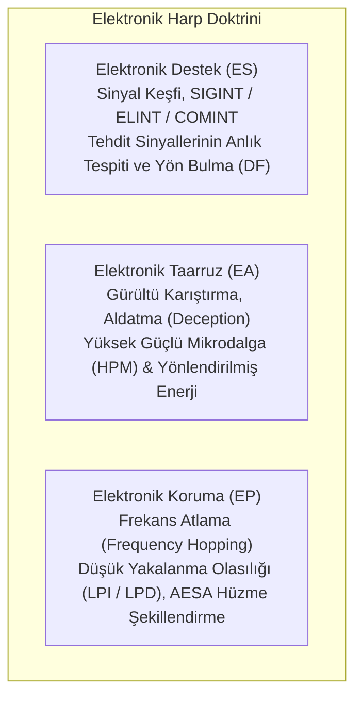
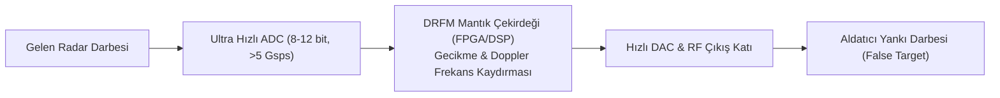

# 📡 Elektronik Harp (EW), Bilişsel Radar Karıştırıcılar ve Sayısal RF Bellek (DRFM) Mimarisi
### *Askeri Savunma Teknolojileri, Radar & Elektronik Harp Monografı (2026+)*

> *“Görünmezlik artık sadece gövde geometrisinden ibaret değildir; elektromanyetik spektrumu bir silah gibi bükebilen, düşman radarının sinyalini hafızaya alıp ona kendi yankısıyla illüzyon yaratan sistemler hava sahasının mutlak hakimidir.”*

---

## 📌 1. Giriş ve Modern Elektronik Harbin (EW) Üç Ana Sacayağı

Elektronik Harp (Electronic Warfare), elektromanyetik spektrumu (EMS) kontrol altına almak, dost unsurların kullanımını korumak ve hasmın kullanımını felç etmek amacıyla yürütülen operasyonlar bütünüdür:

---

## 📻 2. Radar Menzil Denklemi ve Karıştırma-Sinyal Oranı ($J/S$)

Standart monostatik radar menzil denklemi:

$$P_r = \frac{P_t G_t G_r \lambda^2 \sigma}{(4\pi)^3 R^4}$$

Burada $P_t$ verici gücü, $G_t$ verici anten kazancı, $\sigma$ hedefin Radar Kesit Alanı (RCS), $R$ ise hedefe olan mesafedir. Radarın aldığı güç mesafenin dördüncü kuvvetiyle ($R^{-4}$) azalır.

Buna karşın hedefin üzerindeki bir kendini koruma karıştırıcısının (Self-Protection Jammer) yaydığı sinyal radara tek yönlü ($R^{-2}$) yayılır:

$$P_{j} = \frac{P_j G_j G_{r} \lambda^2}{(4\pi)^2 R^2}$$

Karıştırma-Sinyal Güç Oranı ($J/S$):

$$\frac{J}{S} = \frac{P_j G_j 4\pi R^2}{P_t G_t \sigma}$$

Karıştırıcı hedefe yaklaştıkça $J/S$ oranı mesafenin karesiyle ($R^2$) orantılı olarak radar aleyhine katlanarak artar. Radarın karıştırma sinyalini bastırıp gerçek yankıyı ayırt edebildiği kritik mesafeye **Yanma Mesafesi (Burn-Through Range)** denir:

$$R_{\text{BT}} = \sqrt{\frac{P_t G_t \sigma}{P_j G_j 4\pi (J/S)_{\text{req}}}}$$

---

## 🧠 3. Sayısal RF Bellek (DRFM) ve Aldatma Karıştırması

Analog karıştırıcılar yalnızca geniş bantlı gürültü (Noise Jamming) yayarak radara karıştırıldığını belli ederken; **DRFM (Digital Radio Frequency Memory)** düşman radar dalgasını GHz hızında örnekler, dijital hafızada saklar ve üzerinde faz/frekans manipülasyonu yaparak radara geri fırlatır:

### 3.1. Mesafe Kapısı Çekme (Range Gate Pull-Off - RGPO)
DRFM birimi, gelen radar darbesini ilk anda gerçek yankı ile birebir aynı gecikmeyle geri gönderir. Ardından her darbede gecikmeyi adım adım yapay olarak artırır. Radarın mesafe izleme döngüsü (Range Tracking Loop) daha güçlü olan aldatıcı yankıyı izler; ardından DRFM aniden sinyali kestiğinde radar kilitlenmeyi tamamen kaybeder (Break Lock).

---

## 🤖 4. Bilişsel Elektronik Harp (Cognitive EW)

Geleneksel EW sistemleri önceden kaydedilmiş tehdit kütüphanelerine (Threat Library) dayanır. Ancak yazılım tanımlı ve çevik (agile) radarlar her darbede frekans ve modülasyon değiştirdiğinde bu kütüphaneler işlevsiz kalır.

**Bilişsel EW (Cognitive EW)** mimarisi; pekiştirmeli öğrenme (Reinforcement Learning - Q-Learning / PPO) ajanları kullanarak radarın tepkisini gerçek zamanlı analiz eder ve daha önce hiç karşılaşılmamış dalga formlarına karşı dahi saniyeler içinde optimal karşı-tedbir (Countermeasure) dalga formunu üretir.

---

## 📚 5. Kanonik Kaynakça

1. **Adamy, D. (2001-2021):** *“EW 101, 102, 103, 104, 105: A First Course in Electronic Warfare”*, Artech House.
2. **Skolnik, M. I. (2008):** *“Radar Handbook”*, McGraw-Hill Education.
3. **Poisel, R. A. (2011):** *“Modern Communications Jamming: Principles and Techniques”*, Artech House.
4. **Stimson, G. W. (2014):** *“Introduction to Airborne Radar”*, SciTech Publishing.
5. **Haykin, S. (2006):** *“Cognitive radar: a way of the future”*, IEEE Signal Processing Magazine, 23(1), 30-40.
