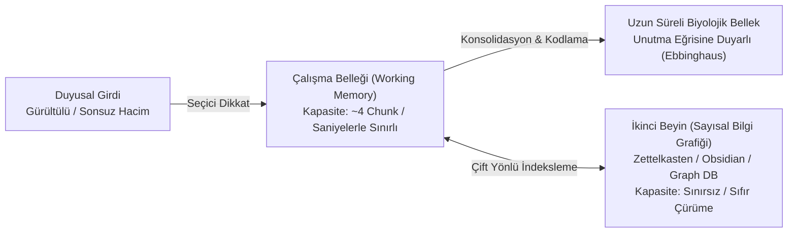

# 👁️ Polimatik Bilişsel Mimari, İkinci Beyin (PKM) ve Yüksek Kaldıraçlı Zihin Sistemleri
### *Epistemik Felsefe & Bilişsel Bilim Monografı (2026+)*

> *“Zihin bir ambar değil, bir katalizördür. Bilgiyi hafızada hapsetmek onu çürütür; bilgiyi çift yönlü bağlarla ağa dönüştürmek ise onu ölümsüz bir bilişsel sermayeye çevirir.”*

---

## 📌 1. Giriş: Bilişsel Aşırı Yük ve İkinci Beyin İhtiyacı

Enformasyon çağında bireyin karşılaştığı en temel kriz, **Bilişsel Yük Teorisi (Cognitive Load Theory)** ile açıklanır. İnsan çalışma belleği (working memory) George Miller ve Nelson Cowan'ın bulgularına göre aynı anda yalnızca $4 \pm 1$ bilgi parçasını (chunk) aktif olarak işleyebilir:



İkinci Beyin mimarisinin amacı; çalışma belleğini depolama yükünden tamamen arındırarak insan beynini sadece en güçlü olduğu iki fonksiyona tahsis etmektir: **Derin Odaklanma (Deep Work)** ve **Çapraz Sentez (Synthesis)**.

---

## 🕸️ 2. Zettelkasten ve Çift Yönlü Çizge (Bidirectional Graph) Matematiği

Klasik hiyerarşik dosyalama sistemleri (ağaç yapıları: klasör içinde klasör) bilginin gerçek doğasına aykırıdır; çünkü doğada hiçbir kavram izole bir hiyerarşide yaşamaz. Niklas Luhmann'ın analog olarak geliştirdiği, modern dijital dünyada çift yönlü bağlantılarla ($[[WikiLink]]$) hayat bulan **Zettelkasten Yöntemi**, bilgiyi bir yönlü ağ (directed network graph) olarak modeller:

$$G = (V, E)$$

Burada $V$ atomik bilgi notlarını (Zettel), $E$ ise notlar arasındaki kavramsal bağlantıları temsil eder. Bir düğümün polimatik değer yoğunluğu, ağdaki merkezilik (betweenness centrality) metriği ile ölçülür:

$$C_B(v) = \sum_{s \neq v \neq t} \frac{\sigma_{st}(v)}{\sigma_{st}}$$

Burada $\sigma_{st}$, $s$ ve $t$ düğümleri arasındaki toplam en kısa yol sayısı, $\sigma_{st}(v)$ ise bu yollardan $v$ düğümünden geçenlerin sayısıdır. Bir polimatın zihinsel gücü, görünüşte birbirinden en uzak disiplinler (örneğin Kuantum Fiziği ile Hukuk, veya Biyoloji ile Yazılım Mimarisi) arasındaki en yüksek $C_B(v)$ düğümlerini inşa edebilmesinde yatar.

---

## 🧠 3. Feynman Tekniği ve Fraktal Basitleştirme Algoritması

Bir kavramı gerçekten bilmek, onu en alt seviyesine kadar dekonstrükte edebilmektir:

```
[Adım 1: Hedef Kavramı Seç] ➔ [Adım 2: 10 Yaşındaki Birine Anlatır Gibi Açıkla (Sıfır Jargon)]
                                              │
                                              ▼
[Adım 4: Analojilerle Sentezle] ◄── [Adım 3: Tıkandığın / Basitleştiremediğin Boşlukları Tespit Et]
```

Matematiksel olarak Feynman Tekniği, Kolmogorov Karmaşıklığını ($K(s)$) minimize etme sürecidir:

$$K(s) = \min_p \{ |p| : U(p) = s \}$$

Bir fikri açıklayan en kısa program (en yalın analoji), o fikrin hakiki özüdür.

---

## ⚡ 4. Solopreneur Yüksek Kaldıraç Matrisi

Naval Ravikant'ın kaldıraç kuramına göre, insanlık tarihindeki dört büyük kaldıraç biçimi:

| Kaldıraç Türü | İzin Gereksinimi (Permission) | Marjinal Çoğaltma Maliyeti | Örnek |
| :--- | :---: | :---: | :--- |
| **İnsan Emeği (Labor)** | Evet (İnsanları ikna etmelisin) | Yüksek | Şirket çalışanları |
| **Sermaye (Capital)** | Evet (Yatırımcı bulmalısın) | Orta | Para, kredi, hisse |
| **Kod ve Yazılım (Code)** | **Hayır (İzinsiz Kaldıraç)** | **Sıfır ($\approx 0$)** | Algoritmalar, açık kaynak araçlar |
| **Medya ve Bilgi (Media/Content)**| **Hayır (İzinsiz Kaldıraç)** | **Sıfır ($\approx 0$)** | Ansiklopediler, araştırmalar, kitaplar |

Bir modern polimat; sermayesini ve zihnini sıfır marjinal maliyetle uyurken bile değer üreten **Kod ve Medya** kaldıraçlarına yatıran egemen bireydir.

---

## 💻 5. Python Uygulaması: Otomatik Zettelkasten Çizge Analizcisi

```python
"""
Kişisel Bilgi Notları Arasındaki Disiplinlerarası Köprüleri Bulan Çizge Analizcisi
"""
import re
from collections import defaultdict
from typing import Dict, List, Set

class ZettelkastenGraph:
    def __init__(self):
        self.nodes: Set[str] = set()
        self.adj: Dict[str, Set[str]] = defaultdict(set)
        
    def add_note(self, note_id: str, content: str):
        self.nodes.add(note_id)
        # [[Bağlantı]] kalıplarını yakala
        links = re.findall(r'\[\[(.*?)\]\]', content)
        for target in links:
            self.nodes.add(target)
            self.adj[note_id].add(target)
            self.adj[target].add(note_id) # Çift yönlü kenar
            
    def find_cross_disciplinary_bridges(self) -> List[tuple]:
        """Ağdaki en kritik bağlantı noktalarını derece merkeziliğiyle bul."""
        degrees = [(node, len(self.adj[node])) for node in self.nodes]
        degrees.sort(key=lambda x: x[1], reverse=True)
        return degrees[:10]
```

---

## 📚 6. Kanonik Kaynakça

1. **Sweller, J. (1988):** *“Cognitive Load During Problem Solving: Effects on Learning”*, Cognitive Science, 12(2), 257-285.
2. **Ahrens, S. (2017):** *“How to Take Smart Notes: One Simple Technique to Boost Writing, Learning and Thinking”*, CreateSpace.
3. **Newport, C. (2016):** *“Deep Work: Rules for Focused Success in a Distracted World”*, Grand Central Publishing.
4. **Feynman, R. P. (1985):** *“Surely You're Joking, Mr. Feynman!”*, W. W. Norton & Company.
5. **Ravikant, N. (2020):** *“The Almanack of Naval Ravikant: A Guide to Wealth and Happiness”*, Magrathea Publishing.
