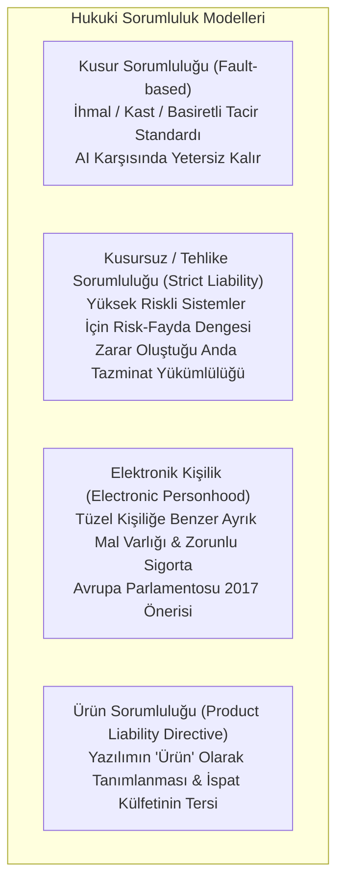

# ⚖️ Yapay Zeka Hukuku, Algoritmik Sorumluluk ve Otonom Sistemlerin Hukuki Statüsü
### *İleri Hukuk Bilimi & Siber Hukuk Araştırma Raporu (2026+)*

> *“Hukuk normları, insan iradesi ve kusur sorumluluğu üzerine inşa edilmiştir. İnsan müdahalesi olmaksızın karar alan, öngörülemeyen çıktılar üreten otonom algoritmalar; bin yıllık Roma hukuku ve Anglo-Sakson kusur teorisini köklü bir krizle yüzleştirmektedir.”*

---

## 📌 1. Giriş ve Otonom Sistemlerde Sorumluluk Krizi

Yapay zeka (AI) sistemlerinin sebep olduğu zararlarda klasik haksız fiil sorumluluğu (Tort Law) üç temel engelle karşılaşır:
1. **Kara Kutu (Black Box) Problemi:** Derin sinir ağlarının milyarlarca ağırlık parametresi arasındaki doğrusal olmayan etkileşimler nedeniyle nedensellik bağının (causation) ispatının imkansızlaşması.
2. **Özerklik ve Öngörülemezlik:** Modelin pekiştirmeli öğrenme (RL) ile insan tasarımcının talimatlarının ötesine geçerek özgün davranış kalıpları geliştirmesi.
3. **Çoklu Faillik (Many Hands Problem):** Veri sağlayıcı, model mimarı, ince ayar (fine-tuner) yapan geliştirici, API entegratörü ve son kullanıcının sorumluluk paylarının iç içe geçmesi.

---

## 📜 2. Karşılaştırmalı Sorumluluk Teorileri

### 2.1. Kusursuz Sorumluluk ve Risk Teorisi (Strict Liability)
Hukuk iktisadı (Law and Economics) prensiplerine göre, yapay zekanın yol açtığı riskleri en düşük maliyetle önleyebilecek taraf (Cheapest Cost Avoider) veya sisteme piyasaya sürerek ekonomik menfaat sağlayan işleten, kusursuz sorumluluk rejimine tabi tutulmalıdır:

$$\text{Learned Hand Kuralı:} \quad B < P \times L \implies \text{İhmal Var}$$

Burada $B$ önlem maliyeti, $P$ zararın gerçekleşme olasılığı, $L$ ise beklenen zarar miktarıdır. Otonom sistemlerde $P$ değeri kestirilemez olduğunda katı tehlike sorumluluğu devreye girer.

---

## 🏛️ 3. Avrupa Birliği Yapay Zeka Yasası (EU AI Act - Regulation 2024/1689)

AB Yapay Zeka Yasası, sistemleri risk piramidine göre hiyerarşik olarak düzenleyen dünyadaki ilk kapsamlı bağlayıcı mevzuattır:

| Risk Düzeyi | Sistem Türü | Yasal Rejim | Örnek Uygulamalar |
| :--- | :--- | :--- | :--- |
| **Kabul Edilemez Risk** | İnsan haklarına aykırı sistemler | **Kesinlikle Yasak** | Bilişsel davranışsal manipülasyon, sosyal puanlama (social scoring), kamusal gerçek zamanlı biyometrik kimlik tespiti |
| **Yüksek Risk** | Kritik altyapı, adalet, istihdam | **Sıkı Uyumluluk & CE İşareti** | Cerrahi robotlar, CV filtreleme algoritmaları, kredi skorlama, adli risk tahmin araçları |
| **Genel Amaçlı Yapay Zeka (GPAI)** | Temel modeller (Foundation Models) | **Şeffaflık & Sistemik Risk Denetimi** | $>10^{25}$ FLOPs modeller (kırmızı takım testleri, enerji tüketimi raporlama, telif hakkı uyumu) |
| **Minimal / Sıfır Risk** | Standart yazılımlar | **Serbest Kullanım** | İstenmeyen posta filtreleri, yapay zekalı video oyunları |

---

## 🔒 4. Telif Hukuku ve Eğitim Verisi Muafiyetleri (TDM - Text & Data Mining)

LLM ve üretici yapay zeka modellerinin telifli eserleri eğitim verisi olarak kullanması, uluslararası fikri mülkiyet hukukunun en büyük uyuşmazlık alanıdır:
- **ABD Doktrini (Fair Use - Adil Kullanım):** *17 U.S.C. § 107* kapsamında dönüşümsel kullanım (transformative use) savunması. Eğitilen model eserin kendisini kopyalamak yerine istatistiksel ağırlıkları öğreniyorsa adil kullanım kabul edilebilir; ancak piyasa ikamesi yaratıyorsa ihlal oluşur (*NYT v. OpenAI davası*).
- **AB Doktrini (DSM Direktifi Madde 4):** Metin ve veri madenciliği (TDM) için ticari amaçlı kullanım serbesttir; ancak eser sahiplerine açıkça sistemden çıkma (Opt-Out) hakkı tanınmıştır.

---

## 📚 5. Kanonik Kaynakça

1. **European Union (2024):** *“Regulation (EU) 2024/1689 laying down harmonised rules on artificial intelligence (Artificial Intelligence Act)”*.
2. **Calo, R. (2015):** *“Robotics and the Lessons of Cyberlaw”*, California Law Review, 103(3), 513-563.
3. **Pagallo, U. (2013):** *“The Laws of Robots: Crimes, Contracts, and Torts”*, Springer.
4. **Vladeck, D. C. (2014):** *“Machines without principals: liability rules and artificial intelligence”*, Washington Law Review, 89, 117.
5. **Gless, S. et al. (2016):** *“If Robots Cause Harm, Who Is to Blame? Self-Driving Cars and Criminal Liability”*, New Criminal Law Review, 19(3), 412-436.
