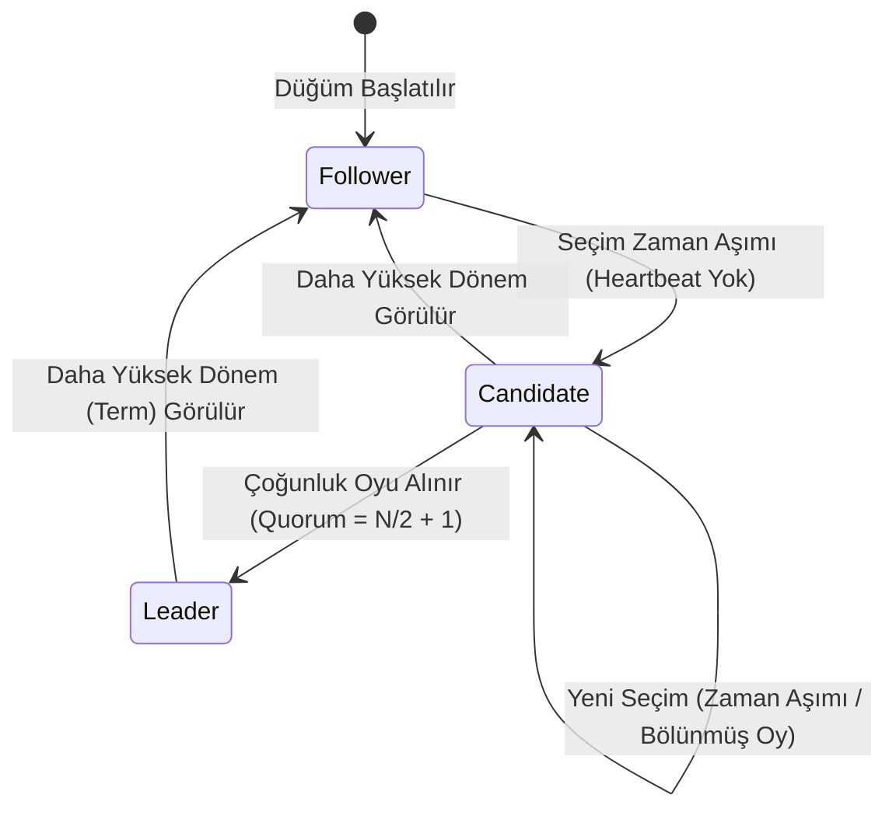
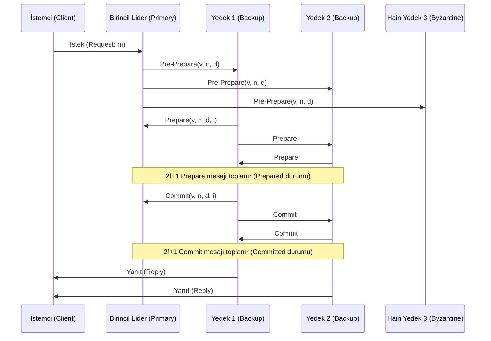

# 🌐 Dağıtık Sistemler, Konsensüs Protokolleri (Paxos, Raft, BFT) ve CAP Teoremi Mimarisi
### *İleri Bilgisayar Mühendisliği & Dağıtık Sistemler Araştırma Raporu (2026+)*

> *“Dağıtık bir sistem; varlığından bile haberiniz olmayan bir bilgisayarın arızalanması yüzünden kendi bilgisayarınızın çalışamaz hale geldiği sistemdir.”* — **Leslie Lamport**

---

## 📌 1. Giriş ve Dağıtık Sistemlerin Temel Aksiyomları

Dağıtık bir ortamda bağımsız işlem düğümleri, güvenilmez ve asenkron bir ağ üzerinden mesajlaşarak ortak bir durum makinesini (State Machine Replication - SMR) senkronize yürütür. Temel fiziksel kısıtlar şunlardır:
1. **Küresel Saat Yokluğu:** Görelilik ve ağ gecikmeleri nedeniyle tüm düğümlerde mutlak ve eşzamanlı bir zaman algısı imkansızdır.
2. **Kısmi Başarısızlık (Partial Failure):** Sistemin bir bileşeni çökerken veya ağ bölünürken (network partition) diğer bileşenlerin çalışmaya devam etmesi.
3. **Mesaj Kaybı ve Yeniden Sıralanması:** Mesajların keyfi gecikmelerle ulaşabilmesi veya kaybolabilmesi.

---

## 📐 2. CAP Teoremi ve PACELC Analizi

Eric Brewer'ın formüle ettiği ve Seth Gilbert & Nancy Lynch tarafından ispatlanan **CAP Teoremi**:

$$\text{Herhangi bir dağıtık veri deposu aynı anda şu üç özellikten en fazla ikisini garanti edebilir:}$$

- **C (Consistency - Tutarlılık):** Her okuma işlemi, en son yazılan veriyi veya bir hata mesajını döndürür (Linearizability).
- **A (Availability - Erişilebilirlik):** Çökmeyen her düğüm, her istek için başarılı bir yanıt döndürür.
- **P (Partition Tolerance - Bölünme Toleransı):** Ağ paketleri kaybolduğunda veya ağ bölündüğünde sistem çalışmayı sürdürür.

Daniel Abadi'nin genişletilmiş **PACELC Teoremi**:
$$\text{If } \mathbf{P} \text{ (Partition)} \implies \text{Trade-off } [\mathbf{A} \text{ vs } \mathbf{C}], \quad \text{ELSE} \implies \text{Trade-off } [\mathbf{L} \text{ (Latency)} \text{ vs } \mathbf{C} \text{ (Consistency)}]$$

---

## 🗳️ 3. Çökme Hata Toleranslı Konsensüs: Raft Algoritması

Leslie Lamport'un anlaşılması güç Paxos protokolüne alternatif olarak Ongaro ve Ousterhout tarafından tasarlanan **Raft**, konsensüsü üç alt probleme böler:



### 3.1. Günlük Çoğaltma (Log Replication) ve Güvenlik Değişmezleri
1. **Seçim Güvenliği (Election Safety):** Belirli bir dönemde ($Term$) en fazla bir lider seçilebilir.
2. **Lider Yalnızca Ekleme Yapar (Leader Append-Only):** Lider kendi günlüğündeki kayıtları asla silmez veya üzerine yazmaz.
3. **Günlük Eşleşme Özelliği (Log Matching):** İki günlük aynı indeks ve terime sahip bir girdi içeriyorsa, o indekse kadarki tüm girdiler özdeştir.
4. **Lider Tamlığı (Leader Completeness):** Belirli bir dönemde bir günlük girdisi işlenmişse (committed), o girdi daha yüksek terimli tüm liderlerin günlüklerinde yer almak zorundadır.

---

## ⚔️ 4. Bizans Hata Toleransı (Byzantine Fault Tolerance - PBFT)

Miguel Castro ve Barbara Liskov tarafından önerilen **Pratik Bizans Hata Toleransı (PBFT)**, düğümlerin sadece çökmediği; aynı zamanda kötü niyetli (malicious), yalan söyleyen veya manipüle edilmiş mesajlar üretebildiği asenkron ağlarda konsensüs sağlar:

$$N \ge 3f + 1$$

Burada $N$ toplam düğüm sayısı, $f$ ise tolere edilebilecek azami hain (Bizans) düğüm sayısıdır.



---

## 💻 5. Python Uygulaması: Vektör Saatleri (Vector Clocks) ile Nedensellik Takibi

```python
"""
Dağıtık Düğümler Arasında Nedensel İlişkileri (Happens-Before) İzleyen Vektör Saati
"""
from typing import Dict, List

class VectorClock:
    def __init__(self, node_id: str, all_nodes: List[str]):
        self.node_id = node_id
        self.clock: Dict[str, int] = {nid: 0 for nid in all_nodes}
        
    def local_event(self):
        """Düğüm içi yerel işlem: Kendi saatini 1 artır."""
        self.clock[self.node_id] += 1
        
    def send_event(self) -> Dict[str, int]:
        """Mesaj gönderme: Saatini artır ve vektörün bir kopyasını gönder."""
        self.clock[self.node_id] += 1
        return self.clock.copy()
        
    def receive_event(self, incoming_clock: Dict[str, int]):
        """Mesaj alma: Bileşen bazında maksimum al ve kendi saatini 1 artır."""
        for nid in self.clock:
            self.clock[nid] = max(self.clock[nid], incoming_clock.get(nid, 0))
        self.clock[self.node_id] += 1
        
    def happens_before(self, other: Dict[str, int]) -> bool:
        """Nedensel öncelik (V1 < V2) kontrolü."""
        less_equal = all(self.clock[k] <= other[k] for k in self.clock)
        strictly_less = any(self.clock[k] < other[k] for k in self.clock)
        return less_equal and strictly_less
```

---

## 📚 6. Kanonik Kaynakça

1. **Lamport, L. (1978):** *“Time, Clocks, and the Ordering of Events in a Distributed System”*, Communications of the ACM, 21(7), 558-565.
2. **Ongaro, D., & Ousterhout, J. (2014):** *“In Search of an Understandable Consensus Algorithm (Raft)”*, USENIX ATC.
3. **Castro, M., & Liskov, B. (2002):** *“Practical Byzantine Fault Tolerance and Proactive Recovery”*, ACM TOCS, 20(4), 398-461.
4. **Gilbert, S., & Lynch, N. (2002):** *“Brewer's conjecture and the feasibility of consistent, available, partition-tolerant web services”*, ACM SIGACT News, 33(2), 51-59.
5. **Kleppmann, M. (2017):** *“Designing Data-Intensive Applications: The Big Ideas Behind Reliable, Scalable, and Maintainable Systems”*, O'Reilly Media.
