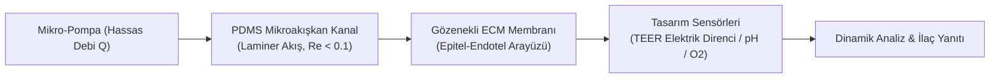

# 🧬 Organ-on-a-Chip Teknolojileri, Mikroakışkan Doku Mühendisliği ve Biyo-Uyumlu Nöral İmplantlar
### *İleri Biyomedikal Mühendisliği & Biyo-Hibrit Sistemler Araştırma Monografı (2026+)*

> *“Canlı doku statik bir yapı değildir; mekanik stres, elektriksel gradyanlar ve kimyasal akışların dinamik bir senfonisidir.”*

---

## 📌 1. Giriş ve Biyomühendislik Vizyonu

Geleneksel farmakolojik araştırmalar ve toksikoloji testleri, 2D statik petri kaplarında veya türler arası genetik farklılıklar nedeniyle insan fizyolojisini tam yansıtmayan hayvan modellerinde yürütülmektedir. Bu metodolojik yetersizlik, klinik Faz-I ve Faz-II aşamalarında %90'a varan ilaç başarısızlık oranlarına yol açmaktadır.

**Organ-on-a-Chip (OOC)** ve **Biyo-Hibrit Mikro-Sistemler**; mikroakışkan kanallar, 3D biyo-yazıcılarla oluşturulan hücre dışı matriksler (Extracellular Matrix - ECM) ve mekanik gerilim aktüatörleri kullanarak insan organlarının hücresel mikromimarisini mikroskobik çipler üzerinde yeniden üretir.

---

## 📐 2. Mikroakışkan Dinamik ve Laminer Akış Matematiği

Mikro ölçekli kanallarda ($D_h \sim 10 - 500 \, \mu\text{m}$) yüzey gerilimi ve viskoz kuvvetler, atalet kuvvetlerine baskın gelir.

### 2.1. Reynolds Sayısı ve Stokes Akışı
Reynolds sayısı formülasyonu:

$$\text{Re} = \frac{\rho v D_h}{\mu} \ll 1$$

Burada $\rho$ akışkan yoğunluğu, $v$ akış hızı, $D_h$ hidrolik çap ve $\mu$ dinamik viskozitedir. $\text{Re} \ll 1$ durumunda Navier-Stokes denklemleri doğrusal **Stokes Denklemine** indirgenir:

$$\nabla p = \mu \nabla^2 \mathbf{u} + \mathbf{f}$$

Bu rejimde türbülans tamamen ortadan kalkar; moleküler taşıma yalnızca difüzyonla gerçekleşir.

### 2.2. Damar İçi Kayma Gerilmesi (Shear Stress)
Endotelyal hücrelerin fizyolojik polarizasyonu için gereken çeper kayma gerilmesi $\tau_w$:

$$\tau_w = \frac{6 \mu Q}{w h^2}$$

Burada $Q$ debi, $w$ kanal genişliği ve $h$ kanal yüksekliğidir. İnsan damar endotelinde $1 - 10 \, \text{dyne/cm}^2$ fizyolojik aralığı mikroakışkan şırınga pompaları ile kapalı döngü PID kontrolüyle sağlanır.

---

## 🔬 3. Çoklu Organ Entegrasyonu (Multi-Organ-on-a-Chip)

Akciğer, Karaciğer, Böbrek ve Kan-Beyin Bariyeri (BBB) çiplerinin tek bir mikroakışkan dolaşım devresinde birleştirilmesi:
1. **Trans-Endotelyal Elektriksel Direnç (TEER):** Hücreler arası sıkı bağlantıların (tight junctions) bariyer bütünlüğü gerçek zamanlı AC empedans spektroskopisi ile ölçülür:

$$Z(\omega) = R_{\text{çözelti}} + \frac{R_{\text{doku}}}{1 + j \omega C_{\text{membran}} R_{\text{doku}}}$$

2. **Dinamik İlaç Emilimi ve Metabolizması (PK/PD Modellemesi):** Karaciğer küremsi hücrelerinde (spheroids) sitokrom P450 enzimatik yıkımı incelenir.

---

## ⚡ 4. Biyo-Uyumlu Nöral İmplantlar ve Biyo-Elektronik

1. **İpek Fibroin ve Grafen Tabanlı Esnek Elektrotlar:** Beyin dokusunun elastik modülü ($E \sim 1 - 5 \, \text{kPa}$) ile sert silikon elektrotlar ($E \sim 170 \, \text{GPa}$) arasındaki mekanik uyumsuzluk kronik glial yara (glial scar) oluşumuna yol açar. Esnek iletken polimerler (PEDOT:PSS) bu bariyeri ortadan kaldırır.
2. **Piezoelektrik Enerji Hasadı:** Organ hareketlerinden (kalp atımı, akciğer genişlemesi) nanovat seviyesinde biyomekanik enerji dönüştürülerek pilsiz çalışan nöral stimülatörler üretilir.

---

## 🚀 5. Gelecek Perspektifi

Organ-on-a-Chip teknolojisi, kişiselleştirilmiş kanser tedavisinde hastanın kendi tümör biyopsisinden türetilen organoidlerle 48 saat içinde en etkili kemoterapötik kombinasyonun bulunmasını sağlayarak medikal paradigmayı dönüştürmektedir.
