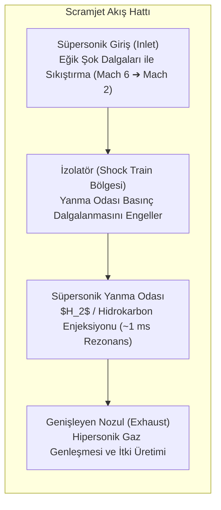

# 🚀 Hipersonik İtki Sistemleri, Scramjet Termodinamiği ve Yörünge Mekaniği
### *İleri Havacılık ve Uzay Mühendisliği Araştırma Raporu & İtki Monografı (2026+)*

> *“Yerçekimi bir sınır değil, sadece aşılması gereken bir enerji potansiyeli kuyusudur. Mach 5'in ötesinde aerodinamik, kimyasal termodinamik ve plazma fiziği tek bir kızgın akış potasında birleşir.”*

---

## 📌 1. Giriş ve Hipersonik Akış Rejiminin Fiziği

Ses hızının 5 katı ve üzerindeki akışlar ($M \ge 5$) **hipersonik rejim** olarak tanımlanır. Bu rejimde klasik ideal gaz varsayımları geçerliliğini yitirir ve yüksek sıcaklık gaz dinamikleri devreye girer:

1. **İnce Şok Tabakası (Thin Shock Layer):** Cisim yüzeyi ile şok dalgası arasındaki mesafe minimuma iner; sınır tabaka (boundary layer) ile şok dalgası doğrudan etkileşir.
2. **Yüksek Sıcaklık Gaz Ayrışması (Dissociation):** Şok dalgası gerisindeki sıcaklıklar $2000 \ \text{K}$'i aştığında havadaki moleküller ayrışmaya başlar:
   $$O_2 \rightarrow 2O \quad (T > 2000 \ \text{K}), \qquad N_2 \rightarrow 2N \quad (T > 4000 \ \text{K})$$
   $T > 9000 \ \text{K}$ mertebesinde ise iyonlaşma başlar ($NO^+ + e^-$ plazma kılıfı oluşturarak RF iletişimini keser).
3. **Viskoz Etkileşim ve Yüzey Sürtünmesi:** Sınır tabakadaki yüksek viskoz sürtünme kinetik enerjiyi ısıya dönüştürür; yüzey ısı akısı:
   $$q_w \propto \rho_\infty^{0.5} V_\infty^3$$

---

## 🌪️ 2. Scramjet (Supersonic Combustion Ramjet) Termodinamiği

Ramjet motorları Mach 3-5 arasında gelen havayı ses altı hıza yavaşlatarak yakarken, **Scramjet** akışı yanma odası boyunca süpersonik hızda ($M > 1$) tutar. Bu sayede aşırı şok basıncı ve ayrışma kayıpları engellenir.



### 2.1. Rayleigh Hattı ve Termal Boğulma (Thermal Choking)
Yanma odasında süpersonik akışa ısı eklendiğinde ($q > 0$), Mach sayısı $1$'e doğru yaklaşır. Aşırı ısı eklenmesi durumunda Mach sayısı $1$'e eşitlenerek akış boğulur (Thermal Choking) ve girişte şokun dışarı atılmasına (Inlet Unstart) yol açar:

$$\frac{T_0}{T_{0}^*} = \frac{2(\gamma + 1) M^2 (1 + \frac{\gamma - 1}{2} M^2)}{(1 + \gamma M^2)^2}$$

---

## 🛰️ 3. Yörünge Mekaniği ve Gezegenlerarası Transfer Yörüngeleri

### 3.1. Vis-Viva Denklemi
$M_E$ kütleli bir merkezi cisim etrafında $r$ yarıçaplı konumda bulunan ve yarı-büyük ekseni $a$ olan bir yörüngedeki uzay aracının hızı:

$$v^2 = \mu \left( \frac{2}{r} - \frac{1}{a} \right), \quad \mu = G M_E$$

### 3.2. Hohmann Transferi
İki eşmerkezli dairesel yörünge ($r_1$ ve $r_2$) arasındaki minimum enerjili transfer elipsi:

$$a_{\text{trans}} = \frac{r_1 + r_2}{2}$$

Gerekli hız değişimleri ($\Delta v_1$ ve $\Delta v_2$):

$$\Delta v_1 = \sqrt{\frac{\mu}{r_1}} \left( \sqrt{\frac{2 r_2}{r_1 + r_2}} - 1 \right), \qquad \Delta v_2 = \sqrt{\frac{\mu}{r_2}} \left( 1 - \sqrt{\frac{2 r_1}{r_1 + r_2}} \right)$$

$$\Delta v_{\text{total}} = \Delta v_1 + \Delta v_2$$

```mermaid
graph TD
    LEO["Düşük Dünya Yörüngesi (LEO: $r_1 \approx 6678 \ \text{km}$)"] -->|$\Delta v_1 \approx 2.45 \ \text{km/s}$| Transfer["Hohmann Transfer Elipsi (GTO)"]
    Transfer -->|$\Delta v_2 \approx 1.48 \ \text{km/s}$| GEO["Yer Eşzamanlı Yörünge (GEO: $r_2 \approx 42164 \ \text{km}$)"]
```

---

## 💻 4. Python Algoritması: Lambert Problemi ve Yörünge İtki Simülatörü

```python
"""
İki Konum Vektörü Arasındaki Kepler Yörünge Transferi (Hohmann / Vis-Viva)
"""
import numpy as np

MU_EARTH = 3.986004418e14  # m^3 / s^2
R_EARTH = 6378.137e3       # metre

def hohmann_transfer_delta_v(r1_alt_km: float, r2_alt_km: float):
    """LEO ve GEO irtifaları için toplam delta-v ve uçuş süresini hesaplar."""
    r1 = R_EARTH + r1_alt_km * 1000.0
    r2 = R_EARTH + r2_alt_km * 1000.0
    
    # 1. Yörünge hızları
    v1 = np.sqrt(MU_EARTH / r1)
    v2 = np.sqrt(MU_EARTH / r2)
    
    # 2. Transfer elipsi
    a_trans = (r1 + r2) / 2.0
    v_trans1 = np.sqrt(MU_EARTH * (2.0 / r1 - 1.0 / a_trans))
    v_trans2 = np.sqrt(MU_EARTH * (2.0 / r2 - 1.0 / a_trans))
    
    dv1 = abs(v_trans1 - v1)
    dv2 = abs(v2 - v_trans2)
    total_dv = dv1 + dv2
    
    # Uçuş süresi (Periyot yarı süresi)
    time_of_flight_sec = np.pi * np.sqrt(a_trans**3 / MU_EARTH)
    
    return {
        "dv1_m_s": dv1,
        "dv2_m_s": dv2,
        "total_dv_m_s": total_dv,
        "time_of_flight_hours": time_of_flight_sec / 3600.0
    }
```

---

## 📚 5. Kanonik Kaynakça

1. **Anderson, J. D. (2019):** *“Hypersonic and High-Temperature Gas Dynamics”*, AIAA Education Series.
2. **Heiser, W. H., & Pratt, D. T. (1994):** *“Hypersonic Airbreathing Propulsion”*, AIAA.
3. **Curtis, H. D. (2020):** *“Orbital Mechanics for Engineering Students”*, Butterworth-Heinemann.
4. **Bate, R. R., Mueller, D. D., & White, J. E. (2020):** *“Fundamentals of Astrodynamics”*, Dover Publications.
5. **Sutton, G. P., & Biblarz, O. (2016):** *“Rocket Propulsion Elements”*, John Wiley & Sons.
