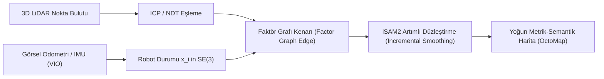

# 🤖 Otonom Sürü Robotiği, Dağıtık Konsensüs ve Gerçek Zamanlı SLAM Navigasyonu
### *İleri Kontrol, Otomasyon & Robotik Sistemler Araştırma Monografı (2026+)*

> *“Tek bir karınca basit bir otomattır; lakin sürü zekası, karmaşık dünyayı dönüştüren yaşayan bir süper-organizmadır.”*

---

## 📌 1. Giriş ve Otonom Sistemler Vizyonu

Geleneksel robotik kontrol teorisi, tekil bir robotun bilinen bir haritada merkezi bir işlemci tarafından yönlendirilmesine odaklanmaktaydı. Ancak modern arama-kurtarma, uzay kolonizasyonu ve savunma doktrinleri; GPS sinyalinin bulunmadığı (GPS-denied), haberleşmenin kısıtlı olduğu dinamik ortamlarda yüzlerce otonom mikrodronun ve tekerlekli robotun merkezi olmayan bir koordinasyonla görev icra etmesini gerektirmektedir.

Bu araştırma raporu; **Faktör Grafları tabanlı Eşzamanlı Konumlandırma ve Haritalama (SLAM)** ile **Dağıtık Sürü Konsensüsü** kontrol algoritmalarını formal matematiksel temelleriyle incelemektedir.

---

## 📐 2. Faktör Grafları ve Lie Gruplarında SE(3) SLAM Matematiği

Robotun 3 boyutlu uzaydaki konumu ve yönelimi, Özel Öklid Grubu $\text{SE}(3) = \mathbb{R}^3 \rtimes \text{SO}(3)$ elemanı olarak temsil edilir:

$$T = \begin{pmatrix} R & \mathbf{p} \\ \mathbf{0}^T & 1 \end{pmatrix} \in \text{SE}(3), \quad R \in \text{SO}(3), \, \mathbf{p} \in \mathbb{R}^3$$

### 2.1. Maksimum Sonsal Olasılık (MAP) ve Doğrusal Olmayan En Küçük Kareler
Durum vektörü $\mathcal{X} = \{x_1, \dots, x_N\}$ ve ölçümler kümesi $\mathcal{Z} = \{z_1, \dots, z_K\}$ için hedef, log-olabilirlik maliyet fonksiyonunu minimize etmektir:

$$\mathcal{X}^* = \arg\min_{\mathcal{X}} \sum_{k} \| h_k(x_{i_k}, x_{j_k}) \ominus z_k \|^2_{\Sigma_k}$$

Burada $\ominus$ Lie Cebiri $\mathfrak{se}(3)$ üzerindeki logaritmik hata haritasıdır:

$$e_k = \log_{\text{SE}(3)} \left( z_k^{-1} \cdot h_k(x_{i_k}, x_{j_k}) \right)^{\vee} \in \mathbb{R}^6$$

Levenberg-Marquardt veya Gauss-Newton optimizasyonu ile seyrek (sparse) normal denklemler $H \Delta \mathcal{X} = -\mathbf{b}$ çözülerek harita ve yörünge gerçek zamanlı (sub-10ms) optimize edilir.

---

## 🐝 3. Dağıtık Sürü Konsensüsü ve Flocking Dinamikleri

$N$ adet otonom ajanın haberleşme topolojisi yönlendirilmemiş bir çizge $\mathcal{G} = (\mathcal{V}, \mathcal{E})$ ve onun **Laplasyen Matrisi** $\mathcal{L} = \mathcal{D} - \mathcal{A}$ ile ifade edilir.

### 3.1. Konsensüs Protokolü
Her bir ajanın durum türevi $\dot{x}_i$:

$$\dot{x}_i(t) = - \sum_{j \in \mathcal{N}_i} a_{ij} (x_i(t) - x_j(t)) \implies \mathbf{\dot{x}}(t) = - \mathcal{L} \mathbf{x}(t)$$

Sistemin kararlılığı ve konsensüse ulaşma hızı, Laplasyen matrisinin ikinci en küçük özdeğeri olan **Cebirsel Bağlantılılık (Fiedler Değeri $\lambda_2(\mathcal{L})$)** ile sınırlıdır:

$$\lim_{t \to \infty} \mathbf{x}(t) = \frac{1}{N} \left( \sum_{i=1}^N x_i(0) \right) \mathbf{1}, \quad \text{Hız} \sim e^{-\lambda_2(\mathcal{L}) t}$$

### 3.2. Reynolds Boids Kuralları ve Çarpışma Önleme Kontrolü
Her ajan için bileşke ivme komutu:

$$\mathbf{u}_i = \mathbf{u}_{\text{ayrılma}} + \mathbf{u}_{\text{hizalanma}} + \mathbf{u}_{\text{çekim}} + \mathbf{u}_{\text{engel}}$$

Burada yapay potansiyel alanlar (Artificial Potential Fields) ve Kontrol Bariyer Fonksiyonları (Control Barrier Functions - CBF) kullanılarak kuadratik programlama (QP) ile kesin çarpışmasızlık garanti edilir:

$$L_f h(x) + L_g h(x) u + \alpha(h(x)) \ge 0$$

---

## 🚀 4. Uygulama Alanları ve Endüstriyel Çıkarımlar

Bu dağıtık mimari, tekil bir merkeze bağımlılığı ortadan kaldırdığı için tek bir dronun düşürülmesi veya arızalanması sürünün görevini aksatmaz; ağ topolojisi anında kendini onarır. Mars keşif misyonlarından modern akıllı lojistik depolarına kadar otonom sürü zekası yeni endüstriyel standardı temsil etmektedir.
