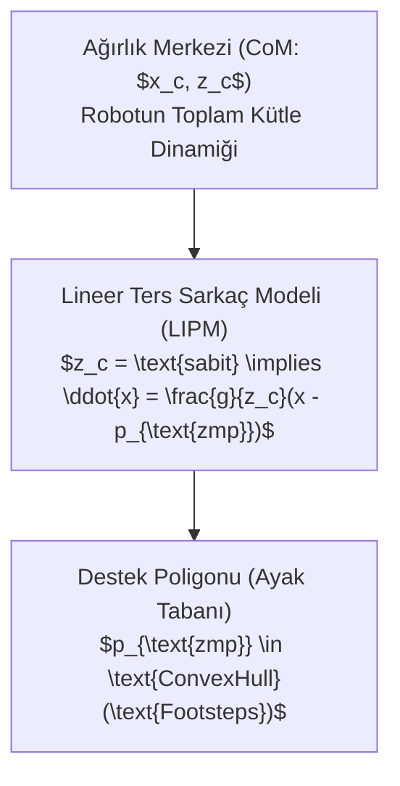

# 🤖 İnsansı Robotik, Bütünsel Vücut Kontrolü (WBC) ve Sıfır Moment Noktası (ZMP) Dinamiği
### *İleri Mekatronik & Robotik Otonomi Araştırma Raporu (2026+)*

> *“İnsansı bir robotun dinamik yürüyüşü; sürekli bir düşme eyleminin, zeminle yapılan hassas temas kuvvetleriyle mükemmel şekilde kontrol altında tutulmasıdır.”*

---

## 📌 1. Giriş ve İnsansı Kinematik/Dinamik Mimarisi

İnsansı robotlar (Humanoid Robots), yüzen tabanlı (floating-base) ve çok serbestlik dereceli (DoF $\ge 20$) karmaşık mekanik sistemlerdir. Taban gövdenin uzaydaki konumu ve yönelimi $SE(3)$ grubu üzerinde serbesttir; hareket yalnızca zeminle kurulan temas reaksiyon kuvvetleri ($\lambda_c$) aracılığıyla kontrol edilebilir.

Sistemin tam dinamik denklemi:

$$M(q) \ddot{q} + C(q, \dot{q}) \dot{q} + g(q) = S^T \tau + J_c^T(q) \lambda_c$$

Burada:
- $q = [p_b^T, \phi_b^T, q_j^T]^T \in SE(3) \times \mathbb{R}^n$: 6 serbestlik dereceli yüzen gövde ve $n$ adet eklem açısı.
- $S = [0_{n \times 6}, I_{n \times n}]$: Eylemsiz gövdeyi ayıran seçim matrisi (Underactuation).
- $\tau \in \mathbb{R}^n$: Eklem torkları.
- $J_c$: Temas noktalarının Jacobian matrisi.
- $\lambda_c$: Zemin reaksiyon kuvvet ve momentleri (GRF).

---

## ⚖️ 2. Sıfır Moment Noktası (ZMP) ve Basitleştirilmiş Modeller

### 2.1. ZMP (Zero Moment Point) İlkesi
Miomir Vukobratović tarafından ortaya atılan ZMP ilkesine göre; zemindeki tüm reaksiyon kuvvetlerinin yatay eksenlerdeki net momentinin sıfır olduğu nokta ($p_{\text{zmp}}$) **Destek Poligonu (Support Polygon)** içinde kaldığı sürece robot devrilmez:

$$x_{\text{zmp}} = \frac{\sum m_i (\ddot{z}_i + g) x_i - \sum m_i \ddot{x}_i z_i - \sum I_{yy, i} \dot{\omega}_{yy, i}}{\sum m_i (\ddot{z}_i + g)}$$



### 2.2. Lineer Ters Sarkaç Modeli (Linear Inverted Pendulum - LIPM)
Sabit ağırlık merkezi yüksekliğinde ($z = z_0$), robotun kütle merkezi dinamikleri doğrusal hale gelir:

$$\ddot{x} = \omega_0^2 (x - p_x), \quad \omega_0 = \sqrt{\frac{g}{z_0}}$$

Bu diferansiyel denklemden türetilen **Yakalama Noktası (Capture Point / Divergent Component of Motion - DCM)**:

$$\xi = x + \frac{\dot{x}}{\omega_0}$$

Robotun düşmeden durabilmesi için bir sonraki adımını tam olarak $\xi$ noktasına atması zorunludur.

---

## 🎯 3. Bütünsel Vücut Kontrolü (Whole-Body Control - WBC)

Farklı kontrol görevlerinin (ayak yerleşimi, gövde dengesi, kafa yönelimi, el manipülasyonu) öncelik sırasına göre karesel programlama (QP) ile çözülmesi:

$$\min_{\ddot{q}, \tau, \lambda_c} \sum_k w_k \| J_k \ddot{q} + \dot{J}_k \dot{q} - \ddot{x}_k^{\text{des}} \|^2 + \|\tau\|_{W_\tau}^2$$

$$\text{Kısıtlar:} \quad \begin{cases} M \ddot{q} + C \dot{q} + g = S^T \tau + J_c^T \lambda_c & \text{(Sistem Dinamiği)} \\ \lambda_c \in \mathcal{K}_{\text{friction}} & \text{(Coulomb Sürtünme Konisi)} \\ \tau_{\min} \le \tau \le \tau_{\max} & \text{(Tork Limitleri)} \end{cases}$$

---

## 💻 4. Python Algoritması: DCM (Divergent Component of Motion) Yürüyüş Planlayıcısı

```python
"""
İnsansı Robot Adım Planlayıcısı: LIPM ve Divergent Component of Motion (DCM)
"""
import numpy as np

class HumanoidGaitPlanner:
    def __init__(self, z0: float = 0.8, g: float = 9.81):
        self.z0 = z0
        self.g = g
        self.omega = np.sqrt(g / z0)
        
    def calculate_dcm(self, com_pos: float, com_vel: float) -> float:
        """DCM (Capture Point) hesaplar: xi = x + x_dot / omega"""
        return com_pos + (com_vel / self.omega)
        
    def step_location_for_stop(self, com_pos: float, com_vel: float) -> float:
        """Robotun tek adımda durabilmesi gereken ayak basış koordinatını döner."""
        return self.calculate_dcm(com_pos, com_vel)
        
    def trajectory_step(self, x: float, x_dot: float, zmp: float, dt: float = 0.001):
        """LIPM dinamik adımı simüle eder."""
        x_ddot = (self.omega ** 2) * (x - zmp)
        x_new = x + x_dot * dt + 0.5 * x_ddot * (dt ** 2)
        x_dot_new = x_dot + x_ddot * dt
        return x_new, x_dot_new
```

---

## 📚 5. Kanonik Kaynakça

1. **Vukobratović, M., & Borovac, B. (2004):** *“Zero-moment point—thirty five years of its life”*, International Journal of Humanoid Robotics, 1(01), 157-173.
2. **Kajita, S. et al. (2003):** *“Biped walking pattern generation by using preview control of zero-moment point”*, IEEE ICRA.
3. **Pratt, J. et al. (2006):** *“Capture point: A step towards translating human push recovery to bipedal robots”*, IEEE-RAS Humanoids.
4. **Sentis, L., & Khatib, O. (2005):** *“Synthesis of whole-body behaviors through hierarchical control of behavioral primitives”*, IJRR.
5. **Kuindersma, S. et al. (2016):** *“Optimization-based locomotion planning, estimation, and control for the Atlas humanoid robot”*, Autonomous Robots, 40(3), 429-455.
