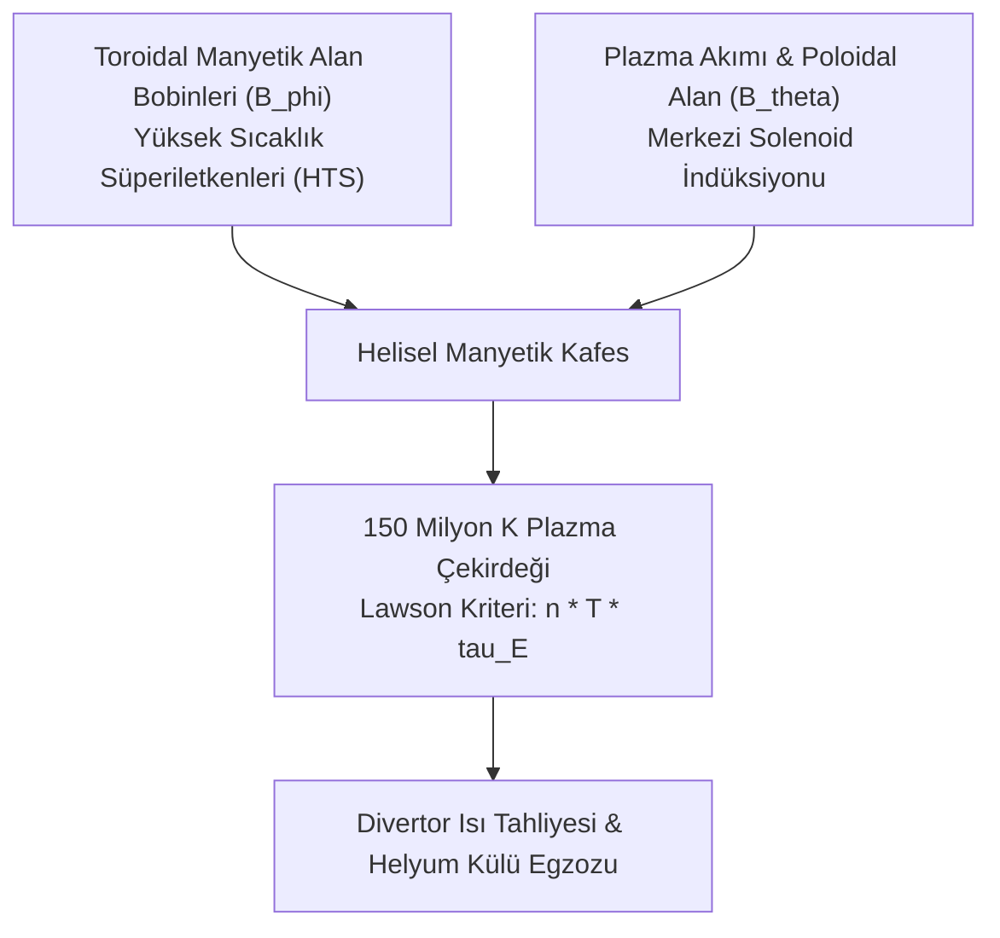

# ⚛️ Manyetik Sınırlamalı Nükleer Füzyon, Tokamak & Stellarator Plazma Dinamiği ve Lawson Kriteri
### *İleri Nükleer Enerji Mühendisliği & Plazma Fiziği Araştırma Monografı (2026+)*

> *“Yıldızları yeryüzünde yakmak; insan aklının termodinamik evren üzerindeki nihai zaferidir.”*

---

## 📌 1. Giriş ve Füzyon Paradigması

Nükleer fisyonun aksine nükleer füzyon; uzun ömürlü radyoaktif atık üretmeyen, erime (meltdown) riski bulunmayan ve yakıt kaynağı olarak okyanuslardaki döteryum ile lityumdan üretilen trityumu kullanan, insanlığın nihai temiz enerji kaynağıdır.

Ancak çekirdeklerin Coulomb itme bariyerini aşabilmesi için plazmanın **150 milyon Kelvin ($>10 \, \text{keV}$)** sıcaklığa ısıtılması ve hiçbir katı maddeye temas etmeden güçlü manyetik alanlar ile toroidal bir haznede hapsedilmesi zorunludur.

---

## 📐 2. Lawson Üçlü Çarpımı ve Ateşleme Kriteri

Kendi kendini besleyen bir füzyon reaksiyonu (ateşleme - *ignition*, $Q \to \infty$) için plazma parçacık yoğunluğu ($n$), iyon sıcaklığı ($T$) ve enerji hapsolma süresi ($\tau_E$) çarpımı Lawson sınırını aşmalıdır:

$$n \cdot T \cdot \tau_E \ge 3 \times 10^{21} \, \text{keV} \cdot \text{s} / \text{m}^3$$

Döteryum-Trityum (D-T) nükleer reaksiyon denklemi:

$$^2_1\text{H} + \, ^3_1\text{H} \;\longrightarrow\; ^4_2\text{He} \, (3.5 \, \text{MeV}) + \, ^1_0\text{n} \, (14.1 \, \text{MeV}) + 17.6 \, \text{MeV}$$

Alfa parçacıkları ($^4_2\text{He}$) plazma içinde manyetik olarak tutularak plazmayı içeriden ısıtırken; yüksüz nötronlar ($^1_0\text{n}$) manyetik alandan kaçarak lityum battaniyesinde (breeding blanket) trityum üretir ve kinetik enerjilerini ısıya dönüştürür.

---

## 🌀 3. Manyetohidrodinamik (MHD) Denge: Grad-Shafranov Denklemi

Toroidal eksenel simetride plazma basınç gradyanı ile Lorentz manyetik kuvvetinin dengesi:

$$\mathbf{J} \times \mathbf{B} = \nabla p$$

Bu denge, toroidal manyetik akı fonksiyonu $\psi$ cinsinden **Grad-Shafranov Diferansiyel Denklemi** ile ifade edilir:

$$\Delta^* \psi = -\mu_0 R^2 \frac{dp}{d\psi} - F \frac{dF}{d\psi}$$

Burada:
- $\Delta^* = R \frac{\partial}{\partial R} \left( \frac{1}{R} \frac{\partial}{\partial R} \right) + \frac{\partial^2}{\partial Z^2}$ eliptik diferansiyel operatörüdür,
- $p(\psi)$ plazma basınç profili,
- $F(\psi) = R B_\phi$ poloidal akım fonksiyonudur.

---

## 🧲 4. Tokamak vs. Stellarator Mimarisi

1. **Tokamak Mimarisi (ITER, SPARC):**
   - Poloidal manyetik alan, plazmanın içinden geçirilen milyonlarca amperlik plazma akımı (indüktif akım) ile oluşturulur.
   - *Avantajı:* Mükemmel eksenel simetri, yüksek hapsolma verimi.
   - *Dezavantajı:* Akım kesintisi (disruption) kararsızlığı ve darbeli (pulsed) çalışma zorunluluğu.
2. **Stellarator Mimarisi (Wendelstein 7-X):**
   - Poloidal ve toroidal alanların tamamı, karmaşık 3D bükümlü harici süperiletken bobinlerle üretilir. Plazma akımına ihtiyaç duymaz.
   - *Avantajı:* Tamamen sürekli (steady-state) kararlı çalışma, sıfır disrupsiyon riski.
   - *Dezavantajı:* Aşırı karmaşık süper-bilgisayar optimizasyonlu bobin geometrisi.

---

## 💎 5. Yüksek Sıcaklık Süperiletkenleri (HTS - REBCO)

Modern füzyon girişimleri (Commonwealth Fusion Systems vb.), sıvı helyum yerine sıvı nitrojenle soğutulabilen Nadir Toprak Baryum Bakır Oksit (**REBCO**) şeritleri kullanarak manyetik alan gücünü $B \sim 5 \, \text{Tesla}$ seviyesinden **$B \sim 20 \, \text{Tesla}$** seviyesine çıkarmıştır.

Füzyon gücü manyetik alanın dördüncü kuvvetiyle ölçeklendiğinden:

$$P_{\text{fusion}} \propto B^4$$

Manyetik alanın 4 katına çıkması, reaktör hacmini 40 kat küçülterek füzyon santrallerini ekonomik olarak inşa edilebilir kılmaktadır.
