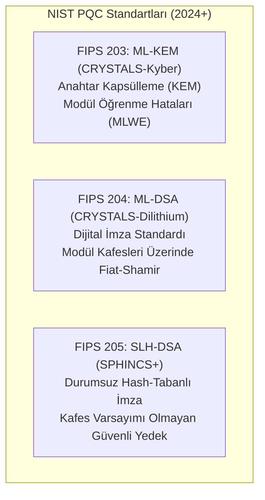

# 🛡️ Post-Kuantum Kriptografi (PQC), Sıfır Güven Mimarisi (Zero Trust) ve Çekirdek Güvenliği (eBPF)
### *İleri Siber Güvenlik Mühendisliği Araştırma Raporu (2026+)*

> *“Kuantum bilgisayarlarının RSA ve Eliptik Eğri şifrelemeyi kıracağı gün (Q-Day), bir gelecek senaryosu değil; şimdiden kaydedilip gelecekte çözülmek üzere toplanan (Harvest Now, Decrypt Later) veriler için bugünün akut tehdididir.”*

---

## 📌 1. Kuantum Tehdidi ve Klasik Kriptografinin Çöküşü

Peter Shor tarafından 1994'te önerilen kuantum algoritması, tamsayı çarpanlara ayırma ve ayrık logaritma problemlerini polinom zamanda çözer:

$$\text{Klasik Çarpanlara Ayırma (GNFS):} \quad \mathcal{O}\left( \exp\left( \sqrt[3]{\frac{64}{9} n (\log n)^2} \right) \right)$$

$$\text{Shor Algoritması (Kuantum):} \quad \mathcal{O}\left( (\log N)^2 (\log \log N) (\log \log \log N) \right)$$

Bu nedenle günümüz dijital ekonomisini güvenceye alan **RSA-2048, RSA-4096, ECDSA, ECDH ve Ed25519** algoritmaları, yeterli mantıksal kübit sayısına sahip bir hata toleranslı kuantum bilgisayar karşısında tamamen savunmasızdır.

---

## 📐 2. NIST Post-Kuantum Kriptografi Standartları (FIPS 203, 204, 205)

Ağustos 2024'te NIST tarafından nihai standartları yayımlanan Kafes Tabanlı (Lattice-Based) kriptografi:



### 2.1. Hatalarla Öğrenme (Learning With Errors - LWE) Prensibi
Bir gizli vektör $s \in \mathbb{Z}_q^n$ ve rastgele bir matris $A \in \mathbb{Z}_q^{m \times n}$ verildiğinde, küçük bir hata vektörü $e \leftarrow \chi^m$ ile:

$$b = A s + e \pmod{q}$$

$(A, b)$ çifti verildiğinde $s$ vektörünü bulmak, en kısa vektör problemi (SVP) ve en yakın vektör problemi (CVP) gibi $n$-boyutlu kafeslerde NP-zor kabul edilen geometri problemlerine denktir.

---

## 🏰 3. Sıfır Güven Mimarisi (Zero Trust Architecture - NIST SP 800-207)

Klasik kale-hendek (perimeter-based) güvenlik paradigması yerini şu 3 aksiyoma bırakmıştır:
1. **Asla Güvenme, Daima Doğrula (Never Trust, Always Verify):** Konum, ağ içi IP veya cihaz bağımsız dinamik kimlik denetimi.
2. **En Düşük Yetki Prensibi (Least Privilege Access):** Just-in-Time (JIT) ve Just-Enough-Access (JEA) izinleri.
3. **İhlali Varsay (Assume Breach):** Saldırganın zaten iç ağda olduğunu varsayarak saldırı yüzeyini mikro-bölümleme (microsegmentation) ile sınırlandırma.

---

## 💻 4. Çekirdek Düzeyinde Tehdit Avcılığı: eBPF (Extended Berkeley Packet Filter)

Geleneksel kullanıcı alanı (user-space) güvenlik ajanları yüksek CPU yükü yaratırken, eBPF Linux çekirdeğinde (kernel-space) olayları sıfır bağlam değişimiyle (zero context-switch) izler:

```python
"""
eBPF Tabanlı Yetkisiz Bellek ve Çekirdek Çağrısı (Syscall) Monitörü (Kavramsal C/BCC)
"""
ebpf_code = """
#include <uapi/linux/ptrace.h>
#include <linux/sched.h>

BPF_PERF_OUTPUT(security_events);

struct event_t {
    u32 pid;
    char comm[TASK_COMM_LEN];
    u64 syscall_nr;
};

int trace_sys_execve(struct pt_regs *ctx) {
    struct event_t event = {};
    event.pid = bpf_get_current_pid_tgid() >> 32;
    bpf_get_current_comm(&event.comm, sizeof(event.comm));
    
    // Anormal yetki yükseltme (Privilege Escalation) tespiti
    if (event.pid == 0) {
        security_events.perf_submit(ctx, &event, sizeof(event));
    }
    return 0;
}
"""
```

---

## 📚 5. Kanonik Kaynakça

1. **NIST (2024):** *“FIPS 203: Module-Lattice-Based Key-Encapsulation Mechanism Standard”*.
2. **NIST (2024):** *“FIPS 204: Module-Lattice-Based Digital Signature Standard”*.
3. **Rose, S. et al. (2020):** *“Zero Trust Architecture”*, NIST Special Publication 800-207.
4. **Alperovitch, D. (2021):** *“World on the Brink: How America Can Beat China in the Race for the Twenty-First Century”*.
5. **Rice, L. (2023):** *“Learning eBPF: Developing Linux Kernel Intelligence”*, O'Reilly Media.
