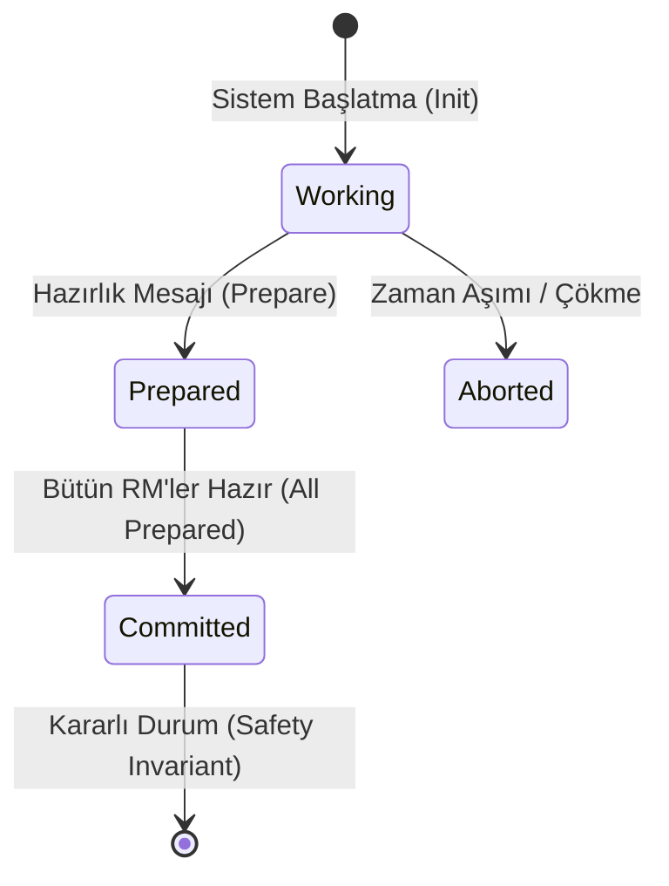

# 🛡️ Formal Doğrulama (Formal Verification), TLA+, Model Checking ve Görev-Kritik Dağıtık Yazılım Güvenilirliği
### *İleri Yazılım Mühendisliği & Biçimsel Yöntemler Araştırma Monografı (2026+)*

> *“Program testi yalnızca hataların varlığını gösterebilir; yokluğunu asla kanıtlayamaz.”*  
> — **Edsger W. Dijkstra**

---

## 📌 1. Giriş ve Kuramsal Temeller

Modern yazılım sistemleri, asenkron ağ ortamlarında çalışan dağıtık konsensüs algoritmaları, çok çekirdekli donanım mimarileri ve finansal/havacılık görev-kritik altyapılarıyla ölçeklenmektedir. Klasik birim (unit) ve entegrasyon testleri, kombinatoryal durum patlaması (state explosion) karşısında yetersiz kalmakta; mikro-saniyelik yarış durumları (race conditions) ve kısmi ağ bölünmeleri (network partitions) milyarlarca dolarlık sistem kesintilerine yol açmaktadır.

**Formal Doğrulama (Formal Verification)**; yazılımın davranışsal spesifikasyonunu matematiksel mantık zemininde aksiyomatize eden ve sistemin tüm olası yürütme yollarında güvenlik (*safety*) ve canlılık (*liveness*) invariantlarını sağladığını ispatlayan en üst düzey mühendislik disiplinidir.

---

## 📐 2. Zamansal Mantık ve Durum Geçiş Sistemleri

### 2.1. Lineer Zamansal Mantık (LTL) vs Hesaplama Ağacı Mantığı (CTL)
Bir sistem, Kripke yapısı $\mathcal{M} = (S, S_0, R, L)$ olarak modellenir:
- $S$: Sonlu durumlar kümesi,
- $S_0 \subseteq S$: Başlangıç durumları,
- $R \subseteq S \times S$: Sol tarafı toplam geçiş bağıntısı,
- $L: S \to 2^{AP}$: Durum etiketleme fonksiyonu (Atomic Propositions).

LTL zamansal operatörleri:
1. **Daima (Globally) $\Box \phi$:** $\forall i \ge 0, \pi[i] \models \phi$
2. **Nihayetinde (Eventually) $\Diamond \phi$:** $\exists i \ge 0, \pi[i] \models \phi$
3. **Sonraki Adımda (Next) $\bigcirc \phi$:** $\pi[1] \models \phi$
4. **-e Kadar (Until) $\phi \, \mathcal{U} \, \psi$:** $\exists k \ge 0, \pi[k] \models \psi \land (\forall j < k, \pi[j] \models \phi)$

Güvenlik (*Safety*) ve Canlılık (*Liveness*) ayrımı:

$$\text{Safety} \equiv \Box \neg \text{BadState}, \quad \text{Liveness} \equiv \Box (\text{Request} \to \Diamond \text{Response})$$

---

## ⚙️ 3. TLA+ Spesifikasyonu ve Model Checking

Leslie Lamport tarafından geliştirilen **TLA+ (Temporal Logic of Actions)**, sistem durumunu birinci dereceden mantık ve küme kuramı ile modeller:

$$\text{Spec} \triangleq \text{Init} \land \Box [\text{Next}]_{\text{vars}} \land \text{Fairness}$$

### 3.1. Örnek: İki Aşamalı Taahhüt (Two-Phase Commit) TLA+ Modeli

```tla
-------------------------------- MODULE TwoPhaseCommit --------------------------------
EXTENDS Naturals, FiniteSets
CONSTANT ResourceManagers

VARIABLE rmState, tmState

Init == 
  /\ rmState = [rm \in ResourceManagers |-> "working"]
  /\ tmState = "init"

RMRulePrepare(rm) ==
  /\ rmState[rm] = "working"
  /\ rmState' = [rmState EXCEPT ![rm] = "prepared"]
  /\ UNCHANGED tmState

TMCommit ==
  /\ tmState = "init"
  /\ \A rm \in ResourceManagers : rmState[rm] = "prepared"
  /\ tmState' = "committed"
  /\ UNCHANGED rmState

ConsistencyInvariant ==
  ~ (tmState = "committed" /\ \E rm \in ResourceManagers : rmState[rm] = "aborted")
======================================================================================
```

TLC Model Checker, yukarıdaki invariant'ın tüm erişilebilir durumlarda korunduğunu durum uzayı grafiği üzerinde BFS/DFS ile ispatlar.



---

## 🧪 4. Biçimsel İspat Asistanları: Coq, Lean ve Rust Doğrulaması

1. **İspat Odaklı Tip Teorisi (Curry-Howard İzomorfizmi):** Bir tip bir teorem, o tipin bir terimi ise teoremin ispatıdır ($\text{Program} \equiv \text{Proof}$).
2. **Kani & Creusot:** Rust kodlarının LLVM-IR ve MIR seviyesinde CBMC (Bounded Model Checker) ile doğrulanması.
3. **Formal Mikrokernel Mimarisi (seL4 Örneği):** 10.000 satır C kodunun Isabelle/HOL asistanı ile ikili kod seviyesine (binary-level) kadar matematiksel ispatının tamamlanması.

---

## 🚀 5. Sonuç ve Endüstriyel Çıkarımlar

Formal doğrulama, akademik bir fantezi olmaktan çıkıp AWS S3 konsensüs protokollerinde, Apple T2 güvenlik çiplerinde ve Ethereum akıllı sözleşmelerinde endüstri standardı haline gelmiştir. Geleceğin yazılım mühendisi; yalnızca kod yazan değil, yazdığı kodun matematiksel ispatını inşa eden bir **biçimsel sistem mimarı**dır.
