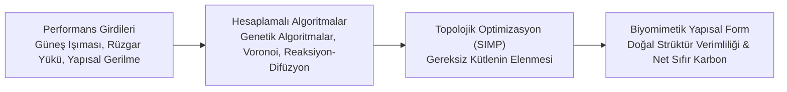
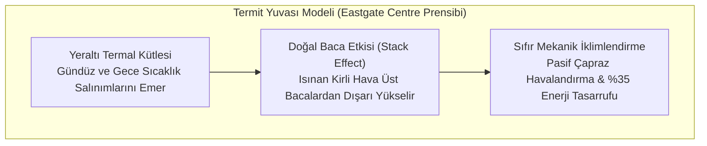

# 🏛️ Hesaplamalı Tasarım (Computational Design), Topolojik Optimizasyon ve Biyomimetik Mimarlık
### *İleri Mimarlık, Yapı Mühendisliği & Hesaplamalı Morfogenez Monografı (2026+)*

> *“Doğa hiçbir zaman bir binayı dikdörtgen prizması olarak tasarlamazdı. Malzemeyi yalnızca gerilmenin olduğu yere yerleştiren kemik yapısı ve rüzgara göre eğilen ağaç lifleri; hesaplamalı tasarımın ve sürdürülebilir mimarinin en kusursuz yapısal manifestosudur.”*

---

## 📌 1. Giriş ve Hesaplamalı Morfogenez (Computational Morphogenesis)

Geleneksel mimari sezgisel eskizlerden türetilen geometrileri strüktürel mühendisliğe uydurmaya çalışırken; **Hesaplamalı Morfogenez**, biçimi (form) fiziksel performans parametrelerinin, malzeme özelliklerinin ve çevresel kuvvetlerin algoritmik bir çıktısı olarak üretir:



---

## 🦴 2. Topolojik Optimizasyon ve Malzeme Dağıtımı (SIMP Yöntemi)

Yapısal elemanlardaki malzeme yoğunluğunu sonlu elemanlar analizi (FEA) ile optimize eden **Katı İzotropik Malzeme Cezalandırma (SIMP)** formülasyonu:

$$\min_{\rho} C(\rho) = U^T K(\rho) U = \sum_{e=1}^N \rho_e^p u_e^T k_0 u_e$$

$$\text{Kısıtlar:} \quad \begin{cases} \frac{V(\rho)}{V_0} = \frac{\sum_{e=1}^N \rho_e v_e}{V_0} \le f_v & \text{(Hacim Kesri Kısıtı)} \\ K(\rho) U = F & \text{(Statik Denge)} \\ 0 < \rho_{\min} \le \rho_e \le 1 & \text{(Tasarım Değişkeni)} \end{cases}$$

Burada $p > 1$ (genellikle $p = 3$) cezalandırma katsayısı olup ara yoğunlukları ($0 < \rho < 1$) sıfıra veya bire zorlar. Sonuç; kuş kemiklerinin veya ağaç dallarının iç gerilme çizgilerini birebir taklit eden, $\%40-60$ daha az beton/çelik tüketen organik kafes strüktürlerdir.

---

## 🐜 3. Biyomimetik Çevresel Kabuklar ve Pasif Havalandırma

Doğadaki organizmalar yüz milyonlarca yıllık evrimsel baskı altında minimum enerjiyle termal denge kurmayı başarmıştır:



### 3.1. Kinetik Biyomimetik Cepheler
Bitkilerin stoma gözeneklerinin nem ve ışığa tepki vererek açılıp kapanması prensibini taklit eden akıllı cephe panelleri:
- **Şekil Hafızalı Alaşımlar (SMA - Nitinol):** Güneş ısısıyla genleşerek lamel açısını değiştirir; harici elektrik motoru gerektirmez.
- **Higromorfik Ahşap Kompozitler:** Bağıl nem değişimine göre doğal olarak bükülen ahşap lifleri ile pasif gölgelendirme.

---

## 💻 4. Python Algoritması: 2 Boyutlu Voronoi Cephe Bölüntüleme Simülatörü

```python
"""
Parametrik Mimari Cepheler İçin Gerilme-Ağırlıklı Voronoi Bölüntüleme
"""
import numpy as np
from scipy.spatial import Voronoi

def generate_parametric_facade(width: float, height: float, num_attractors: int = 25):
    """Cephe üzerinde yapısal gerilme yoğunluğuna göre adaptif Voronoi hücreleri üretir."""
    np.random.seed(42)
    # Gerilmenin yüksek olduğu taban bölgesine daha yoğun çekici noktalar (attractors)
    x = np.random.uniform(0, width, num_attractors)
    y = np.random.beta(a=0.8, b=2.0, size=num_attractors) * height
    points = np.column_stack((x, y))
    
    # Voronoi hücrelerini inşa et
    vor = Voronoi(points)
    
    cells = []
    for region_idx in vor.point_region:
        region = vor.regions[region_idx]
        if not -1 in region and len(region) > 0:
            polygon = [vor.vertices[i] for i in region]
            cells.append(polygon)
            
    return {
        "num_cells": len(cells),
        "generator_points": points.tolist()
    }
```

---

## 📚 5. Kanonik Kaynakça

1. **Menges, A., & Ahlquist, S. (2011):** *“Computational Design Thinking: Computation Design Thinking”*, John Wiley & Sons.
2. **Knippers, J. et al. (2016):** *“Biomimetic Research for Architecture and Building Construction”*, Springer.
3. **Bendsøe, M. P., & Sigmund, O. (2004):** *“Topology Optimization: Theory, Methods, and Applications”*, Springer.
4. **Oxman, N. (2010):** *“Material-based design computation”*, Massachusetts Institute of Technology.
5. **Pawlyn, M. (2019):** *“Biomimicry in Architecture”*, Riba Publishing.
