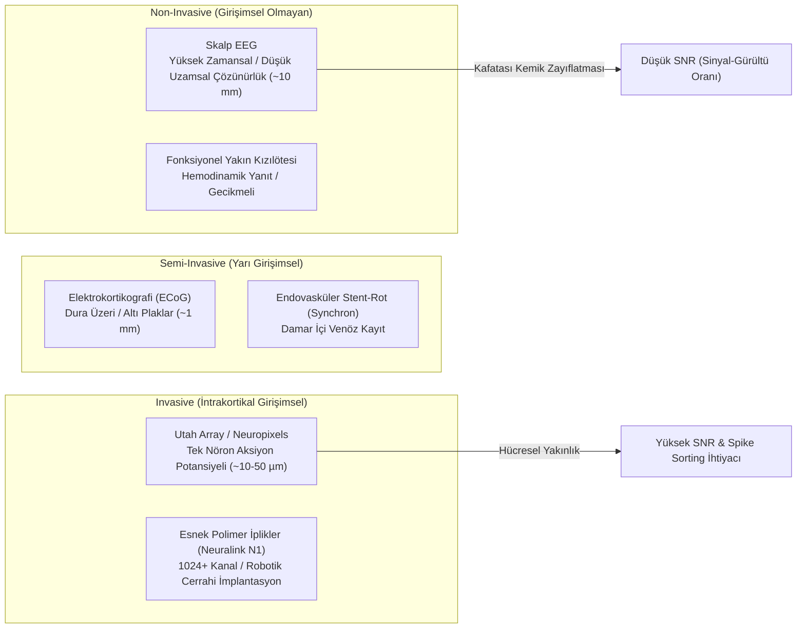

# 🧠 Beyin-Bilgisayar Arayüzleri (BCI): Nöral Kod Çözümleme, Elektrofizyoloji ve Nöromorfik Sinyal İşleme
### *İleri BCI Araştırma Raporu & Nöroteknoloji Monografı (2026+)*

> *“İnsan beyninin elektrik ve kimyasal diliyle sayısal sistemlerin mantık kapıları arasındaki sınır; biyoloji ile sibernetiğin nihai füzyon noktasıdır.”*

---

## 📌 1. Giriş ve Elektrofizyolojik Temeller

Beyin-Bilgisayar Arayüzleri (Brain-Computer Interfaces - BCI), merkezi sinir sisteminin ürettiği elektrofizyolojik sinyalleri yakalayarak, onları harici aygıtlar, protezler veya dijital ortamlar için yürütülebilir komutlara dönüştüren çift yönlü sibernetik sistemlerdir. 

Nöronal aksiyon potansiyelleri, hücre zarındaki sodyum-potasyum ($Na^+ / K^+$) voltaj kapılı iyon kanallarının açılıp kapanmasıyla oluşur. Goldman-Hodgkin-Katz (GHK) denklemine göre dinlenim potansiyeli:

$$V_m = \frac{RT}{F} \ln \left( \frac{P_{\text{K}} [\text{K}^+]_o + P_{\text{Na}} [\text{Na}^+]_o + P_{\text{Cl}} [\text{Cl}^-]_i}{P_{\text{K}} [\text{K}^+]_i + P_{\text{Na}} [\text{Na}^+]_i + P_{\text{Cl}} [\text{Cl}^-]_o} \right)$$

---

## 🔬 2. BCI Kayıt Modaliteleri ve Karşılaştırmalı Analiz



| Modalite | Uzamsal Çözünürlük | Zamansal Çözünürlük | İnvazivlik | Klinik / Tüketici Kullanımı |
| :--- | :---: | :---: | :---: | :--- |
| **EEG (Elektroensefalografi)** | ~10-20 mm | ~1 ms | Yok | Felç rehabilitasyonu, uyku, oyun |
| **ECoG (Elektrokortikografi)** | ~1-3 mm | ~1 ms | Cerrahi (Dura) | Epilepsi haritalama, motor protez |
| **Endovasküler (Synchron Stentrode)** | ~1-2 mm | ~5 ms | Minimal (Venöz) | ALS hastalarında iletişim |
| **İntrakortikal Mikro-Dizi (Neuralink/Utah)** | ~50 µm (Tek Hücre) | < 1 ms | Yüksek (Kraniektomi) | Yüksek serbestlik dereceli robotik kol, görme restorasyonu |

---

## 📡 3. Nöral Sinyal İşleme Hattı (Pipeline)

### 3.1. Frekans Bantları ve Spektral Özellikler
- **Delta ($\delta$, 0.5 - 4 Hz):** Derin yavaş dalga uykusu.
- **Theta ($\theta$, 4 - 8 Hz):** Bellek pekiştirme, derin meditasyon ve hipnagojik durumlar.
- **Alpha ($\alpha$, 8 - 12 Hz / Mu $\mu$ ritmi):** Sensörimotor kortekste gevşeme, gözler kapalıyken oksipital güç artışı.
- **Beta ($\beta$, 13 - 30 Hz):** Aktif odaklanma, motor korteks motor planlama baskılanması (ERD).
- **Gamma ($\gamma$, > 30 Hz):** Karmaşık bilişsel bağlama, bilinçli farkındalık, yerel alan potansiyelleri (LFP).

### 3.2. Olay İlişkili Desenkronizasyon (ERD) ve Senkronizasyon (ERS)
Motor imgeleme (Motor Imagery) sırasında el veya ayak hareketi hayal edildiğinde, karşıt yarımkürenin (contralateral) sensörimotor bölgesinde Mu ve Beta bantlarında güç azalması ($\text{ERD}$) görülür:

$$\text{ERD}\% = \frac{A - R}{R} \times 100$$

Burada $A$ motor eylem veya imgeleme anındaki güç spektral yoğunluğu, $R$ ise dinlenim (baseline) durumundaki referans güçtür.

### 3.3. Ortak Uzamsal Örüntüler (Common Spatial Patterns - CSP)
İki sınıflı motor imgeleme verisinde, bir sınıfın varyansını maksimize ederken diğer sınıfın varyansını minimize eden uzamsal filtre matrisi $W$ genelleştirilmiş özdeğer problemiyle çözülür:

$$\Sigma_1 w = \lambda \Sigma_2 w \quad \Longrightarrow \quad W^T \Sigma_1 W = \Lambda_1, \quad W^T \Sigma_2 W = \Lambda_2$$

$$\Lambda_1 + \Lambda_2 = I$$

---

## 💻 4. Algoritmik Uygulama: EEG Olay İlişkili Potansiyel (P300) Tespiti

```python
"""
P300 ve Motor İmgeleme İçin Çizgisel Diskriminant Analizi (LDA) ile Filtreleme
"""
import numpy as np
from scipy.signal import butter, filtfilt

def bandpass_filter(signal: np.ndarray, lowcut: float = 8.0, highcut: float = 30.0, fs: float = 250.0, order: int = 4):
    """Sensörimotor ritimler için Butterworth bant geçiren filtre."""
    nyquist = 0.5 * fs
    low = lowcut / nyquist
    high = highcut / nyquist
    b, a = butter(order, [low, high], btype='band')
    return filtfilt(b, a, signal, axis=-1)

class SpatialCovarianceClassifier:
    def __init__(self):
        self.w = None
        
    def fit(self, X_class1: np.ndarray, X_class2: np.ndarray):
        """Kovaryans matrislerini hesapla ve diskriminant vektörünü bul."""
        c1 = np.mean([np.cov(trial) for trial in X_class1], axis=0)
        c2 = np.mean([np.cov(trial) for trial in X_class2], axis=0)
        # Genelleştirilmiş özdeğer ayrışımı
        eigvals, eigvecs = np.linalg.eigh(np.linalg.pinv(c2) @ c1)
        # En yüksek ve en düşük özdeğerlere karşılık gelen filtreleri seç
        self.w = eigvecs[:, [0, -1]]
        
    def transform(self, X: np.ndarray) -> np.ndarray:
        """Denemeleri uzamsal filtre ile projekte et."""
        projected = self.w.T @ X
        variance = np.var(projected, axis=-1)
        return np.log(variance / np.sum(variance))
```

---

## 📚 5. Kanonik Kaynakça ve Başvuru Literatürü

1. **Wolpaw & Wolpaw (2012):** *“Brain-Computer Interfaces: Principles and Practice”*, Oxford University Press.
2. **Nicolelis, M. A. (2001):** *“Actions from thoughts: Nature Reviews Neuroscience”*, 2(10), 721-729.
3. **Musk, E. & Neuralink (2019):** *“An Integrated Brain-Machine Interface Platform With Thousands of Channels”*, J Med Internet Res.
4. **Willett et al. (2021):** *“High-performance brain-to-text communication via handwriting”*, Nature, 593, 249-254.
5. **Blankertz et al. (2008):** *“The Optimizing of Spatial Filters for Brain-Computer Interfaces”*, IEEE SPM.

---

## 🔬 6. Açık Nöromühendislik Problemleri (2026+)

- **Kronik Biyouyumluluk ve Glial Skarlaşma (Glial Scarring):** Mikroelektrotların etrafında astrosit ve mikroglia birikiminin önlenmesi ve iletkenliğin 10+ yıl korunması.
- **Kablosuz Güç ve Termal Yönetim:** İmplante yonganın beyin dokusunda oluşturacağı sıcaklık artışının $1^\circ\text{C}$ altında tutulması (ISO 14708-1 normu).
- **Nöroetik ve Bilişsel Gizlilik (Neuro-Rights):** İnsan düşüncelerinin, niyetlerinin ve örtük duygularının şifresiz üçüncü taraflarca ele geçirilmesini önleyen biyometrik nöro-şifreleme.
