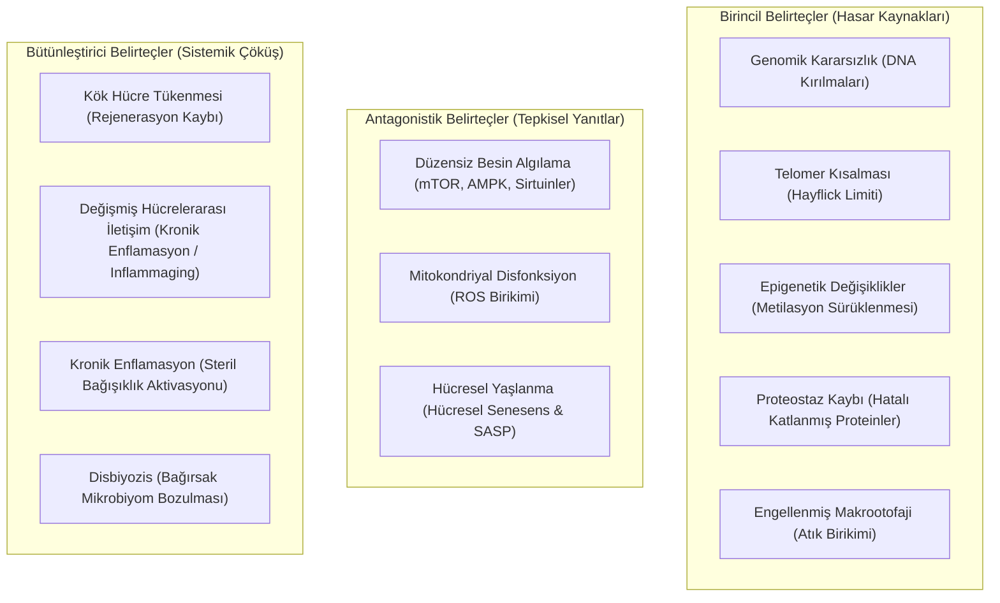

# 🧬 Hücresel Yaşlanma Biyolojisi, Epigenetik Saatler ve Longevity (Uzun Ömür) Tıbbı
### *İleri Biyolojik Yaşlanma & Biyoteknoloji Araştırma Raporu (2026+)*

> *“Yaşlanma kaçınılmaz bir doğa kanunu değil; hücresel onarım mekanizmalarının ve bilgi entropisinin termodinamik bir bozulma sürecidir. Programlanabilir bir biyoloji ile bu entropi yavaşlatılabilir ve tersine çevrilebilir.”*

---

## 📌 1. Giriş ve Yaşlanmanın Temel Belirteçleri (The Hallmarks of Aging)

Carlos López-Otín ve ekibinin öncülüğünü yaptığı modern geroscience konsensüsü, memeli organizmalarındaki yaşlanmayı 12 temel hücresel ve moleküler belirteçle (Hallmarks) tanımlar:



---

## ⏰ 2. Epigenetik Saatler ve DNA Metilasyon Analizi (Horvath Saati)

Steve Horvath tarafından keşfedilen epigenetik saat, genomdaki CpG adacıklarının metilasyon seviyelerindeki sistematik değişimleri ölçerek kronolojik yaştan bağımsız bir **Biyolojik Yaş (Biological Age)** tayin eder.

CpG dinükleotidindeki sitozin bazının 5-karbonuna metil grubu ($-\text{CH}_3$) transferi:

$$\text{Sitozin} + \text{SAM} \xrightarrow{\text{DNMT}} \text{5-Metilsitozin} + \text{SAH}$$

Epigenetik yaş tahmini, binlerce CpG bölgesinin ağırlıklı doğrusal kombinasyonunun dönüştürülmesiyle hesaplanır:

$$\text{DNAmAge} = F\left( \beta_0 + \sum_{i=1}^{353} \beta_i \cdot \text{CpG}_i \right)$$

Burada $\text{CpG}_i \in [0, 1]$ ilgili bölgenin metilasyon fraksiyonunu (beta-değerini) temsil eder.

---

## ⚡ 3. Hücresel Enerji Algılama Ağları: mTOR vs. AMPK ve Sirtuinler

Yaşlanmanın hızlanması veya yavaşlaması, hücrenin bolluk ve kıtlık durumlarına verdiği biyokimyasal yanıtların dengesine bağlıdır:

```
[Bolluk: Amino Asitler, İnsülin/IGF-1] ➔ mTORC1 Aktivasyonu ➔ Hücre Büyümesi & Protein Sentezi ➔ [Yaşlanma Hızlanır]
                                              ▲
                                              │ (Zıt Etki)
                                              ▼
[Kıtlık: Kalori Kısıtlaması, Egzersiz] ➔ AMPK & SIRT1 Aktivasyonu ➔ Otofaji, Mitokondriyal Biyogenez ➔ [Longevity Uyarılır]
```

### 3.1. mTOR İnhibisyonu (Rapamisin Protokolü)
mTORC1 kompleksinin allosterik inhibitörü olan **Rapamisin (Sirolimus)**, FKBP12 proteinine bağlanarak fosforilasyon döngüsünü baskılar:
- S6K1 ve 4E-BP1 inhibisyonu ile aşırı protein translasyonunu azaltır.
- ULK1 serbest kalarak makrootofajiyi tetikler; sitoplazmik hasarlı organeller lizozomlarda geri dönüştürülür.

### 3.2. NAD+ Biyosentezi ve Sirtuinler (SIRT1-SIRT7)
Sirtuinler, NAD+-bağımlı deasetilaz enzimleridir. Yaşla birlikte hücre içi $\text{NAD}^+$ havuzunun tükenmesi (CD38 enzim aktivitesinin artması nedeniyle), SIRT1 ve SIRT3 aktivitesini felç eder. Kurtarma yolağı:

$$\text{Nikotinamid (NAM)} \xrightarrow{\text{NAMPT}} \text{NMN} \xrightarrow{\text{NMNAT}} \text{NAD}^+$$

---

## 🧪 4. Senolitik Terapi ve SASP Eliminasyonu

Bölünmesi durmuş ancak ölmeyerek çevre dokuya pro-enflamatuar sitokinler (IL-6, IL-1$\beta$, TNF-$\alpha$, MMPs) salgılayan zombi hücrelere **Senesen Hücreler** denir. Bu salgı profili **SASP (Senescence-Associated Secretory Phenotype)** olarak adlandırılır.

```python
"""
Senolitik İlaç Kombinasyonları veSASPBaskılama Simülasyonu
"""
import numpy as np

def simulate_senescent_burden(t_years: int = 80, clearance_intervention_year: int = 50):
    """Senesen hücre birikimini ve senolitik müdahalenin etkisini modeller."""
    time = np.linspace(0, t_years, t_years * 12)
    # Yaşla birlikte üstel artan senesen yük (Gompertz-benzeri dinamik)
    senescent_load = 0.01 * np.exp(0.065 * time)
    
    # Müdahale uygulandığında (Örn: Dasatinib + Quercetin veya Fisetin döngüsü)
    for idx, t in enumerate(time):
        if t >= clearance_intervention_year and (t % 1.0) < 0.08: # Yılda bir aralıklı darbe dozu
            senescent_load[idx:] *= 0.55 # %45 hücresel senolitik eliminasyon
            
    return time, senescent_load
```

---

## 📚 5. Kanonik Kaynakça ve Başvuru Literatürü

1. **López-Otín, C. et al. (2013, 2023):** *“The Hallmarks of Aging”*, Cell, 153(6), 1194-1217 & Cell, 186(2), 243-278.
2. **Horvath, S. (2013):** *“DNA methylation age of human tissues and cell types”*, Genome Biology, 14(10), R115.
3. **Harrison, D. E. et al. (2009):** *“Rapamycin fed late in life extends lifespan in genetically heterogeneous mice”*, Nature, 460, 392-395.
4. **Kirkland, J. L., & Tchkonia, T. (2020):** *“Senolytic drugs: from discovery to translation”*, Journal of Internal Medicine, 288(5), 518-536.
5. **Sinclair, D. A. (2019):** *“Lifespan: Why We Age—and Why We Don't Have To”*, Atria Books.

---

## 🔬 6. Açık Yaşlanma Biyolojisi Problemleri (2026+)

- **Yamanaka Faktörleri ile Kısmi Yeniden Programlama (Partial Cellular Reprogramming):** Oct4, Sox2, Klf4 ve c-Myc (OSKM) genlerinin in vivo darbe şeklinde aktifleştirilerek doku kimliğini kaybetmeden (teratoma oluşturmadan) epigenetik saatin sıfırlanması.
- **DNA Çift Zincir Kırıklarının Epigenetik Bilgi Kaybı Olmadan Onarımı:** Epigenetik hafızanın kromatin mimarisinde yedeklenmesi mekanizmasının çözülmesi.
