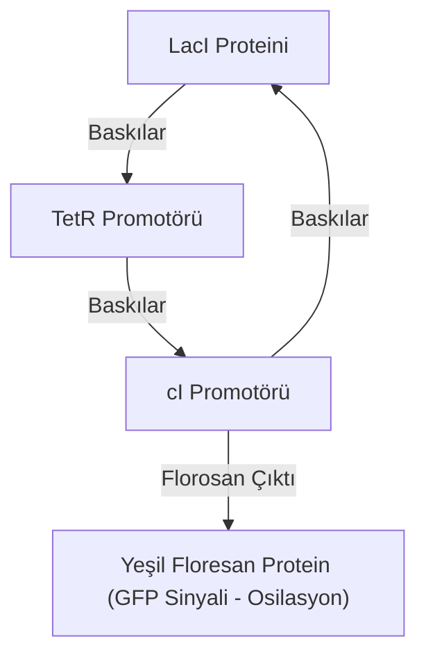

# 🧬 Sentetik Genomik, Minimal Hücre Tasarımı ve Genetik Devre Mühendisliği
### *İleri Biyoinformatik & Sentetik Biyoloji Araştırma Monografı (2026+)*

> *“Ne yapabileceğimi bilmiyorsam, inşa edemem.”*  
> — **Richard Feynman** *(Sentetik Genomik Prensibi)*

---

## 📌 1. Giriş ve Biyolojik Programlama Paradigması

Klasik moleküler biyoloji, canlı organizmaları tanımlamaya ve var olan genetik mekanizmaları analiz etmeye odaklanmıştır. **Sentetik Biyoloji ve Biyoinformatik** ise doğada var olmayan biyolojik fonksiyonları, modüler standart genetik parçalar (BioBricks) ve sayısal hesaplama prensipleri kullanarak sıfırdan inşa eden bir **mühendislik disiplini**dir.

Bu monograf; yaşamın asgari genetik sınırlarını belirleyen **Minimal Sentetik Hücre Tasarımı** ile hücre içi biyokimyasal mantık devrelerinin tasarım prensiplerini incelemektedir.

---

## 📐 2. Genetik Mantık Devreleri ve Hill Kinetiği

Biyolojik transkripsiyon regülasyonu, genetik promotörlerin represör ve aktivatör proteinlerle etkileşimi üzerinden modellenir.

### 2.1. Hill Kinetiği ile Genetik Mantık Kapısı Modellemesi
Bir transkripsiyon faktörünün ($X$) bir promotöre bağlanarak gen ekspresyonunu ($Y$) aktive etme hızı Hill Fonksiyonu ile ifade edilir:

$$f(X) = V_{\max} \frac{X^n}{K_d^n + X^n}$$

Negatif regülasyon (Baskılama / Represyon - **NOT Kapısı**):

$$f_{\text{NOT}}(X) = V_{\max} \frac{K_d^n}{K_d^n + X^n}$$

Burada:
- $V_{\max}$: Maksimum transkripsiyonel üretim hızı,
- $K_d$: Ayrışma sabiti (bağlanma afinitesi),
- $n$: Hill katsayısı (kooperatiflik derecesi; $n > 1$ sigmoid / anahtarlama davranışı üretir).

### 2.2. Sentetik Genetik Osilatör (Repressilator)
Üç adet birbirini döngüsel olarak baskılayan genden oluşan dinamik sistem ($A \dashv B \dashv C \dashv A$):

$$\frac{dm_i}{dt} = - \gamma_m m_i + \frac{\alpha}{1 + p_{i-1}^n}, \quad \frac{dp_i}{dt} = - \gamma_p p_i + \beta m_i \quad (i = 1, 2, 3)$$

Uygun parametre uzayında sistem limit döngüye (limit cycle) girerek hücre içinde sentetik bir biyolojik saat oluşturur.

---

## 🔬 3. Metabolik Akı Dengesi Analizi (Flux Balance Analysis - FBA)

Hücrenin metabolik ağındaki $M$ metabolit ve $N$ reaksiyon, stokiyometrik matris $S \in \mathbb{R}^{M \times N}$ ile tanımlanır. Kararlı durumda (steady-state) kütle korunumu:

$$S \cdot \mathbf{v} = \mathbf{0}$$

Amaç, belirli bir hücresel hedefi (örneğin biyokütle üretimini $Z = \mathbf{c}^T \mathbf{v}$) doğrusal programlama (Linear Programming - LP) ile maksimize etmektir:

$$\max_{\mathbf{v}} \mathbf{c}^T \mathbf{v} \quad \text{Kısıtlar:} \quad S \mathbf{v} = \mathbf{0}, \quad \mathbf{v}_{\min} \le \mathbf{v} \le \mathbf{v}_{\max}$$

Bu matematiksel optimizasyon sayesinde in-silico ortamda hangi genlerin silinmesi (gene knockout) gerektiği hesaplanarak endüstriyel biyoyakıt ve aşı üretiminde verimlilik 10 kat artırılmaktadır.

---

## 🧬 4. Minimal Genom Tasarımı: JCVI-syn3.0

1. **Top-Down Yaklaşım:** *Mycoplasma mycoides* bakterisinden transpozon mutagenezi ile zorunlu olmayan genlerin tek tek elenmesi.
2. **Kritik Eşik:** 473 gene ve 531 kilobazlık DNA dizisine sahip minimal yaşam formu **JCVI-syn3.0** sentezlenmiştir. Bu genlerin 149'unun hücresel işlevi halen tam bilinmemektedir; bu durum biyoinformatik araştırmacıları için yaşamın temel sınır taşını oluşturmaktadır.

---

## 🚀 5. Sonuç

Sentetik genomik, biyolojiyi gözlemsel bir doğa biliminden çıkarıp, genetik kodu derlenebilir bir programlama diline dönüştürmektedir.
