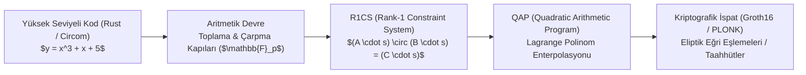
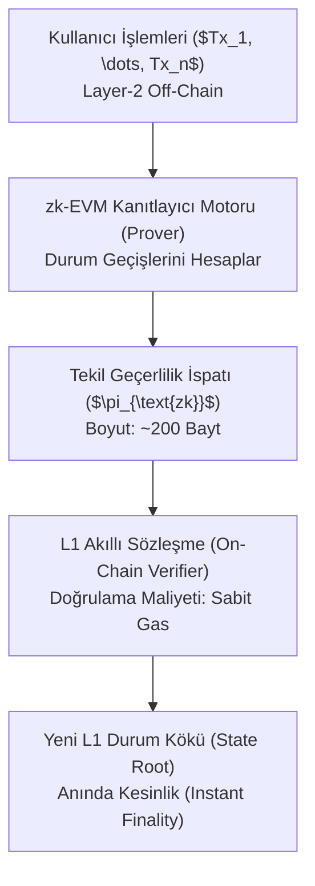

# 🔐 Sıfır Bilgi İspatları (zk-SNARKs & zk-STARKs), PLONK Mimarisi ve zk-Rollup Ölçeklemesi
### *İleri Kriptografi, Blokzincir & Web3 Araştırma Raporu (2026+)*

> *“Sıfır bilgi ispatı; bir ifadenin doğruluğunu, o ifadenin doğruluğu dışında karşı tarafa tek bir bit dahi bilgi sızdırmadan ispatlama sanatıdır.”*

---

## 📌 1. Giriş ve Sıfır Bilgi İspatlarının (ZKP) Üç Temel Aksiyomu

Goldwasser, Micali ve Rackoff tarafından 1985'te ortaya atılan bir Sıfır Bilgi İspatı (Zero-Knowledge Proof) sistemi şu üç koşulu sağlamak zorundadır:

1. **Tamlık (Completeness):** İfade doğruysa ve Kanıtlayıcı (Prover) ile Doğrulayıcı (Verifier) protokolü dürüstçe takip ederse, Doğrulayıcı ispatı daima kabul eder:
   $$P(\text{Verifier accepts} \mid x \in L) = 1$$
2. **Sağlamlık (Soundness):** İfade yanlışsa, hiçbir hilekar Kanıtlayıcı Doğrulayıcıyı (ihmal edilebilir küçük bir $\epsilon$ olasılığı hariç) ikna edemez:
   $$P(\text{Verifier accepts} \mid x \notin L) \le \epsilon$$
3. **Sıfır Bilgi (Zero-Knowledge):** İfade doğruysa, Doğrulayıcı ifadenin doğru olduğu bilgisi haricinde Kanıtlayıcının gizli tanığından (witness $w$) hiçbir şey öğrenemez:
   $$\exists \text{ Simülatör } S \quad \text{öyle ki} \quad S(x) \approx \text{View}_V(\text{Prover}(x, w) \leftrightarrow V(x))$$

---

## ⚙️ 2. Aritmetik Devreler ve R1CS'ten QAP'ye İndirgeme

Bir hesaplama problemini kriptografik ispata dönüştürme hattı:



### 2.1. R1CS Kısıt Sistemi
Tanık vektörü $s = [1, y, x, v_1, v_2]^T$ için her çarpma kapısı $L \cdot R = O$ biçiminde kodlanır:

$$\langle A_i, s \rangle \cdot \langle B_i, s \rangle - \langle C_i, s \rangle = 0$$

QAP'ye geçildiğinde bu kısıtlar tek bir polinom bölünebilirlik problemine dönüşür:

$$A(x) \cdot B(x) - C(x) = H(x) \cdot T(x)$$

Burada $T(x) = \prod_{i=1}^m (x - \omega^i)$ kökleri kapı indeksleri olan hedef polinomdur.

---

## 🏛️ 3. ZK İspat Sistemlerinin Karşılaştırmalı Analizi

| Sistem | Güvenilir Kurulum (Setup) | İspat Boyutu | Doğrulama Süresi | Kriptografik Varsayım | Post-Kuantum Güvenlik |
| :--- | :---: | :---: | :---: | :--- | :---: |
| **Groth16** | Devreye Özel Trusted Setup | **~130-200 Bayt (Sabit)** | $\sim 2-5 \ \text{ms}$ (3 Pairing) | Eliptik Eğri Ayrık Log (q-DLOG) | Hayır |
| **PLONK** | Evrensel / Güncellenebilir Setup | ~400-800 Bayt | $\sim 5-10 \ \text{ms}$ | KZG Polinom Taahhüdü | Hayır |
| **STARK** | **Şeffaf (Setup Yok)** | ~50-100 KB (Büyük) | $\sim 10-50 \ \text{ms}$ | Hash Fonksiyonları & FRI Protokolü | **Evet** |

---

## 🚀 4. zk-Rollup ve zk-EVM Mimarisi

Blokzincir katman-1 (Layer-1) ağlarının saniye başına işlem (TPS) sınırını aşmak için binlerce transfer zincir dışında (off-chain) yürütülür ve tek bir zk-SNARK ispatı ile L1'e yazılır:



---

## 💻 5. Python Uygulaması: Basit Sıfır Bilgi Schnorr Protokolü

```python
"""
Schnorr Ayrık Logaritma Sıfır Bilgi Kimlik Doğrulama Protokolü
İspatlanan: 'x' gizli anahtarını bilirim, öyle ki y = g^x (mod p)
"""
import random

P = 2147483647  # Büyük asal (Mersenne prime M31)
G = 7           # Üreteç (Generator)

class SchnorrZKP:
    def __init__(self, secret_x: int):
        self.x = secret_x
        self.y = pow(G, self.x, P) # Genel anahtar
        self.v = None
        
    def round1_commit(self) -> int:
        """1. Adım: Kanıtlayıcı rastgele v seçer ve taahhüt (t = g^v) gönderir."""
        self.v = random.randint(1, P - 2)
        t = pow(G, self.v, P)
        return t
        
    def round2_response(self, challenge_c: int) -> int:
        """2. Adım: Doğrulayıcının meydan okumasına (c) yanıt üretir: r = v - c*x."""
        r = (self.v - challenge_c * self.x) % (P - 1)
        return r
        
    @staticmethod
    def verify(public_y: int, t: int, c: int, r: int) -> bool:
        """Doğrulayıcı kontrol eder: g^r * y^c == t (mod p)"""
        lhs = (pow(G, r, P) * pow(public_y, c, P)) % P
        return lhs == t
```

---

## 📚 6. Kanonik Kaynakça

1. **Goldwasser, S., Micali, S., & Rackoff, C. (1989):** *“The knowledge complexity of interactive proof systems”*, SIAM Journal on Computing, 18(1), 186-208.
2. **Groth, J. (2016):** *“On the size of pairing-based non-interactive arguments”*, EUROCRYPT 2016, Springer.
3. **Gabizon, A., Williamson, Z. J., & Ciobotaru, O. (2019):** *“PLONK: Permutations over Lagrange-bases for Oecumenical Non-interactive arguments of Knowledge”*, Cryptology ePrint.
4. **Ben-Sasson, E. et al. (2018):** *“Scalable, transparent, and post-quantum secure computational integrity (STARKs)”*, IACR Cryptology ePrint.
5. **Thaler, J. (2022):** *“Proofs, Arguments, and Zero-Knowledge”*, Foundations and Trends in Privacy and Security.
