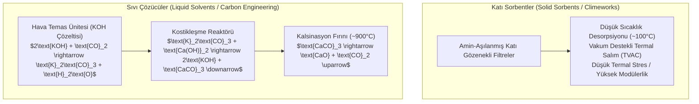

# 🌍 Doğrudan Hava Yakalama (DAC), Jeolojik Mineralizasyon ve Yeşil Hidrojen Termodinamiği
### *İleri İklim Teknolojileri & Enerji Sistemleri Araştırma Raporu (2026+)*

> *“Karbondioksiti atmosferin seyreltik gaz okyanusundan ayırmak; bir termodinamik entropi savaşıdır. Gezegen ölçeğinde karbon dengesini yeniden kurmak, insanlık tarihindeki en büyük kimya ve proses mühendisliği meydan okumasıdır.”*

---

## 📌 1. Doğrudan Hava Yakalama (Direct Air Capture - DAC) Termodinamiği

Atmosferdeki mevcut $\text{CO}_2$ derişimi yaklaşık $420 \ \text{ppm}$'dir ($\%0.042$). Bu denli seyreltik bir gaz karışımından saf $\text{CO}_2$ ayrıştırmak için gereken minimum teorik termodinamik iş, serbest Gibbs enerjisi değişimiyle verilir:

$$W_{\text{min}} = -RT \sum_i x_i \ln\left(\frac{x_i}{y_i}\right)$$

Derişim $420 \ \text{ppm}$'den $\%100$'e çıkarıldığında, $T = 298 \ \text{K}$ sıcaklıkta saf $\text{CO}_2$'nin her bir tonu için gereken minimum iş:

$$W_{\text{min}} \approx 20 \ \text{kJ/mol} \approx 450 \ \text{MJ/ton } \text{CO}_2 \approx 125 \ \text{kWh/ton } \text{CO}_2$$

Gerçek endüstriyel proseslerde (Climeworks, Carbon Engineering) kinetik kayıplar, adsorpsiyon entalpisi ve ısı kayıpları nedeniyle tüketilen enerji **$1500 - 2500 \ \text{kWh/ton } \text{CO}_2$** seviyesindedir.

---

## ⚗️ 2. DAC Kimyasal Süreçleri: Sıvı vs. Katı Soğurucular

---

## 🪨 3. Kalıcı Jeolojik Depolama ve İn Situ Mineralizasyon (Carbfix Modeli)

Yakalanan $\text{CO}_2$, yeraltı bazaltik kayaç formasyonlarına yüksek basınç altında su ile çözünmüş halde enjekte edilir. Bazalttaki kalsiyum, magnezyum ve demir iyonlarıyla reaksiyona girerek 2 yıl içinde katı taşa (kalsit mineraline) dönüşür:

$$\text{CO}_2 + \text{H}_2\text{O} \rightleftharpoons \text{H}_2\text{CO}_3 \rightleftharpoons \text{H}^+ + \text{HCO}_3^-$$

$$(\text{Ca}^{2+}, \text{Mg}^{2+}, \text{Fe}^{2+}) + \text{CO}_3^{2-} \longrightarrow (\text{Ca, Mg, Fe})\text{CO}_3 \downarrow \quad (\text{Katı Mineral})$$

Bu reaksiyon sızıntı riskini sıfıra indirir; zira gaz fazındaki karbon tamamen katı jeolojik kütle haline gelir.

---

## ⚡ 4. Yeşil Hidrojen Elektroliz Teknolojileri Karşılaştırması

| Teknoloji | Elektrolit | Çalışma Sıcaklığı | Verimlilik (HHV) | Asil Metal İhtiyacı |
| :--- | :--- | :---: | :---: | :--- |
| **Alkali (AEL)** | Sıvı KOH ($\%20-30$) | $60 - 90^\circ\text{C}$ | $\%60 - 70$ | Düşük (Nikel bazlı) |
| **Proton Değişim Membranı (PEM)** | Katı Polimer Membran | $50 - 80^\circ\text{C}$ | $\%70 - 82$ | Yüksek (Platin, İridyum) |
| **Katı Oksit Elektrolizörü (SOEC)** | Yttria-Stabilize Zirkonya | $650 - 850^\circ\text{C}$ | $\%85 - 95$ | Orta (Seramik elektrotlar) |

---

## 📚 5. Kanonik Kaynakça

1. **IPCC (2022):** *“Climate Change 2022: Mitigation of Climate Change”*, Working Group III.
2. **Sanz-Pérez, E. S. et al. (2016):** *“Direct Capture of CO2 from Ambient Air”*, Chemical Reviews, 116(19), 11840-11876.
3. **Matter, J. M. et al. (2016):** *“Rapid carbon mineralization for permanent disposal of anthropogenic carbon dioxide emissions”*, Science, 352(6291), 1312-1314.
4. **IEA (2023):** *“Direct Air Capture: A Key Technology for Net Zero”*, International Energy Agency Report.
