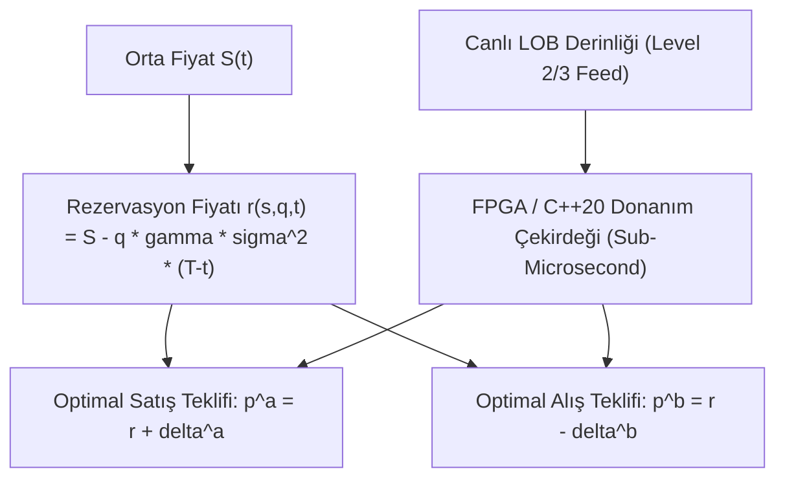

# 📈 Algoritmik Piyasa Yapıcılığı (Market Making), Limit Emir Defteri Dinamiği ve Yüksek Frekanslı İşlemler (HFT)
### *İleri FinTek, Yapay Zeka & Kantitatif Finans Araştırma Monografı (2026+)*

> *“Piyasada kazanan en zeki olan değil; en düşük bilgi asimetrisine ve en hızlı deterministik yürütmeye sahip olandır.”*

---

## 📌 1. Giriş ve Mikro-Yapı Paradigması

Modern elektronik finansal piyasalar, hisse ve dijital varlık fiyatlarının sürekli zamanlı bir Brown hareketinden ziyade, ayrık zamanlı mikro-saniyelik olay akışlarıyla güncellendiği **Limit Emir Defteri (Limit Order Book - LOB)** üzerinde çalışmaktadır.

**Yüksek Frekanslı İşlemler (High-Frequency Trading - HFT)** ve **Otonom Piyasa Yapıcılığı (Automated Market Making - AMM)**; alım-satım makasını (bid-ask spread) daraltarak likidite sağlayan, ancak enformasyon sahibi tüccarlara (informed traders) karşı envanter ve ters seçim (adverse selection) riski taşıyan stokastik optimizasyon problemleridir.

---

## 📐 2. Avellaneda-Stoikov Optimal Piyasa Yapıcı Modeli

Piyasa yapıcının orta piyasa fiyatı $S_t$, standart bir Brown hareketi $W_t$ ile modellenir:

$$dS_t = \sigma dW_t$$

Piyasa yapıcının alım ($p^b$) ve satım ($p^a$) teklifleri ile orta fiyat arasındaki farklar:

$$\delta^b = S - p^b, \quad \delta^a = p^a - S$$

Emirlerin gerçekleşme yoğunluğu $\lambda(\delta)$, teklif mesafesiyle üstel olarak azalır:

$$\lambda(\delta) = A e^{-k \delta}$$

### 2.1. Değer Fonksiyonu ve Hamilton-Jacobi-Bellman (HJB) Denklemi
Piyasa yapıcı, terminal servetini ve envanter riskini optimize eden fayda fonksiyonunu maksimize etmeye çalışır:

$$V(x, q, s, t) = \sup_{\delta^a, \delta^b} \mathbb{E}_t \left[ - e^{-\gamma (x_T + q_T S_T)} \right]$$

Burada $\gamma$ riskten kaçınma katsayısı, $q$ envanter miktarıdır. HJB denkleminin analitik çözümüyle elde edilen **Rezervasyon Fiyatı (Reservation Price $r(s, q, t)$)**:

$$r(s, q, t) \approx s - q \gamma \sigma^2 (T - t)$$

Optimal alım ve satım spread formülasyonu:

$$\delta^a + \delta^b = \frac{2}{\gamma} \ln\left(1 + \frac{\gamma}{k}\right) + (1 - 2q) \frac{\gamma \sigma^2 (T - t)}{2}$$

Bu formül şu temel piyasa yasasını ifade eder: *Envanter pozitifse ($q > 0$), piyasa yapıcı satışı teşvik etmek için hem alım hem satım fiyatlarını aşağı kaydırır.*

---

## ⚡ 3. Düşük Gecikmeli Yürütme Mimarisi: Donanım ve Çekirdek Düzeyi

Mikro-saniyelik rekabette yazılım katmanındaki bellek kopyalamaları ve işletim sistemi kesmeleri kabul edilemez:

1. **Kernel Bypass Teknolojileri:** Linux ağ yığınını atlayarak ağ kartından (NIC) doğrudan kullanıcı uzayına (user-space) DMA transferi sağlayan **Solarflare OpenOnload** ve **DPDK**.
2. **FPGA Tabanlı Emir Ayrıştırma:** NASDAQ ITCH ve FIX protokollerinin Xilinx UltraScale+ FPGA üzerinde doğrudan donanımsal mantık kapılarıyla ayrıştırılması ($< 80 \, \text{nanosaniye}$).
3. **C++20 Sıfır Bellek Tahsisi (Zero-Allocation):** `std::pmr::monotonic_buffer_resource` ve halka tamponları (ring buffers) ile kilitlenmesiz atomik veri kuyrukları.

---

## 🛡️ 4. Ters Seçim (Adverse Selection) ve VPIN Metriği

Toxik akışı (bilgilendirilmiş tüccarların piyasaya anlık büyük emirler boşaltması) tespit etmek için **VPIN (Volume-Synchronized Probability of Toxicity)** kullanılır:

$$\text{VPIN} = \frac{\sum_{\tau=1}^N |V_\tau^B - V_\tau^S|}{N \cdot V}$$

VPIN belirli bir kritik eşiği aştığında piyasa yapıcı algoritmaları likiditeyi anında geri çekerek "Flash Crash" zararlarından korunur.

---

## 🚀 5. Sonuç

FinTek yapay zekası; derin takviyeli öğrenme (Multi-Agent RL) modelleriyle piyasa mikro-dinamiklerini saniyede yüz binlerce kez modelleyerek modern dijital likiditenin omurgasını oluşturmaktadır.
