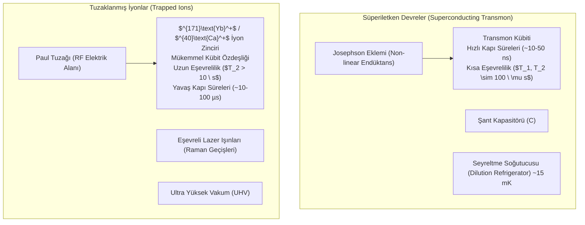

# ⚛️ Kuantum Hesaplama, Süperiletken Kübit Mimarileri ve Kuantum Hata Düzeltme (QEC)
### *İleri Kuantum Mühendisliği Araştırma Raporu & Donanım Monografı (2026+)*

> *“Doğa klasik değildir; eğer doğanın bir simülasyonunu yapmak istiyorsanız, onu kuantum mekaniği cinsinden inşa etmek zorundasınız.”* — **Richard Feynman**

---

## 📌 1. Giriş ve Kuantum Mekaniksel Postulatlar

Klasik bilişimin temel yapı birimi olan bit ($0$ veya $1$), kuantum mekaniğinde iki durumlu bir Hilbert uzayında yaşayan **kübit (qubit)** haline gelir:

$$|\psi\rangle = \alpha |0\rangle + \beta |1\rangle, \quad \alpha, \beta \in \mathbb{C}, \quad |\alpha|^2 + |\beta|^2 = 1$$

Bloch küresi üzerinde bir saf durumun parametrizasyonu:

$$|\psi\rangle = \cos\left(\frac{\theta}{2}\right) |0\rangle + e^{i\phi} \sin\left(\frac{\theta}{2}\right) |1\rangle, \quad \theta \in [0, \pi], \; \phi \in [0, 2\pi)$$

---

## 🧊 2. Kübit Fiziksel Gerçekleştirim Teknolojileri

Kuantum hesaplama alanında donanım ölçeğinde öne çıkan iki ana paradigma yarışmaktadır:



### 2.1. Transmon Kübiti Hamiltoniyeni
Klasik LC rezonatörü harmonik bir osilatördür ve enerji seviyeleri eşit aralıklıdır ($\Delta E = \hbar \omega$). Kübit olarak ilk iki seviyeyi ($|0\rangle$ ve $|1\rangle$) izole edebilmek için Josephson ekleminin doğrusal olmayan endüktansı kullanılır. Transmon Hamiltoniyeni:

$$\hat{H} = 4 E_C (\hat{n} - n_g)^2 - E_J \cos \hat{\phi}$$

Burada $E_C = \frac{e^2}{2C}$ şarj enerjisi, $E_J = \frac{I_c \Phi_0}{2\pi}$ Josephson enerjisidir. Yük gürültüsüne (charge noise) karşı dayanıklılık için $E_J / E_C \gg 1$ (genellikle $\approx 50 - 100$) rejimi seçilir. Anarmonisite:

$$\alpha = E_{12} - E_{01} \approx -E_C$$

---

## 🛡️ 3. Kuantum Hata Düzeltme (Quantum Error Correction) ve Yüzey Kodları

Klasik bilgisayarlarda yalnızca bit çevirme ($X$) hatası oluşurken, kuantum sistemlerinde faz çevirme ($Z$) hataları ve bunların sürekli kombinasyonları oluşur.

### 3.1. Pauli Hata Operatörleri
$$\sigma_X = \begin{pmatrix} 0 & 1 \\ 1 & 0 \end{pmatrix}, \quad \sigma_Z = \begin{pmatrix} 1 & 0 \\ 0 & -1 \end{pmatrix}, \quad \sigma_Y = i \sigma_X \sigma_Z = \begin{pmatrix} 0 & -i \\ i & 0 \end{pmatrix}$$

### 3.2. Yüzey Kodu (Surface Code / Toric Code)
Modern hata toleranslı kuantum bilgisayarların (FTQC) temel mimarisi, 2 boyutlu kare ızgara üzerine yerleştirilmiş veri kübitleri ve sendrom (yardımcı / ancilla) kübitlerine dayanır:

- **$X$-Tipi Dengeleyici (Vertex Operator):** $A_v = \prod_{i \in v} X_i$ (Faz çevirme hatalarını yakalar)
- **$Z$-Tipi Dengeleyici (Plaquette Operator):** $B_p = \prod_{j \in p} Z_j$ (Bit çevirme hatalarını yakalar)

Hata eşiği (Fault-Tolerance Threshold): İki kübitlik kapı hata payı $p < 1\%$ olduğunda, fiziksel kübit sayısı artırılarak mantıksal hata oranı üstel olarak sıfıra yaklaştırılabilir.

---

## 💻 4. Algoritmik Uygulama: VQE (Variational Quantum Eigensolver)

```python
"""
Moleküler Taban Durumu Enerjisi İçin VQE Kuantum-Klasik Hibrit Algoritması
"""
import numpy as np

def ansatz_circuit(params: np.ndarray) -> np.ndarray:
    """1-kübitlik Ry ve Rz rotasyonlarından oluşan parametrik durum."""
    theta, phi = params[0], params[1]
    # |psi(theta, phi)> = cos(theta/2)|0> + e^(i*phi)*sin(theta/2)|1>
    state = np.array([np.cos(theta / 2.0), np.exp(1j * phi) * np.sin(theta / 2.0)])
    return state

def expectation_value(hamiltonian: np.ndarray, state: np.ndarray) -> float:
    """<psi| H |psi> beklenen değerini hesapla."""
    return np.real(np.conj(state).T @ hamiltonian @ state)

def classical_optimizer_step(hamiltonian: np.ndarray, params: np.ndarray, lr: float = 0.1) -> np.ndarray:
    """Parametre Kaydırma Kuralı (Parameter-Shift Rule) ile analitik gradyan."""
    shift = np.pi / 2.0
    grad = np.zeros_like(params)
    
    for i in range(len(params)):
        params_plus = params.copy()
        params_minus = params.copy()
        params_plus[i] += shift
        params_minus[i] -= shift
        
        e_plus = expectation_value(hamiltonian, ansatz_circuit(params_plus))
        e_minus = expectation_value(hamiltonian, ansatz_circuit(params_minus))
        grad[i] = 0.5 * (e_plus - e_minus)
        
    return params - lr * grad
```

---

## 📚 5. Kanonik Kaynakça ve Temel Eserler

1. **Nielsen, M. A., & Chuang, I. L. (2010):** *“Quantum Computation and Quantum Information”*, Cambridge University Press.
2. **Koch, J. et al. (2007):** *“Charge-insensitive qubit design derived from the Cooper pair box”*, Physical Review A, 76(4), 042319.
3. **Fowler, A. G. et al. (2012):** *“Surface codes: Towards practical large-scale quantum computation”*, Physical Review A, 86(3), 032324.
4. **Preskill, J. (2018):** *“Quantum Computing in the NISQ era and beyond”*, Quantum, 2, 79.
5. **Google Quantum AI (2023):** *“Suppressing quantum errors by scaling a quantum error-correcting code”*, Nature, 614, 676-681.

---

## 🔬 6. Açık Kuantum Donanım Problemleri (2026+)

- **Kriyojenik Kontrol ve Kablolama Darboğazı:** 1 milyon fiziksel kübit için seyreltme buzdolabına girecek mikrodalga koaksiyel kablo yoğunluğu ve ısı yükü. Çözüm: Kriyojenik CMOS ($4 \ \text{K}$) entegre kontrol devreleri.
- **İki Kübitlik Kapı Sadakati (Two-Qubit Gate Fidelity):** Hata oranının $\%0.1$'in (CZ / iSWAP sadakatinin $\%99.9$) altına çekilmesi.
- **Kozmik Işınlar ve Quasiparticle Zehirlenmesi:** İyonlaştırıcı radyasyonun süperiletken filmlerde eşzamanlı çoklu kübit dekoheransına yol açmasının önlenmesi.
