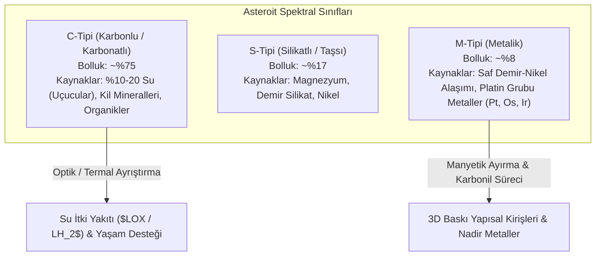
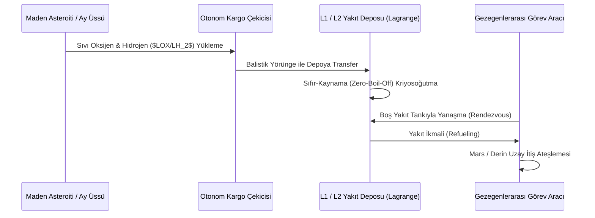

# 🪐 Asteroit Madenciliği, Yerinde Kaynak Kullanımı (ISRU) ve Yörüngesel Yakıt Depoları
### *İleri Uzay Madenciliği, Lojistik & Gezegenlerarası Ekonomi Monografı (2026+)*

> *“Dünya'nın derin kütleçekim kuyusundan uzaya fırlatılan her kilogram su ve yakıt, astronomik bir enerji israfıdır. Uzay endüstrisinin gerçek kırılma noktası; yapı malzemelerinin ve itki yakıtının bizzat uzayda, asteroitlerden ve Ay regolitinden üretildiği gün başlayacaktır.”*

---

## 📌 1. Giriş ve Tsiolkovsky Roket Denklemi Darboğazı

Konstantin Tsiolkovsky'nin roket denklemine göre, bir uzay aracının ulaşabileceği nihai hız değişimi ($\Delta v$):

$$\Delta v = I_{\text{sp}} g_0 \ln \left( \frac{m_0}{m_f} \right)$$

Burada $m_0$ kalkış kütlesi, $m_f$ nihai faydalı kütle, $I_{\text{sp}}$ ise motorun özgül itici kuvvetidir. Dünya yüzeyinden kaçış hızı ($v_{\text{esc}} \approx 11.2 \ \text{km/s}$) sağlamak için gereken yakıt kütlesi, faydalı yükün $\%90-95$'ini oluşturur.

**ISRU (In-Situ Resource Utilization - Yerinde Kaynak Kullanımı)** paradigması; yakıtı, suyu ve yapısal metalleri doğrudan Ay veya Yakın Dünya Asteroitlerinden (NEA) temin ederek Dünya'dan kalkış kütlesi ihtiyacını radikal şekilde düşürür.

---

## 🪨 2. Asteroit Sınıflandırması ve Madencilik Potansiyeli

---

## 🌙 3. Ay Regolitinden Oksijen ve Metal Üretimi

Ay yüzeyindeki regolit ağırlıkça yaklaşık **$\%40-45$ oksijen** içerir; ancak bu oksijen silikatlar ve metal oksitler ($\text{SiO}_2, \text{TiO}_2, \text{FeO}, \text{Al}_2\text{O}_3, \text{CaO}$) içinde kimyasal olarak hapsedilmiştir.

### 3.1. Erimiş Regolit Elektrolizi (Molten Regolith Electrolysis - MRE)
Regolit $1600^\circ\text{C}$'ye kadar eritilir ve doğrudan elektrik akımı verilerek oksijen gaz fazında serbest bırakılırken, erimiş metal alaşımları katotta çöker:

$$\text{Anot (+):} \quad 2\text{O}^{2-} \longrightarrow \text{O}_2 \uparrow + 4e^-$$

$$\text{Katot (-):} \quad (\text{Fe}^{2+}, \text{Si}^{4+}, \text{Ti}^{4+}, \text{Al}^{3+}) + n e^- \longrightarrow \text{Sıvı Metal Alaşımı}$$

Bu süreç hiçbir sarf malzemesi veya reaktif kimyasal gerektirmez; tek girdi saf elektrik enerjisidir (Güneş veya nükleer fisyon).

### 3.2. Kalıcı Gölgeli Kraterlerde (PSR) Su Buzu Hasadı
Ay'ın güney kutbunda (Shackleton krateri vb.) sıcaklığın $40 \ \text{K}$ ($-233^\circ\text{C}$) olduğu krater diplerinde hapsolmuş su buzu; konsantre güneş aynaları veya mikrodalga radyasyonu ile süblimleştirilerek soğuk tuzaklarda (cold traps) toplanır:

$$\text{Su Buzu } \xrightarrow{\text{Termal Süblimleşme}} \text{Su Buharı} \xrightarrow{\text{Kondansatör}} \text{Sıvı Su } \xrightarrow{\text{Elektroliz}} \text{LH}_2 + \text{LOX}$$

---

## ⛽ 4. Yörüngesel Yakıt İkmal Depoları (Orbital Propellant Depots)

---

## 📚 5. Kanonik Kaynakça

1. **Lewis, J. S. (2015):** *“Asteroid Mining 101: Wealth for the New Space Economy”*, Deep Space Industries.
2. **Gertsch, L. et al. (2008):** *“Extraction of volatiles from extraterrestrial bodies using concentrated solar thermal energy”*, Space Resources Roundtable.
3. **Sowers, G. F. (2021):** *“The economic viability of a lunar water mining architecture”*, Acta Astronautica, 187, 442-451.
4. **NASA (2020):** *“Lunar Living: In-Situ Resource Utilization (ISRU) Technology Plan”*, NASA Technical Reports.
5. **Kuck, D. L. (1995):** *“Contour mining of asteroids”*, Resources of Near-Earth Space, University of Arizona Press.
