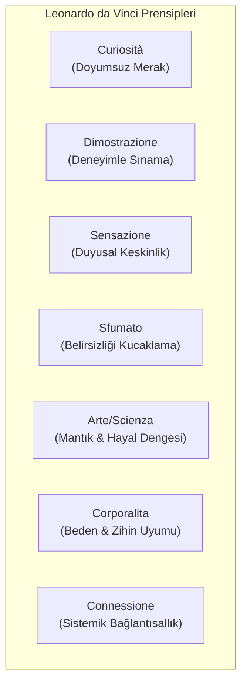

# 🌌 UNIVERSITY COURSES (UC)
### *Evrensel Akademik İşletim Sistemi & Solopreneur Bilgi Mimarisi* 🌐🧬🏗️

---

> *“Eğer daha uzağı görebildiysem, bu benden önceki devlerin omuzlarında durduğum içindir.”*  
> — **Sir Isaac Newton**

> *“İlim cesaret ister; cehaletin karanlığını sadece hakikatin sarsılmaz ışığı dağıtabilir.”*  
> — **El-Farabi**

> *“Basitlik, en üst düzeydeki gelişmişliktir.”*  
> — **Leonardo da Vinci**

> *“Bilim ve sanat, takdir edilmediği yerden göç eder.”*  
> — **İbn-i Sînâ**

> *“Evren her an gözlemimize açıktır; fakat onun dilini ve yazıldığı harfleri öğrenmeden anlaşılamaz. O dil matematiktir.”*  
> — **Galileo Galilei**

---

## 📜 EVRENSEL AKIL VE BİREYSEL EGEMENLİK MANİFESTOSU

**University Courses (UC)**; sıradan bir ders notu arşivi veya pasif bir dokümantasyon havuzu değildir. **Yüksek Kaldıraçlı Bireyin (Solopreneur Polymath) Zihinsel Karargâhı, Bilişsel İşletim Sistemi ve Epistemik Sermaye Mimarisi**dir.

Bilginin hızla çoğaldığı ama derinliğin, odaklanmanın ve sentez gücünün aşındığı modern bilgi çağında, asıl üstünlük bilginin ham hacminde değil; onun **bütüncül kavranışında, felsefi temellendirilişinde, zihinsel modellerle sentezlenmesinde ve somut katma değere dönüştürülme mimarisindedir.**

Eğitimi tek tip kalıpların, hantal bürokratik duvarların ve dar uzmanlaşma tuzaklarının ötesine taşıyarak; **İslam Altın Çağı'nın polimatik dehasını, Rönesans'ın evrensel araştırma merakını ve modern bilişim çağının yüksek teknoloji disiplinini** tek bir epistemik çatı altında birleştiriyoruz.

---

## 🏛️ BÜYÜK DÜŞÜNÜRLER VE POLİMATLAR PANTEONU (THE POLYMATH PANTHEON)

> *“Bütün bilimler birbirine bağlıdır; biri tam kavranmadan diğeri hakkıyla anlaşılamaz.”* — **Roger Bacon**

### 1. 🧪 Bilim, Matematik ve Doğa Felsefesi
*   > *“Matematik, doğanın gizli kalmış armonisini insan aklına tercüme eden ilahi dildir.”* — **Leonhard Euler**
*   > *“Doğa kanunları öylesine kusursuz bir simetriye sahiptir ki, onları keşfetmek adeta bir ibadettir.”* — **Johannes Kepler**
*   > *“Fizikte önemli olan gerçeği bulmaktır, popüler olanı değil.”* — **Richard Feynman**
*   > *“Evren, matematiksel bir düşünceden ibarettir.”* — **Sir James Jeans**
*   > *“Bir kuramın güzelliği, onun doğruluğunun en güçlü kanıtıdır.”* — **Paul Dirac**
*   > *“Matematik esas olarak sabır olayıdır. Ezberleyerek değil, keşfederek anlamak gerekir.”* — **Cahit Arf**
*   > *“Bilim yapmak sadece zeka işi değildir; bilakis büyük bir tutku, disiplin ve fedakarlık gerektirir.”* — **Aziz Sancar**
*   > *“Hayatta hiçbir şeyden korkmayın, yalnızca anlamaya çalışın. Şimdi daha fazlasını anlama ve daha az korkma zamanıdır.”* — **Marie Curie**
*   > *“Bana bir dayanak noktası verin, dünyayı yerinden oynatayım.”* — **Arşimet (Archimedes)**

### 2. 👁️ Epistemoloji, Mantık ve Zihin Mimarisi
*   > *“Zihin doldurulacak bir kap değil, tutuşturulacak bir meşaledir.”* — **Plutarkhos**
*   > *“Mantık, aklı hataya düşmekten koruyan bir terazi ve hakikatin mihenk taşıdır.”* — **İbn-i Sînâ**
*   > *“Aklını kullanma cesaretini göster! (Sapere Aude!)”* — **Immanuel Kant**
*   > *“Şüphe etmek düşünmektir; düşünmek ise var olmaktır.”* — **René Descartes**
*   > *“Dilimin sınırları, zihnimin evrenidir.”* — **Ludwig Wittgenstein**
*   > *“Hakikat arayışı, insanın kendi aklına ve vicdanına borçlu olduğu en asil vazifedir.”* — **İbn Rüşd (Averroes)**
*   > *“Özgürlük, aklın zorunlulukları kavraması ve ona göre eylemesidir.”* — **Baruch Spinoza**
*   > *“Bilim yanılabilir teorilerin cesurca öne sürülmesi ve onların acımasızca sınanması sürecidir.”* — **Karl Popper**
*   > *“Bildiğim tek şey, hiçbir şey bilmediğimdir.”* — **Sokrates**

### 3. ⚙️ Mühendislik, Sibernetik ve Hesaplama Zekası
*   > *“Makineler düşünebilir mi sorusu, denizaltılar yüzebilir mi sorusu kadar anlamsızdır.”* — **Edsger W. Dijkstra**
*   > *“Geleceği tahmin etmeye çalışma; geleceği kodla ve inşa et.”* — **Alan Kay**
*   > *“Entelektüel bir problemi çözmenin ilk adımı, onu çözülebilir alt bileşenlerine ayırmaktır.”* — **Claude Shannon**
*   > *“Mükemmellik, eklenecek bir şey kalmadığında değil, çıkarılacak bir şey kalmadığında elde edilir.”* — **Antoine de Saint-Exupéry**
*   > *“Bilgisayar bilimi, teleskopun astronomiyle ilişkisi neyse bilgisayarlarla o kadar ilgilidir; asıl mesele hesaplamanın doğasıdır.”* — **Hal Abelson**
*   > *“Yalnızca kısa bir mesafe ilerisini görebiliriz, ama orada yapılması gereken ne çok iş olduğunu açıkça fark ederiz.”* — **Alan Turing**
*   > *“Basit bir mekanizma tasarlamak karmaşık bir mekanizma tasarlamaktan yüz kat daha fazla zeka ister.”* — **El-Cezerî**
*   > *“Mühendislik, kaynakların sınırlı olduğu bir dünyada hayal gücünü gerçeğe dönüştürme disiplinidir.”* — **John von Neumann**
*   > *“Biz makineleri biçimlendiririz, sonra da makineler bizi biçimlendirir.”* — **Norbert Wiener**

### 4. ⚔️ Strateji, İrade ve Bilişsel Disiplin (Stoic & Strategic Mastery)
*   > *“Dış olayları kontrol edemezsin, ama kendi zihnini ve tepkilerini her an kontrol edebilirsin.”* — **Marcus Aurelius**
*   > *“Zorluklar olmasaydı, insanın büyüklüğü ve iradesi nasıl ortaya çıkardı?”* — **Epiktetos**
*   > *“Planlar hiçbir şeydir, lakin planlama her şeydir.”* — **Dwight D. Eisenhower**
*   > *“Stratejisi olmayan taktik, yenilgiden önceki son gürültüdür.”* — **Sun Tzu**
*   > *“Kendine hakim olan, tüm dünyaya hakim olur.”* — **Lao Tzu**
*   > *“Bin günlük eğitimle başlarsın, on bin günlük disiplinle ustalaşırsın.”* — **Miyamoto Musashi**
*   > *“Zihni sakinleştirmeden dünyayı fethedemezsiniz; en büyük savaş kendi dürtülerinizle yapılandır.”* — **Seneca**
*   > *“Beni öldürmeyen şey, beni daha güçlü kılar.”* — **Friedrich Nietzsche**
*   > *“Savaşta kuvvetten çok muhakeme, hırstan çok sükunet kazandırır.”* — **Carl von Clausewitz**

### 5. 🌌 Kozmoloji, Evren ve Varlık Düzeni
*   > *“Bir yerlerde inanılmaz bir şey keşfedilmeyi bekliyor.”* — **Carl Sagan**
*   > *“Evren hakkındaki en anlaşılmaz şey, onun anlaşılabilir olmasıdır.”* — **Albert Einstein**
*   > *“Ayaklarınızın altına değil, yıldızlara bakın. Gördüğünüz şeylerin mantığını anlamaya ve evrenin neden var olduğunu kavramaya çalışın.”* — **Stephen Hawking**
*   > *“Göklerin ilmi aklın kanatlarıdır; insan yıldızlara baktıkça kendi hakiki yerini idrak eder.”* — **Ali Kuşçu**
*   > *“Hakikat zamanın kızıdır; otoritenin değil.”* — **Giordano Bruno**
*   > *“Düşünce, bir kıvılcımdan ibarettir sonsuz karanlıkta; lakin her şeyi aydınlatan da o kıvılcımdır.”* — **Henri Poincaré**

### 6. 🎨 Estetik, Sanat ve Yaratıcı Deha
*   > *“Sanat, doğanın gizemlerini keşfetme ve görünmeyeni görünür kılma çabasıdır.”* — **Leonardo da Vinci**
*   > *“Sanat, ruhlarımızdaki günlük hayatın tozunu silip süpürür.”* — **Pablo Picasso**
*   > *“Güzellik, hakikatin parıltısıdır.”* — **Platon**
*   > *“Taşın içindeki heykeli görüyorum; tek yapmam gereken fazlalıkları yontup onu özgür bırakmak.”* — **Michelangelo**
*   > *“Bilmek yetmez, uygulamalıyız. İstemek yetmez, yapmalıyız.”* — **Johann Wolfgang von Goethe**
*   > *“Sanatçı, doğanın kölesi değil, onun sırdaşı ve tamamlayıcısıdır.”* — **John Ruskin**

### 7. 📜 Medeniyet, Tarihsel Dinamikler ve Toplum Kuramı
*   > *“Coğrafya kaderdir; lakin toplumların yükselişi ve çöküşü adalet, asabiyet ve üretim dengesine bağlıdır.”* — **İbn-i Haldun**
*   > *“Tarih, geleceğin haritasını geçmişin ışığıyla çizen en büyük kılavuzdur.”* — **Alexis de Tocqueville**
*   > *“İnsan, kendi yarattığı kurumların tutsağı olmamak için sürekli sorgulayan varlıktır.”* — **Max Weber**
*   > *“İşbölümü ve uzmanlaşma insanlığın zenginliğini artırır; lakin sentez gücü o zenginliğe ruh verir.”* — **Adam Smith**
*   > *“Medeniyetler dışarıdan fethedilmeden önce içeriden çözülürler.”* — **Arnold Toynbee**

### 8. 🧬 Biyoloji, Yaşamın Kodu ve Adaptasyon
*   > *“Hayatta kalanlar en güçlüler ya da en zekiler değil; değişime en hızlı ayak uydurabilenlerdir.”* — **Charles Darwin**
*   > *“Yaşam, entropinin kaosuna karşı düzen ve bilgi inşa etme sanatıdır.”* — **Erwin Schrödinger**
*   > *“Doğa acele etmez, yine de her şey vaktinde tamamlanır.”* — **Lao Tzu**
*   > *“Hücrelerimizin her birinde milyarlarca yıllık evrimsel mirasın şifresi saklıdır.”* — **Francis Crick**

---

## 🌟 TARİHİN BÜYÜK POLİMATLARININ ZİHİNSEL İLKELERİ

Evrensel dehaların düşünme ve üretme yöntemleri, bu repo mimarisinin ilham kaynağıdır:

*   **1. Leonardo da Vinci Modeli (Bütüncül Görsel & Mekanik Zeka):**
    *   *Curiosità:* Yaşam boyu kesintisiz öğrenme ve çocuksu merakı kaybetmeme.
    *   *Dimostrazione:* Bilgiyi deneyim ve pratik aracılığıyla test etme; dogmaları reddetme.
    *   *Connessione:* Görünüşte alakasız alanlar (anatomi, hidrolik, resim, müzik, harp sanatı) arasında yapısal örüntüler kurma.
*   **2. İbn-i Sînâ Modeli (Ansiklopedik Epistemoloji & Sentez):**
    *   Tıbbi gözlem ile Aristo mantığını ve metafiziği sentezleyerek dönemin tüm bilgisini *El-Kânûn fî't-Tıbb* ve *Kitâbü'ş-Şifâ* ile modülerleştirdi.
*   **3. Gottfried Wilhelm Leibniz Modeli (Evrensel Karakteristika):**
    *   Matematiksel kalkülüsü, felsefi monadolojiyi ve ikili sayı sistemini (binary) tek bir evrensel sembolik dil potasında eritti.
*   **4. Johann Wolfgang von Goethe Modeli (Morfolojik Düşünce):**
    *   Edebiyat şaheserleri üretirken aynı zamanda bitki morfolojisi, anatomi ve renk teorisi üzerine çığır açan bilimsel eserler verdi.
*   **5. Nikola Tesla Modeli (Zihinsel Simülasyon & Prototipleme):**
    *   Fikirleri fiziksel olarak üretmeden önce zihninde 3 boyutlu çalıştırıp aşınma paylarına kadar test etme yeteneği.

---

## 🧠 ZİHİNSEL MODELLER VE POLİMATİK DÜŞÜNCE ALET ÇANTASI

Modern polimatın zihinsel alet çantasında yer alan temel akıl yürütme modelleri:

| Zihinsel Model | Açıklama | Temsilci Düşünür |
| :--- | :--- | :--- |
| **First Principles (İlk İlkeler)** | Bir problemi kabullerden değil, temel doğa gerçeklerinden sıfırdan kurma | Aristoteles, Elon Musk |
| **Second-Order Thinking** | "Ve sonra ne olacak?" sorusuyla kararların dolaylı sonuçlarını analiz etme | Howard Marks, Frédéric Bastiat |
| **Inversion (Tersine Çevirme)** | Başarıyı nasıl elde edeceğini değil, başarısızlıktan nasıl kaçınacağını planlama | Carl Jacobi, Charlie Munger |
| **Systems Thinking (Sistem Düşüncesi)** | Parçaları değil, aralarındaki geri besleme döngülerini ve dinamikleri anlama | Norbert Wiener, Donella Meadows |
| **Occam's Razor (Ockham'ın Usturası)** | Eşit geçerlilikteki hipotezlerden en az varsayım içerenini tercih etme | William of Ockham |
| **Antifragility (Antikırılganlık)** | Şok ve stres altında kırılmak yerine güçlenen yapılar inşa etme | Nassim Nicholas Taleb |
| **Pareto İlkesi (80/20 Kuralı)** | Sonuçların %80'inin girdilerin %20'sinden kaynaklandığı kaldıraç odağı | Vilfredo Pareto |
| **Circle of Competence** | Gerçekte bildiğin ile bildiğini sandığın arasındaki sınırı net çizme | Warren Buffett, Richard Feynman |

---

## 📜 POLİMATIN 10 EPİSTEMİK AKSİYOMU

1. **Aksiyom I — Evrensel Bütünlük:** Hiçbir disiplin izole bir ada değildir; tüm bilimler, sanatlar ve teknikler aynı hakikat ağacının dallarıdır.
2. **Aksiyom II — İlk Prensipler Sadakati:** Ezberlenmiş analogiler yerine sistemin en temel aksiyomlarına inerek düşünün.
3. **Aksiyom III — Bimodal Yetkinlik:** Sol beynin analitik kesinliği (kod, matematik, fizik) ile sağ beynin sentetik derinliğini (felsefe, estetik, dil) birleştirin.
4. **Aksiyom IV — Yüksek Kaldıraç:** Zamanınızı sıfır marjinal maliyetle çoğaltılabilen bilgi, kod, medya ve sistem sermayesine yatırın.
5. **Aksiyom V — Antikırılgan Zihin:** Hataları felaket değil, veri kaynağı olarak konumlandırın; belirsizlikten güç kazanın.
6. **Aksiyom VI — Pratik Olmayan Bilgi Ölüdür:** Sadece tüketici değil, daima prototipleyen, üreten ve inşa eden bir solopreneur olun.
7. **Aksiyom VII — Zihinsel Netlik ve Sadelik:** Bir fikri 10 yaşındaki bir çocuğa basitçe anlatamıyorsanız, onu henüz tam kavramamışsınızdır.
8. **Aksiyom VIII — Stoik Zihinsel Hakimiyet:** Dış gürültüyü, sosyal onay arayışını ve geçici dikkat tuzaklarını susturun; derin odaklanmaya (Deep Work) sığının.
9. **Aksiyom IX — Sürekli Not Alma ve İkinci Beyin:** Zihninizi depolama alanı değil, fikir üretme fabrikası olarak kullanın; bilginizi bağlamsal bir ağda arşivleyin.
10. **Aksiyom X — Alçakgönüllü Merak:** Ne kadar çok bilirseniz bilin, bilmediklerinizin okyanusunda bir damla olduğunuzu unutmayın.

---

## ⚙️ SİSTEMATİK YAPI: 7-KADEMELİ STANDARTLAŞTIRILMIŞ PROTOKOL (00-06)

UAOS bünyesindeki her bir bilgi düğümü, çıraklıktan bağımsız üretim ustalığına kadar uzanan 7 kademeli bir omurga ile yönetilir:

> [!TIP]
> **Bilişsel Yolculuk:** `Veri ➔ Enformasyon ➔ Kuram ➔ Pratik ➔ İleri Uzmanlık ➔ AR-GE / Sentez ➔ Bağımsız Üretim`.

1. **`00 — Akademik Hazırlık ve Dil`**: Terminoloji, metodolojik kurulum ve küresel dil yetkinliği.
2. **`01 — Temel Bilimler ve Giriş`**: Aksiyomatik prensipler, doğa kanunları ve kuramsal omurga.
3. **`02 — Alan Dersleri ve Pratik`**: Disiplinin çekirdek müfredatı, laboratuvar ve problem çözümleri.
4. **`03 — Seçmeli & İleri Uzmanlık`**: Niş alanlar, derinleşme modülleri ve mikro-uzmanlıklar.
5. **`04 — Araştırma, AR-GE ve Sentez`**: Özgün projeler, açık kaynak kodlama ve Proof-of-Concept üretimi.
6. **`05 — Lisansüstü ve Akademik Kariyer`**: Literatür taraması, tez çalışmaları ve akademik yayın hazırlığı.
7. **`06 — Sertifikasyon ve Endüstriyel Standartlar`**: Uluslararası akreditasyonlar, ISO/IEEE normları ve sektörel yetkinlik.

---

## 📖 THE UNIVERSAL DISCIPLINE MATRIX (374 BÖLÜM / 2618 KADEME)

Tüm akademik ve profesyonel disiplinler açık, doğrudan erişilebilir ve yapılandırılmış 3-sütunlu ızgarada listelenmiştir.

### ⚔️ Savunma Sanayii, Harp Doktrini & Askeri Strateji (6 Alan)

> *“En büyük zafer, savaşmadan kazanılan zaferdir; strateji kuvvetten, akıl silahtan üstündür.” — **Sun Tzu***

> *“Savaş, siyasetin başka araçlarla devamıdır; hazırlıklı olan milletler barışın teminatıdır.” — **Carl von Clausewitz***

> *“Cesaret tehlike karşısında aklın sükunetini korumasıdır.” — **Plutarkhos***

> *“Kılıç kınındayken de caydırıcı olmalıdır; stratejist savaşı başlamadan zihninde bitirir.” — **Miyamoto Musashi***

> *“Hatt-ı müdafaa yoktur, sath-ı müdafaa vardır. O satıh bütün vatandır.” — **Mustafa Kemal Atatürk***

|   |   |   |
| :--- | :--- | :--- |
| [Askeri Havacilik Ve Uzay](./askeri_bilimler_ve_savunma_teknolojileri/askeri_havacilik_ve_uzay/) | [Askeri Istihbarat Analizi](./askeri_bilimler_ve_savunma_teknolojileri/askeri_istihbarat_analizi/) | [Deniz Harp Ve Su Alti Stratejileri](./askeri_bilimler_ve_savunma_teknolojileri/deniz_harp_ve_su_alti_stratejileri/) |
| [Komuta Kontrol Ve Strateji](./askeri_bilimler_ve_savunma_teknolojileri/komuta_kontrol_ve_strateji/) | [Savunma Yonetimi Ve Lojistik](./askeri_bilimler_ve_savunma_teknolojileri/savunma_yonetimi_ve_lojistik/) | [Siber Savunma Ve Elektronik Harp](./askeri_bilimler_ve_savunma_teknolojileri/siber_savunma_ve_elektronik_harp/) |

---

### 📚 Filoloji, Dilbilim & Dünya Edebiyatı (17 Alan)

> *“Dilimin sınırları, dünyamın sınırlarıdır; kelimeler düşüncenin yaşayan heykelleridir.” — **Ludwig Wittgenstein***

> *“Bir dili bilmek bir insan olmaktır, iki dil bilmek iki insan olmaktır.” — **Johann Wolfgang von Goethe***

> *“Kitaplar, zamanın dalgaları üzerinde yüzen ve nesilden nesle değer taşıyan düşünce gemileridir.” — **Francis Bacon***

> *“Dil, insan zihninin sonsuz sayıda düşünceyi sınırlı sayıda sesle ifade etme mucizesidir.” — **Noam Chomsky***

> *“Okumak, geçmiş yüzyılların en erdemli insanlarıyla sohbet etmektir.” — **René Descartes***

|   |   |   |
| :--- | :--- | :--- |
| [Alman Dili Ve Edebiyati](./edebiyat_ve_diller/alman_dili_ve_edebiyati/) | [Arap Dili Ve Edebiyati](./edebiyat_ve_diller/arap_dili_ve_edebiyati/) | [Cin Dili Ve Edebiyati](./edebiyat_ve_diller/cin_dili_ve_edebiyati/) |
| [Cin Klasik Calismalari](./edebiyat_ve_diller/cin_klasik_calismalari/) | [Dogu Kulturleri Ve Bolge Arastirmalari](./edebiyat_ve_diller/dogu_kulturleri_ve_bolge_arastirmalari/) | [Fars Dili Ve Edebiyati](./edebiyat_ve_diller/fars_dili_ve_edebiyati/) |
| [Fransiz Dili Ve Edebiyati](./edebiyat_ve_diller/fransiz_dili_ve_edebiyati/) | [Hititoloji](./edebiyat_ve_diller/hititoloji/) | [Ingiliz Dili Ve Edebiyati](./edebiyat_ve_diller/ingiliz_dili_ve_edebiyati/) |
| [Ispanyol Dili Ve Edebiyati](./edebiyat_ve_diller/ispanyol_dili_ve_edebiyati/) | [Italyan Dili Ve Edebiyati](./edebiyat_ve_diller/italyan_dili_ve_edebiyati/) | [Japon Dili Ve Edebiyati](./edebiyat_ve_diller/japon_dili_ve_edebiyati/) |
| [Kore Dili Ve Edebiyati](./edebiyat_ve_diller/kore_dili_ve_edebiyati/) | [Mutercim Ve Tercumanlik](./edebiyat_ve_diller/mutercim_ve_tercumanlik/) | [Rus Dili Ve Edebiyati](./edebiyat_ve_diller/rus_dili_ve_edebiyati/) |
| [Sumeroloji](./edebiyat_ve_diller/sumeroloji/) | [Turk Dili Ve Edebiyati](./edebiyat_ve_diller/turk_dili_ve_edebiyati/) |   |

---

### 👁️ Epistemik Vizyon & Bilgi Felsefesi (3 Alan)

> *“Bilgi bir ışıktır; onu samimiyetle arayan zihin karanlıkta kalmaz. Hakikatin peşinde olmak en yüce insanlık görevidir.” — **El-Bîrûnî***

> *“Bütün insanlar doğal olarak bilmek isterler. Bilgelik, ilk ilkelerin ve nedenlerin bilimidir.” — **Aristoteles***

> *“Kendini bilmek, tüm bilgeliğin başlangıcıdır.” — **Sokrates***

> *“Hakikat akılla keşfedilir; mantık ise o hakikatin yol gösterici feneridir.” — **İbn Rüşd (Averroes)***

> *“Düşünceler kavramlar olmaksızın boş, sezgiler kavramlar olmaksızın kördür.” — **Immanuel Kant***

|   |   |   |
| :--- | :--- | :--- |
| [Bilgi Ontolojisi](./epistemik/bilgi_ontolojisi/) | [Felsefi Sorgulama](./epistemik/felsefi_sorgulama/) | [Zihin Mimarisi](./epistemik/zihin_mimarisi/) |

---

### 📂 Genel Metodoloji, Arşiv & Ortak Alanlar (3 Alan)

> *“Bütün büyük işler, küçük ve disiplinli adımların kararlılıkla bir araya gelmesiyle gerçekleşir.” — **Vincent van Gogh***

> *“Damlayan su taşı deler; gücünden değil, sürekliliğinden.” — **Ovidius***

> *“Yolculuğun kendisi varış noktasından daha öğreticidir.” — **Konfüçyüs***

> *“Kendi başına düşünmeyi öğrenmemiş insan, başkalarının fikirlerinin hamalı olur.” — **Arthur Schopenhauer***

> *“Dünyada en güç şey, insanın kendini bilmesi ve tanımasıdır.” — **Thales***

|   |   |   |
| :--- | :--- | :--- |
| [Afet Yonetimi Ve Acil Durum Teknolojileri](./genel/afet_yonetimi_ve_acil_durum_teknolojileri/) | [Erasmus Ve Global Degisim Programlari](./genel/erasmus_ve_global_degisim_programlari/) | [Staj Ve Profesyonel Is Hayati Giris](./genel/staj_ve_profesyonel_is_hayati_giris/) |

---

### 🖼️ Güzel Sanatlar, Estetik & Görsel Kültür (8 Alan)

> *“Sanat, doğanın gizemlerini keşfetme ve görünmeyeni görünür kılma çabasıdır.” — **Leonardo da Vinci***

> *“Sanat, ruhlarımızdaki günlük hayatın tozunu silip süpürür.” — **Pablo Picasso***

> *“Güzellik, hakikatin parıltısıdır.” — **Platon***

> *“Sanatçı olmak, kendi gözleriyle görmek ve kalbiyle hissetmektir.” — **Auguste Rodin***

> *“Sanat, insanın doğayla kurduğu en derin ve en kutsal diyalogdur.” — **John Ruskin***

|   |   |   |
| :--- | :--- | :--- |
| [Dijital Tiyatro](./guzel_sanatlar/dijital_tiyatro/) | [El Sanatlari](./guzel_sanatlar/el_sanatlari/) | [Fotograf](./guzel_sanatlar/fotograf/) |
| [Geleneksel Cin Operasi Ve Muzigi](./guzel_sanatlar/geleneksel_cin_operasi_ve_muzigi/) | [Geleneksel Turk Sanatlari](./guzel_sanatlar/geleneksel_turk_sanatlari/) | [Guzel Sanatlar Arastirma](./guzel_sanatlar/guzel_sanatlar_arastirma/) |
| [Heykel](./guzel_sanatlar/heykel/) | [Resim](./guzel_sanatlar/resim/) |   |

---

### ⚖️ Adalet, Hukuk Kuramı & Yasal Düzen (2 Alan)

> *“Adalet mülkün temelidir; hukukun bittiği yerde tiranlık, karmaşa ve haksızlık başlar.” — **John Locke***

> *“Devletin nihai amacı özgürlüktür; adalet ise o özgürlüğün koruyucu kalkanıdır.” — **Baruch Spinoza***

> *“Hukuk, aklın tutkulardan arınmış sesidir.” — **Aristoteles***

> *“Bir tek kişiye yapılan haksızlık, bütün topluma yöneltilmiş bir tehdittir.” — **Montesquieu***

> *“Kanunların kuvveti, halkın vicdanında bulduğu yankı kadardır.” — **Cicero***

|   |   |   |
| :--- | :--- | :--- |
| [Deniz Hukuku Ve Stratejisi](./hukuk_bilimi/deniz_hukuku_ve_stratejisi/) | [Hukuk](./hukuk_bilimi/hukuk/) |   |

---

### 📚 İlahiyat, Dinler Tarihi & Karşılaştırmalı Felsefe (1 Alan)

> *“İlim ilim bilmektir, ilim kendin bilmektir; sen kendini bilmezsin, ya nice okumaktır.” — **Yunus Emre***

> *“Aklını kullanmayanların üzerine pislik yağar.” — **Yunus Suresi, 100***

> *“Hakikat nereden gelirse gelsin onu kabul etmek gerekir; hakikatten daha değerli bir şey yoktur.” — **El-Kindî***

> *“Dünle beraber gitti cancağızım, ne kadar söz varsa düne ait; şimdi yeni şeyler söylemek lazım.” — **Mevlana Celaleddin-i Rumi***

> *“Kalp gözüyle görmeyen akıl, hakikatin derinliğini kavrayamaz.” — **İmam Gazali***

|   |   |   |
| :--- | :--- | :--- |
| [Ilahiyat](./ilahiyat_ve_din/ilahiyat/) |   |   |

---

### 📡 İletişim, Medya Ekolojisi & Dijital Anlatı (4 Alan)

> *“Ortam, mesajın ta kendisidir; insan iletişim kurduğu ve anlam ürettiği ölçüde var olur.” — **Marshall McLuhan***

> *“İletişimdeki en büyük sorun, anlaşıldığı yanılsamasıdır.” — **George Bernard Shaw***

> *“Doğru söz etkileyicidir, ama yerinde bir sükût hiçbir söze değişilmez.” — **Mark Twain***

> *“Haber basıldığında gerçeğin yerini alır; medyanın mimarisi kamusal zihni inşa eder.” — **Walter Lippmann***

> *“Televizyon ve dijital ekranlar bizi bilgilendirmez, eğlendirerek uyuşturur; hakiki bilgi derin tefekkür ister.” — **Neil Postman***

|   |   |   |
| :--- | :--- | :--- |
| [Gazetecilik](./iletisim/gazetecilik/) | [Halkla Iliskiler Ve Reklamcilik](./iletisim/halkla_iliskiler_ve_reklamcilik/) | [Radyo Televizyon Ve Sinema](./iletisim/radyo_televizyon_ve_sinema/) |
| [Yeni Medya Ve İletişim](./iletisim/yeni_medya_ve_iletisim/) |   |   |

---

### 🚀 Kariyer, Portfolyo, Standartlar & Sertifikasyon (12 Alan)

> *“Şans, yalnızca hazırlıklı ve yetkin zihinlere güler; profesyonel ustalık kesintisiz inşa edilir.” — **Louis Pasteur***

> *“Kalite bir eylem değil, bir alışkanlıktır.” — **Will Durant (Aristoteles yorumu)***

> *“Yaptığınız işi mükemmel yapın; öyle ki insanlar sizi görmezden gelemesin.” — **Steve Martin***

> *“Geleceği tahmin etmenin en iyi yolu onu inşa etmektir; verimli çalışan bir kariyer sistemli alışkanlıkların eseridir.” — **Peter Drucker***

> *“Bilgiye yapılan yatırım her zaman en yüksek faizi öder.” — **Benjamin Franklin***

|   |   |   |
| :--- | :--- | :--- |
| [Aws Certified Architect](./kariyer_ve_sertifikasyonlar/aws_certified_architect/) | [Cfa Chartered Financial Analyst](./kariyer_ve_sertifikasyonlar/cfa_chartered_financial_analyst/) | [Cisco Ccna Ccnp](./kariyer_ve_sertifikasyonlar/cisco_ccna_ccnp/) |
| [Comptia A Plus Sec Plus](./kariyer_ve_sertifikasyonlar/comptia_a_plus_sec_plus/) | [Delf Dalf Fransizca](./kariyer_ve_sertifikasyonlar/delf_dalf_fransizca/) | [Goethe Zertifikat Almanca](./kariyer_ve_sertifikasyonlar/goethe_zertifikat_almanca/) |
| [Google Cloud Professional](./kariyer_ve_sertifikasyonlar/google_cloud_professional/) | [Itil V4 Foundation](./kariyer_ve_sertifikasyonlar/itil_v4_foundation/) | [Microsoft Azure Solutions](./kariyer_ve_sertifikasyonlar/microsoft_azure_solutions/) |
| [Pmp Proje Yonetimi](./kariyer_ve_sertifikasyonlar/pmp_proje_yonetimi/) | [Six Sigma Green Black Belt](./kariyer_ve_sertifikasyonlar/six_sigma_green_black_belt/) | [Toefl Ielts Ingilizce](./kariyer_ve_sertifikasyonlar/toefl_ielts_ingilizce/) |

---

### 🛠️ Mühendislik & İleri Teknoloji Bilimleri (64 Alan)

> *“Bilim insanları var olan dünyayı inceler; mühendisler ise daha önce hiç var olmamış dünyaları yaratır.” — **Theodore von Kármán***

> *“Bir makine insan emeğini hafifletmiyorsa ve zihni özgürleştirmiyorsa, sadece karmaşık bir demir yığınıdır.” — **Nikola Tesla***

> *“Mühendislik, bilimi insanlığın refahı için gerçeğe dönüştürme sanatıdır.” — **Neil Armstrong***

> *“Uygulamaya dökülmeyen tasarım zihinde bir hayalden ibarettir; hakiki mühendislik çalışan mekanizmadır.” — **El-Cezerî***

> *“Bir araya gelmek bir başlangıçtır, beraberliği sürdürmek bir ilerlemedir, birlikte çalışmak ise gerçek başarıdır.” — **Henry Ford***

|   |   |   |
| :--- | :--- | :--- |
| [Adli Bilişim Mühendisliği](./meta_muhendislik/adli_bilisim_muhendisligi/) | [Akilli Gorsel Isitsel Muhendislik](./meta_muhendislik/akilli_gorsel_isitsel_muhendislik/) | [Akilli Molekuler Muhendislik](./meta_muhendislik/akilli_molekuler_muhendislik/) |
| [Akilli Sebeke Bilgi Ve Mühendisliği](./meta_muhendislik/akilli_sebeke_bilgi_ve_muhendisligi/) | [Ambalaj Mühendisliği](./meta_muhendislik/ambalaj_muhendisligi/) | [Basim Teknolojileri](./meta_muhendislik/basim_teknolojileri/) |
| [Beyin Bilgisayar Arayuzu Bci Mühendisliği](./meta_muhendislik/beyin_bilgisayar_arayuzu_bci_muhendisligi/) | [Bilgisayar Mühendisliği](./meta_muhendislik/bilgisayar_muhendisligi/) | [Bilişim Sistemleri Mühendisliği](./meta_muhendislik/bilisim_sistemleri_muhendisligi/) |
| [Biyokimya Mühendisliği](./meta_muhendislik/biyokimya_muhendisligi/) | [Biyomedikal Mühendisliği](./meta_muhendislik/biyomedikal_muhendisligi/) | [Biyosistem Mühendisliği](./meta_muhendislik/biyosistem_muhendisligi/) |
| [Cevher Hazirlama Mühendisliği](./meta_muhendislik/cevher_hazirlama_muhendisligi/) | [Cevre Mühendisliği](./meta_muhendislik/cevre_muhendisligi/) | [Deniz Ulastirma İşletme Mühendisliği](./meta_muhendislik/deniz_ulastirma_isletme_muhendisligi/) |
| [Deri Mühendisliği](./meta_muhendislik/deri_muhendisligi/) | [Dusuk Irtifa Teknolojisi Ve Iha](./meta_muhendislik/dusuk_irtifa_teknolojisi_ve_iha/) | [Elektrik Elektronik Mühendisliği](./meta_muhendislik/elektrik_elektronik_muhendisligi/) |
| [Elektronik Ve Haberlesme Mühendisliği](./meta_muhendislik/elektronik_ve_haberlesme_muhendisligi/) | [Endustri Mühendisliği](./meta_muhendislik/endustri_muhendisligi/) | [Endustriyel Tasarim Mühendisliği](./meta_muhendislik/endustriyel_tasarim_muhendisligi/) |
| [Enerji Sistemleri Mühendisliği](./meta_muhendislik/enerji_sistemleri_muhendisligi/) | [Finans Mühendisliği](./meta_muhendislik/finans_muhendisligi/) | [Fizik Mühendisliği](./meta_muhendislik/fizik_muhendisligi/) |
| [Gemi İnşaati Ve Gemi Makineleri Mühendisliği](./meta_muhendislik/gemi_insaati_ve_gemi_makineleri_muhendisligi/) | [Gemi Makineleri İşletme Mühendisliği](./meta_muhendislik/gemi_makineleri_isletme_muhendisligi/) | [Geomatik Mühendisliği](./meta_muhendislik/geomatik_muhendisligi/) |
| [Gida Mühendisliği](./meta_muhendislik/gida_muhendisligi/) | [Harita Mühendisliği](./meta_muhendislik/harita_muhendisligi/) | [Havacilik Ve Uzay Mühendisliği](./meta_muhendislik/havacilik_ve_uzay_muhendisligi/) |
| [Imalat Mühendisliği](./meta_muhendislik/imalat_muhendisligi/) | [İnşaat Mühendisliği](./meta_muhendislik/insaat_muhendisligi/) | [Ipek Mühendisliği Ve Serikultur](./meta_muhendislik/ipek_muhendisligi_ve_serikultur/) |
| [İşletme Mühendisliği](./meta_muhendislik/isletme_muhendisligi/) | [Jeofizik Mühendisliği](./meta_muhendislik/jeofizik_muhendisligi/) | [Jeoloji Mühendisliği](./meta_muhendislik/jeoloji_muhendisligi/) |
| [Kagit Bilimi Ve Mühendisliği](./meta_muhendislik/kagit_bilimi_ve_muhendisligi/) | [Karbon Notr Bilimi Ve Teknolojisi](./meta_muhendislik/karbon_notr_bilimi_ve_teknolojisi/) | [Kimya Mühendisliği](./meta_muhendislik/kimya_muhendisligi/) |
| [Kontrol Ve Otomasyon Mühendisliği](./meta_muhendislik/kontrol_ve_otomasyon_muhendisligi/) | [Maden Mühendisliği](./meta_muhendislik/maden_muhendisligi/) | [Makine Mühendisliği](./meta_muhendislik/makine_muhendisligi/) |
| [Matematik Mühendisliği](./meta_muhendislik/matematik_muhendisligi/) | [Mekatronik Mühendisliği](./meta_muhendislik/mekatronik_muhendisligi/) | [Metalurji Ve Malzeme Mühendisliği](./meta_muhendislik/metalurji_ve_malzeme_muhendisligi/) |
| [Mikro Nano Sistemler Ve Mems](./meta_muhendislik/mikro_nano_sistemler_ve_mems/) | [Modelleme Ve Simulasyon](./meta_muhendislik/modelleme_ve_simulasyon/) | [Nanoteknoloji Mühendisliği](./meta_muhendislik/nanoteknoloji_muhendisligi/) |
| [Nukleer Enerji Mühendisliği](./meta_muhendislik/nukleer_enerji_muhendisligi/) | [Orman Mühendisliği](./meta_muhendislik/orman_muhendisligi/) | [Otomotiv Mühendisliği](./meta_muhendislik/otomotiv_muhendisligi/) |
| [Rayli Sistemler Mühendisliği](./meta_muhendislik/rayli_sistemler_muhendisligi/) | [Seramik Tasarimi Ve Mühendisliği](./meta_muhendislik/seramik_tasarimi_ve_muhendisligi/) | [Siber Guvenlik Mühendisliği](./meta_muhendislik/siber_guvenlik_muhendisligi/) |
| [Su Urunleri Mühendisliği](./meta_muhendislik/su_urunleri_muhendisligi/) | [Tarim Makineleri Ve Teknolojileri Mühendisliği](./meta_muhendislik/tarim_makineleri_ve_teknolojileri_muhendisligi/) | [Tekstil Mühendisliği](./meta_muhendislik/tekstil_muhendisligi/) |
| [Ucak Mühendisliği](./meta_muhendislik/ucak_muhendisligi/) | [Ulaşım Mühendisliği](./meta_muhendislik/ulasim_muhendisligi/) | [Uzay Zaman Bilgi Mühendisliği](./meta_muhendislik/uzay_zaman_bilgi_muhendisligi/) |
| [Yapay Zeka Ve Veri Mühendisliği](./meta_muhendislik/yapay_zeka_ve_veri_muhendisligi/) | [Yazilim Mühendisliği](./meta_muhendislik/yazilim_muhendisligi/) | [Yuksek Guclu Yariiletken Bilimi Ve Mühendisliği](./meta_muhendislik/yuksek_guclu_yariiletken_bilimi_ve_muhendisligi/) |
| [Ziraat Mühendisliği](./meta_muhendislik/ziraat_muhendisligi/) |   |   |

---

### 🧠 Meta-Zihin, Otonom İrade & Bilişsel Disiplin (8 Alan)

> *“Düşünceleriniz ne ise hayatınız da odur; kendi zihnini yöneten, tüm dünyaya yön verir.” — **Marcus Aurelius***

> *“İnsanın en büyük zaferi, kendi nefsine ve zaaflarına karşı kazandığı zaferdir.” — **Platon***

> *“Rüzgarın yönünü değiştiremezsiniz, ancak yelkenlerinizi hedefinize göre ayarlayabilirsiniz.” — **Epiktetos***

> *“Yaşamak için bir 'neden'i olan insan, her türlü 'nasıl'a katlanabilir.” — **Friedrich Nietzsche / Viktor Frankl***

> *“Disiplin, neyi en çok istediğin ile şu anda neyi istediğin arasındaki seçimdir.” — **Abraham Lincoln***

|   |   |   |
| :--- | :--- | :--- |
| [Finansal Okuryazarlik Ve Yatirim](./meta_yetkinlikler_ve_gelisim/finansal_okuryazarlik_ve_yatirim/) | [Hizli Ogrenme Teknikleri](./meta_yetkinlikler_ve_gelisim/hizli_ogrenme_teknikleri/) | [Liderlik Ve Ekip Yonetimi](./meta_yetkinlikler_ve_gelisim/liderlik_ve_ekip_yonetimi/) |
| [Monk Mode Disiplin Sistemi](./meta_yetkinlikler_ve_gelisim/monk_mode_disiplin_sistemi/) | [Muzakere Ve Ikna Sanati](./meta_yetkinlikler_ve_gelisim/muzakere_ve_ikna_sanati/) | [Stoisizm Ve Mental Dayaniklilik](./meta_yetkinlikler_ve_gelisim/stoisizm_ve_mental_dayaniklilik/) |
| [Sun Tzu Stratejik Dusunce](./meta_yetkinlikler_ve_gelisim/sun_tzu_stratejik_dusunce/) | [Zaman Yonetimi Ve U U](./meta_yetkinlikler_ve_gelisim/zaman_yonetimi_ve_u_u/) |   |

---

### 🏛️ Mimarlık, Tasarım & Mekânsal Şehircilik (15 Alan)

> *“Mimarlık, taşın ve ışığın sessiz şiiridir; mekân ise insan ruhunun biçim bulmuş halidir.” — **Mimar Sinan***

> *“Biçim daima işlevi takip eder; bu doğanın en temel yasasıdır.” — **Louis Sullivan***

> *“Bir binayı tasarlarken, geleceğin hatıralarını inşa edersiniz.” — **Juhani Pallasmaa***

> *“İyi mimarlık sağlamlık, işlevsellik ve güzellik üçlüsünün kusursuz dengesidir.” — **Vitruvius***

> *“Mimarlık, ışık altında bir araya getirilmiş kütlelerin ustaca, doğru ve görkemli oyunudur.” — **Le Corbusier***

|   |   |   |
| :--- | :--- | :--- |
| [Cizgi Film Ve Animasyon](./mimarlik_ve_tasarim/cizgi_film_ve_animasyon/) | [Endustriyel Tasarim](./mimarlik_ve_tasarim/endustriyel_tasarim/) | [Gorsel İletişim Tasarimi](./mimarlik_ve_tasarim/gorsel_iletisim_tasarimi/) |
| [Grafik Tasarimi](./mimarlik_ve_tasarim/grafik_tasarimi/) | [Ic Mimarlik Ve Cevre Tasarimi](./mimarlik_ve_tasarim/ic_mimarlik_ve_cevre_tasarimi/) | [Kultur Varliklarini Koruma Ve Onarim](./mimarlik_ve_tasarim/kultur_varliklarini_koruma_ve_onarim/) |
| [Kuyumculuk Ve Mucevher Tasarimi](./mimarlik_ve_tasarim/kuyumculuk_ve_mucevher_tasarimi/) | [Mimarlik](./mimarlik_ve_tasarim/mimarlik/) | [Mucevherat Ve Degerli Tas Bilimi](./mimarlik_ve_tasarim/mucevherat_ve_degerli_tas_bilimi/) |
| [Muzik](./mimarlik_ve_tasarim/muzik/) | [Peyzaj Mimarligi](./mimarlik_ve_tasarim/peyzaj_mimarligi/) | [Sehir Ve Bolge Planlama](./mimarlik_ve_tasarim/sehir_ve_bolge_planlama/) |
| [Seramik Ve Cam Tasarimi](./mimarlik_ve_tasarim/seramik_ve_cam_tasarimi/) | [Tekstil Ve Moda Tasarimi](./mimarlik_ve_tasarim/tekstil_ve_moda_tasarimi/) | [Tiyatro Oyunculuk](./mimarlik_ve_tasarim/tiyatro_oyunculuk/) |

---

### 🎓 Eğitim Fakültesi, Pedagoji & Didaktik (16 Alan)

> *“Bana bir harf öğretenin kırk yıl kölesi olurum; zira akılları inşa edenler medeniyetin hakiki mimarlarıdır.” — **Hz. Ali***

> *“Eğitim, dünyayı değiştirmek için kullanabileceğiniz en güçlü silahtır.” — **Nelson Mandela***

> *“Öğretmek, iki kez öğrenmektir.” — **Joseph Joubert***

> *“Eğitim hayata hazırlık değildir; eğitimin kendisi doğrudan hayatın ta kendisidir.” — **John Dewey***

> *“Çocuğa gösterilen hürmet, insanlığın geleceğine duyulan saygıdır.” — **Maria Montessori***

|   |   |   |
| :--- | :--- | :--- |
| [Beden Eğitimi Ve Spor Öğretmenliği](./ogretmenlik/beden_egitimi_ve_spor_ogretmenligi/) | [Bilgisayar Ve Ogretim Teknolojileri Eğitimi](./ogretmenlik/bilgisayar_ve_ogretim_teknolojileri_egitimi/) | [Din Kulturu Ve Ahlak Bilgisi Öğretmenliği](./ogretmenlik/din_kulturu_ve_ahlak_bilgisi_ogretmenligi/) |
| [Egitim Yonetimi](./ogretmenlik/egitim_yonetimi/) | [Fen Bilgisi Öğretmenliği](./ogretmenlik/fen_bilgisi_ogretmenligi/) | [Ilkogretim Matematik Öğretmenliği](./ogretmenlik/ilkogretim_matematik_ogretmenligi/) |
| [Ingilizce Öğretmenliği](./ogretmenlik/ingilizce_ogretmenligi/) | [Muzik Öğretmenliği](./ogretmenlik/muzik_ogretmenligi/) | [Okul Oncesi Öğretmenliği](./ogretmenlik/okul_oncesi_ogretmenligi/) |
| [Ozel Egitim Öğretmenliği](./ogretmenlik/ozel_egitim_ogretmenligi/) | [Rehberlik Ve Psikolojik Danismanlik](./ogretmenlik/rehberlik_ve_psikolojik_danismanlik/) | [Resim Is Öğretmenliği](./ogretmenlik/resim_is_ogretmenligi/) |
| [Saglik Bilgisi Öğretmenliği](./ogretmenlik/saglik_bilgisi_ogretmenligi/) | [Sinif Öğretmenliği](./ogretmenlik/sinif_ogretmenligi/) | [Sosyal Bilgiler Öğretmenliği](./ogretmenlik/sosyal_bilgiler_ogretmenligi/) |
| [Turkce Öğretmenliği](./ogretmenlik/turkce_ogretmenligi/) |   |   |

---

### 📋 Mesleki Yüksekokul & Uygulamalı Teknik Disiplinler (72 Alan)

> *“Uygulamaya dökülmeyen bilgi bir yüktür; maharet ve teknik ustalık teorinin can damarıdır.” — **El-Cezerî***

> *“Bir işi iyi yapmak, ona ruhunu ve emeğini katmak demektir; hak ile sabır dileyip usta olan pirdir.” — **Ahi Evran***

> *“Bana anlatırsan unuturum, gösterirsen hatırlarım, yaptırırsan anlarım.” — **Konfüçyüs***

> *“Kalite, kimse bakmadığı zaman bile işi doğru yapmaktır.” — **Henry Ford***

> *“Ölçemediğiniz şeyi yönetemez ve geliştiremezsiniz.” — **W. Edwards Deming***

|   |   |   |
| :--- | :--- | :--- |
| [Adalet](./on_lisans_programlari/adalet/) | [Agiz Ve Dis Sağlığı](./on_lisans_programlari/agiz_ve_dis_sagligi/) | [Aricilik](./on_lisans_programlari/aricilik/) |
| [Asansor Teknolojisi](./on_lisans_programlari/asansor_teknolojisi/) | [Ascilik](./on_lisans_programlari/ascilik/) | [Atik Yonetimi](./on_lisans_programlari/atik_yonetimi/) |
| [Avcilik Ve Yaban Hayati](./on_lisans_programlari/avcilik_ve_yaban_hayati/) | [Bagcilik](./on_lisans_programlari/bagcilik/) | [Bankacilik Ve Sigortacilik](./on_lisans_programlari/bankacilik_ve_sigortacilik/) |
| [Bankacilik Ve Sigortacilik Onlisans](./on_lisans_programlari/bankacilik_ve_sigortacilik_onlisans/) | [Bilgisayar Destekli Tasarim Ve Animasyon](./on_lisans_programlari/bilgisayar_destekli_tasarim_ve_animasyon/) | [Bilgisayar Programcılığı](./on_lisans_programlari/bilgisayar_programciligi/) |
| [Buro Yonetimi Ve Yonetici Asistanligi](./on_lisans_programlari/buro_yonetimi_ve_yonetici_asistanligi/) | [Buyukbas Hayvan Yetistiriciligi](./on_lisans_programlari/buyukbas_hayvan_yetistiriciligi/) | [Cay Tarimi Ve Isleme](./on_lisans_programlari/cay_tarimi_ve_isleme/) |
| [Deniz Ulastirma Ve İşletme Onlisans](./on_lisans_programlari/deniz_ulastirma_ve_isletme_onlisans/) | [Dis Ticaret Onlisans](./on_lisans_programlari/dis_ticaret_onlisans/) | [Diyaliz](./on_lisans_programlari/diyaliz/) |
| [Eczane Hizmetleri](./on_lisans_programlari/eczane_hizmetleri/) | [Elektronik Teknolojisi](./on_lisans_programlari/elektronik_teknolojisi/) | [Elektronorofizyoloji](./on_lisans_programlari/elektronorofizyoloji/) |
| [Evde Hasta Bakimi](./on_lisans_programlari/evde_hasta_bakimi/) | [Fidan Yetistiriciligi](./on_lisans_programlari/fidan_yetistiriciligi/) | [Gemi İnşaati Onlisans](./on_lisans_programlari/gemi_insaati_onlisans/) |
| [Gemi Makineleri İşletme Onlisans](./on_lisans_programlari/gemi_makineleri_isletme_onlisans/) | [Grafik Tasarimi Onlisans](./on_lisans_programlari/grafik_tasarimi_onlisans/) | [Halkla Iliskiler Ve Tanitim Onlisans](./on_lisans_programlari/halkla_iliskiler_ve_tanitim_onlisans/) |
| [Harita Ve Kadastro](./on_lisans_programlari/harita_ve_kadastro/) | [Ilk Ve Acil Yardim](./on_lisans_programlari/ilk_ve_acil_yardim/) | [İnşaat Teknolojisi Onlisans](./on_lisans_programlari/insaat_teknolojisi_onlisans/) |
| [Is Sağlığı Ve Guvenligi](./on_lisans_programlari/is_sagligi_ve_guvenligi/) | [Is Sağlığı Ve Guvenligi Onlisans](./on_lisans_programlari/is_sagligi_ve_guvenligi_onlisans/) | [Is Ve Ugrasi Terapisi Onlisans](./on_lisans_programlari/is_ve_ugrasi_terapisi_onlisans/) |
| [Itfaiyecilik Ve Sivil Savunma](./on_lisans_programlari/itfaiyecilik_ve_sivil_savunma/) | [Kabin Hizmetleri](./on_lisans_programlari/kabin_hizmetleri/) | [Laboratuvar Teknolojisi](./on_lisans_programlari/laboratuvar_teknolojisi/) |
| [Lojistik Onlisans](./on_lisans_programlari/lojistik_onlisans/) | [Makine Resim Ve Konstruksiyon](./on_lisans_programlari/makine_resim_ve_konstruksiyon/) | [Mekatronik Onlisans](./on_lisans_programlari/mekatronik_onlisans/) |
| [Muhasebe Ve Vergi Uygulamalari](./on_lisans_programlari/muhasebe_ve_vergi_uygulamalari/) | [Nukleer Tip Teknikleri](./on_lisans_programlari/nukleer_tip_teknikleri/) | [Optisyenlik](./on_lisans_programlari/optisyenlik/) |
| [Organik Tarim](./on_lisans_programlari/organik_tarim/) | [Ortopedik Protez Ve Ortez](./on_lisans_programlari/ortopedik_protez_ve_ortez/) | [Ozel Guvenlik Ve Koruma](./on_lisans_programlari/ozel_guvenlik_ve_koruma/) |
| [Patoloji Laboratuvar Teknikleri](./on_lisans_programlari/patoloji_laboratuvar_teknikleri/) | [Perfuzyon Teknikleri](./on_lisans_programlari/perfuzyon_teknikleri/) | [Podoloji](./on_lisans_programlari/podoloji/) |
| [Polis Meslek Yuksekokulu Dersleri](./on_lisans_programlari/polis_meslek_yuksekokulu_dersleri/) | [Radyoterapi](./on_lisans_programlari/radyoterapi/) | [Rayli Sistemler Elektrik Elektronik Teknolojisi](./on_lisans_programlari/rayli_sistemler_elektrik_elektronik_teknolojisi/) |
| [Rayli Sistemler İşletmeciligi](./on_lisans_programlari/rayli_sistemler_isletmeciligi/) | [Rayli Sistemler Makine Teknolojisi](./on_lisans_programlari/rayli_sistemler_makine_teknolojisi/) | [Saglik Kurumlari İşletmeciligi](./on_lisans_programlari/saglik_kurumlari_isletmeciligi/) |
| [Seracilik](./on_lisans_programlari/seracilik/) | [Sivil Hava Ulastirma İşletmeciligi Onlisans](./on_lisans_programlari/sivil_hava_ulastirma_isletmeciligi_onlisans/) | [Sivil Havacilik Kabin Hizmetleri](./on_lisans_programlari/sivil_havacilik_kabin_hizmetleri/) |
| [Sivil Savunma Ve Itfaiyecilik](./on_lisans_programlari/sivil_savunma_ve_itfaiyecilik/) | [Sosyal Hizmetler Onlisans](./on_lisans_programlari/sosyal_hizmetler_onlisans/) | [Su Urunleri İşletme Teknolojisi](./on_lisans_programlari/su_urunleri_isletme_teknolojisi/) |
| [Sualti Teknolojisi](./on_lisans_programlari/sualti_teknolojisi/) | [Sut Ve Besi Hayvanciligi](./on_lisans_programlari/sut_ve_besi_hayvanciligi/) | [Tibbi Dokumantasyon Ve Sekreterlik](./on_lisans_programlari/tibbi_dokumantasyon_ve_sekreterlik/) |
| [Tibbi Tanitim Ve Pazarlama](./on_lisans_programlari/tibbi_tanitim_ve_pazarlama/) | [Tibbi Ve Aromatik Bitkiler](./on_lisans_programlari/tibbi_ve_aromatik_bitkiler/) | [Turizm Ve Otel İşletmeciligi Onlisans](./on_lisans_programlari/turizm_ve_otel_isletmeciligi_onlisans/) |
| [Turizm Ve Seyahat Hizmetleri](./on_lisans_programlari/turizm_ve_seyahat_hizmetleri/) | [Ucak Teknolojisi](./on_lisans_programlari/ucak_teknolojisi/) | [Un Ve Unlu Mamuller Teknolojisi](./on_lisans_programlari/un_ve_unlu_mamuller_teknolojisi/) |
| [Yasli Bakimi](./on_lisans_programlari/yasli_bakimi/) | [Yat İşletme Ve Yonetimi](./on_lisans_programlari/yat_isletme_ve_yonetimi/) | [Yerel Yonetimler](./on_lisans_programlari/yerel_yonetimler/) |

---

### 🔬 Özel Araştırma, Füzyon & Sınır Disiplinler (39 Alan)

> *“Geleceği tahmin etmenin en emin yolu, onu bizzat icat etmektir.” — **Alan Kay***

> *“Hayal gücü bilgiden daha önemlidir; çünkü bilgi sınırlıyken hayal gücü tüm dünyayı kucaklar.” — **Albert Einstein***

> *“Sadece sınırları aşmayı göze alanlar, ne kadar ileri gidebileceklerini keşfedebilirler.” — **T. S. Eliot***

> *“Yeterince gelişmiş bir teknoloji büyüden ayırt edilemez.” — **Arthur C. Clarke***

> *“Gelecek çoktan geldi, sadece homojen bir biçimde dağıtılmadı.” — **William Gibson***

|   |   |   |
| :--- | :--- | :--- |
| [3D Print Ai](./ozel_arastirma_alanlari/3d_print_ai/) | [Agro Tek Ve Topraksiz Tarim](./ozel_arastirma_alanlari/agro_tek_ve_topraksiz_tarim/) | [Akustik Mühendisliği](./ozel_arastirma_alanlari/akustik_muhendisligi/) |
| [Algorithmic Governance](./ozel_arastirma_alanlari/algorithmic_governance/) | [Artirilmis Gerceklik Mühendisliği](./ozel_arastirma_alanlari/artirilmis_gerceklik_muhendisligi/) | [Bci](./ozel_arastirma_alanlari/bci/) |
| [Bio Hacking Ve Longevity](./ozel_arastirma_alanlari/bio_hacking_ve_longevity/) | [Biyoinformatik](./ozel_arastirma_alanlari/biyoinformatik/) | [Biyoteknik Nanotip](./ozel_arastirma_alanlari/biyoteknik_nanotip/) |
| [Blokzincir Ve Web3](./ozel_arastirma_alanlari/blokzincir_ve_web3/) | [Climate Tech Ve Karbon Yakalama](./ozel_arastirma_alanlari/climate_tech_ve_karbon_yakalama/) | [Contex Engineering](./ozel_arastirma_alanlari/contex_engineering/) |
| [Cyber Physical Systems](./ozel_arastirma_alanlari/cyber_physical_systems/) | [Fintek Ai](./ozel_arastirma_alanlari/fintek_ai/) | [Guvenlik Bilimleri Ve Strateji](./ozel_arastirma_alanlari/guvenlik_bilimleri_ve_strateji/) |
| [Hukuk Ve Ai Etigi](./ozel_arastirma_alanlari/hukuk_ve_ai_etigi/) | [Kamu Guvenligi Mühendisliği](./ozel_arastirma_alanlari/kamu_guvenligi_muhendisligi/) | [Kuantum İletişim Ve Kriptografi](./ozel_arastirma_alanlari/kuantum_iletisim_ve_kriptografi/) |
| [Kuantum Mühendisliği](./ozel_arastirma_alanlari/kuantum_muhendisligi/) | [Longevity Science Advanced](./ozel_arastirma_alanlari/longevity_science_advanced/) | [Merkeziyetsiz Finans Defi](./ozel_arastirma_alanlari/merkeziyetsiz_finans_defi/) |
| [Metaverse](./ozel_arastirma_alanlari/metaverse/) | [Muhendislik Ortak](./ozel_arastirma_alanlari/muhendislik_ortak/) | [Nanoteknoloji Ai](./ozel_arastirma_alanlari/nanoteknoloji_ai/) |
| [Neuro Design](./ozel_arastirma_alanlari/neuro_design/) | [Noro Mühendisliği](./ozel_arastirma_alanlari/noro_muhendisligi/) | [Optik Mühendisliği](./ozel_arastirma_alanlari/optik_muhendisligi/) |
| [Osint Ileri Seviye](./ozel_arastirma_alanlari/osint_ileri_seviye/) | [Osint Ve Siber Istihbarat](./ozel_arastirma_alanlari/osint_ve_siber_istihbarat/) | [Patlayici Mühendisliği](./ozel_arastirma_alanlari/patlayici_muhendisligi/) |
| [Prompt Engineering Pro](./ozel_arastirma_alanlari/prompt_engineering_pro/) | [Prompt Mühendisliği](./ozel_arastirma_alanlari/prompt_muhendisligi/) | [Psikolojik Harp Ve Sosyal Muhendislik](./ozel_arastirma_alanlari/psikolojik_harp_ve_sosyal_muhendislik/) |
| [Regenerative Medicine](./ozel_arastirma_alanlari/regenerative_medicine/) | [Savunma Sanayii Stratejileri](./ozel_arastirma_alanlari/savunma_sanayii_stratejileri/) | [Ton Os Ekosistemi](./ozel_arastirma_alanlari/ton_os_ekosistemi/) |
| [Ulusal Guvenlik Arastirmalari Ileri](./ozel_arastirma_alanlari/ulusal_guvenlik_arastirmalari_ileri/) | [Uzay Madenciligi Ve Lojistigi](./ozel_arastirma_alanlari/uzay_madenciligi_ve_lojistigi/) | [Yurtdisi Cikarlarin Guvenligi Ve Korunmasi](./ozel_arastirma_alanlari/yurtdisi_cikarlarin_guvenligi_ve_korunmasi/) |

---

### 🩺 Sağlık Bilimleri, Klinik Tıp & Yaşam (30 Alan)

> *“Şifanın esası bedenin ve ruhun ahengini kavramaktır; tıp, insanın doğayla uyum sanatıdır.” — **İbn-i Sînâ (Avicenna)***

> *“Hastalık yoktur, hasta vardır; doğanın iyileştirici gücü hekimin en büyük yardımcısıdır.” — **Hipokrat***

> *“Bedeninize iyi bakın; yaşamak zorunda olduğunuz yegâne eviniz orasıdır.” — **Jim Rohn***

> *“Tıbbın gayesi acıyı dindirmek ve yaşamı korumaktır; mikrop değil zemin her şeydir.” — **Louis Pasteur***

> *“Bütün maddeler zehirdir; zehir ile ilacı birbirinden ayıran tek şey dozdur.” — **Paracelsus***

|   |   |   |
| :--- | :--- | :--- |
| [Acil Yardim Ve Afet Yonetimi](./saglik/acil_yardim_ve_afet_yonetimi/) | [Akupunktur Ve Moxibustion](./saglik/akupunktur_ve_moxibustion/) | [Ameliyathane Hizmetleri](./saglik/ameliyathane_hizmetleri/) |
| [Anestezi Ve Reanimasyon](./saglik/anestezi_ve_reanimasyon/) | [Beslenme Ve Diyetetik](./saglik/beslenme_ve_diyetetik/) | [Cocuk Gelisimi](./saglik/cocuk_gelisimi/) |
| [Dil Ve Konusma Terapisi](./saglik/dil_ve_konusma_terapisi/) | [Dis Hekimligi](./saglik/dis_hekimligi/) | [Ebelik](./saglik/ebelik/) |
| [Eczacilik](./saglik/eczacilik/) | [Ergoterapi](./saglik/ergoterapi/) | [Fizyoterapi Ve Rehabilitasyon](./saglik/fizyoterapi_ve_rehabilitasyon/) |
| [Geleneksel Cin Tibbi](./saglik/geleneksel_cin_tibbi/) | [Geleneksel Cin Veteriner Hekimligi](./saglik/geleneksel_cin_veteriner_hekimligi/) | [Gerontoloji](./saglik/gerontoloji/) |
| [Hemsirelik](./saglik/hemsirelik/) | [Is Ve Ugrasi Terapisi](./saglik/is_ve_ugrasi_terapisi/) | [Medikal Cihaz Ve Ekipman Mühendisliği](./saglik/medikal_cihaz_ve_ekipman_muhendisligi/) |
| [Molekuler Biyoloji Ve Genetik](./saglik/molekuler_biyoloji_ve_genetik/) | [Nukleer Eczacilik](./saglik/nukleer_eczacilik/) | [Odyoloji](./saglik/odyoloji/) |
| [Ozurluluk Calismalari](./saglik/ozurluluk_calismalari/) | [Perfuzyon](./saglik/perfuzyon/) | [Saglik Bilimi Ve Teknolojisi](./saglik/saglik_bilimi_ve_teknolojisi/) |
| [Saglik Ve Tibbi Guvenlik](./saglik/saglik_ve_tibbi_guvenlik/) | [Saglik Yonetimi](./saglik/saglik_yonetimi/) | [Tibbi Goruntuleme Teknikleri](./saglik/tibbi_goruntuleme_teknikleri/) |
| [Tibbi Laboratuvar Teknikleri](./saglik/tibbi_laboratuvar_teknikleri/) | [Tip](./saglik/tip/) | [Veterinerlik](./saglik/veterinerlik/) |

---

### ⚖️ Sosyal, Beşeri, İdari & Davranışsal Bilimler (39 Alan)

> *“Coğrafya kaderdir; lakin toplumların yükselişi ve çöküşü adalet, asabiyet ve üretim dengesine bağlıdır.” — **İbn-i Haldun***

> *“Düşünüyorum, öyleyse varım.” — **René Descartes***

> *“İncelenmemiş bir hayat, yaşanmaya değer değildir.” — **Sokrates***

> *“İnsan kendi ördüğü anlam ağlarında asılı duran bir varlıktır.” — **Max Weber***

> *“Bütün zenginliklerin kaynağı emektir ve o emeğin akılla yönlendirilmesidir.” — **Adam Smith***

|   |   |   |
| :--- | :--- | :--- |
| [Aktuarya Bilimleri](./sosyal_ve_beseri_bilimler/aktuarya_bilimleri/) | [Antropoloji](./sosyal_ve_beseri_bilimler/antropoloji/) | [Arkeoloji](./sosyal_ve_beseri_bilimler/arkeoloji/) |
| [Bolgesel Ve Ulke Arastirmalari](./sosyal_ve_beseri_bilimler/bolgesel_ve_ulke_arastirmalari/) | [Calisma Ekonomisi Ve Endustri Iliskileri](./sosyal_ve_beseri_bilimler/calisma_ekonomisi_ve_endustri_iliskileri/) | [Cografya](./sosyal_ve_beseri_bilimler/cografya/) |
| [Dilbilim](./sosyal_ve_beseri_bilimler/dilbilim/) | [Dis Ticaret](./sosyal_ve_beseri_bilimler/dis_ticaret/) | [Ekonometri](./sosyal_ve_beseri_bilimler/ekonometri/) |
| [Ekonomi](./sosyal_ve_beseri_bilimler/ekonomi/) | [Enerji Yonetimi](./sosyal_ve_beseri_bilimler/enerji_yonetimi/) | [Felsefe](./sosyal_ve_beseri_bilimler/felsefe/) |
| [Girisimcilik](./sosyal_ve_beseri_bilimler/girisimcilik/) | [Halk Bilimi](./sosyal_ve_beseri_bilimler/halk_bilimi/) | [Halkbilimi](./sosyal_ve_beseri_bilimler/halkbilimi/) |
| [Havacilik Yonetimi](./sosyal_ve_beseri_bilimler/havacilik_yonetimi/) | [İktisat](./sosyal_ve_beseri_bilimler/iktisat/) | [Insan Kaynaklari Yonetimi](./sosyal_ve_beseri_bilimler/insan_kaynaklari_yonetimi/) |
| [İşletme](./sosyal_ve_beseri_bilimler/isletme/) | [Kutuphanecilik Ve Bilgi Yonetimi](./sosyal_ve_beseri_bilimler/kutuphanecilik_ve_bilgi_yonetimi/) | [Lojistik Yonetimi](./sosyal_ve_beseri_bilimler/lojistik_yonetimi/) |
| [Maliye](./sosyal_ve_beseri_bilimler/maliye/) | [Muhasebe Ve Finans Yonetimi](./sosyal_ve_beseri_bilimler/muhasebe_ve_finans_yonetimi/) | [Muze Yonetimi](./sosyal_ve_beseri_bilimler/muze_yonetimi/) |
| [Muzeoloji Ve Arsivcilik](./sosyal_ve_beseri_bilimler/muzeoloji_ve_arsivcilik/) | [Psikoloji](./sosyal_ve_beseri_bilimler/psikoloji/) | [Sanat Tarihi](./sosyal_ve_beseri_bilimler/sanat_tarihi/) |
| [Sanat Yonetimi](./sosyal_ve_beseri_bilimler/sanat_yonetimi/) | [Sigortacilik Ve Risk Yonetimi](./sosyal_ve_beseri_bilimler/sigortacilik_ve_risk_yonetimi/) | [Siyaset Bilimi Ve Kamu Yonetimi](./sosyal_ve_beseri_bilimler/siyaset_bilimi_ve_kamu_yonetimi/) |
| [Sosyal Hizmet](./sosyal_ve_beseri_bilimler/sosyal_hizmet/) | [Sosyoloji](./sosyal_ve_beseri_bilimler/sosyoloji/) | [Stratejik Hammadde Ekonomisi](./sosyal_ve_beseri_bilimler/stratejik_hammadde_ekonomisi/) |
| [Su Sektoru Ekonomisi Ve Yonetimi](./sosyal_ve_beseri_bilimler/su_sektoru_ekonomisi_ve_yonetimi/) | [Tarih](./sosyal_ve_beseri_bilimler/tarih/) | [Uluslararasi Iliskiler](./sosyal_ve_beseri_bilimler/uluslararasi_iliskiler/) |
| [Uluslararasi Ticaret Ve Lojistik](./sosyal_ve_beseri_bilimler/uluslararasi_ticaret_ve_lojistik/) | [Yenilik Yonetimi](./sosyal_ve_beseri_bilimler/yenilik_yonetimi/) | [Yonetim Bilişim Sistemleri](./sosyal_ve_beseri_bilimler/yonetim_bilisim_sistemleri/) |

---

### 🏅 Spor Bilimleri, Kinetik & Fiziksel Performans (8 Alan)

> *“Bedenin terbiyesi zihnin keskinliğidir; disiplin, arzu ile başarı arasındaki köprüdür.” — **Platon***

> *“Hiç kimse bedeninin ulaşabileceği potansiyeli görmeden yaşlanma hakkına sahip değildir.” — **Sokrates***

> *“Zorluklar bedeni güçlendirir, tıpkı çalışma ve tefekkürün zihni güçlendirdiği gibi.” — **Seneca***

> *“Sağlam kafa sağlam vücutta bulunur.” — **Mustafa Kemal Atatürk / Juvenalis***

> *“Suyun şeklini al; su gibi ak veya kaya gibi çarp. Sınırları aşan irade esnek olandır.” — **Bruce Lee***

|   |   |   |
| :--- | :--- | :--- |
| [Antrenorluk Eğitimi](./spor_bilimleri/antrenorluk_egitimi/) | [Beden Eğitimi Ve Spor Bilimleri](./spor_bilimleri/beden_egitimi_ve_spor_bilimleri/) | [Buz Ve Kar Dansi Performansi](./spor_bilimleri/buz_ve_kar_dansi_performansi/) |
| [Futbol Bilimi](./spor_bilimleri/futbol_bilimi/) | [Geleneksel Cin Savas Sanatlari Wushu](./spor_bilimleri/geleneksel_cin_savas_sanatlari_wushu/) | [Havacilik Sporlari](./spor_bilimleri/havacilik_sporlari/) |
| [Rekreasyon](./spor_bilimleri/rekreasyon/) | [Spor Yoneticiligi](./spor_bilimleri/spor_yoneticiligi/) |   |

---

### 🌱 Tarım, Ziraat, Biyosistem & Doğa Bilimleri (8 Alan)

> *“Toprak berekettir; tohumu sabır, emek ve ilimle işleyen milletin hakiki efendisidir.” — **Mustafa Kemal Atatürk***

> *“Toprak işlenmedikçe zenginlik vermez; doğanın yasalarına uymayan hiçbir sistem ayakta kalamaz.” — **Ksenophon***

> *“Ektiğini biçmek sadece tarımın değil, evrensel adaletin de kanunudur.” — **Cicero***

> *“Tarım insanlığın en temel direğidir; toprak verimli oldukça medeniyet yükselir.” — **Norman Borlaug***

> *“Bitkiler doğanın kimyagerleridir; toprağın inorganik minerallerini canlı hayata dönüştürürler.” — **Justus von Liebig***

|   |   |   |
| :--- | :--- | :--- |
| [Bahce Bitkileri](./tarim_ve_ziraat_bilimleri/bahce_bitkileri/) | [Bitki Koruma](./tarim_ve_ziraat_bilimleri/bitki_koruma/) | [Biyolojik Islah Teknolojisi](./tarim_ve_ziraat_bilimleri/biyolojik_islah_teknolojisi/) |
| [Cay Bilimi Ve Teknolojisi](./tarim_ve_ziraat_bilimleri/cay_bilimi_ve_teknolojisi/) | [Tarla Bitkileri](./tarim_ve_ziraat_bilimleri/tarla_bitkileri/) | [Toprak Bilimi Ve Bitki Besleme](./tarim_ve_ziraat_bilimleri/toprak_bilimi_ve_bitki_besleme/) |
| [Tutun Bilimi](./tarim_ve_ziraat_bilimleri/tutun_bilimi/) | [Zootekni](./tarim_ve_ziraat_bilimleri/zootekni/) |   |

---

### 🧪 Temel Fen Bilimleri (Fizik, Kimya, Matematik) (12 Alan)

> *“Evrenin kitabı matematik dilinde yazılmıştır; onun harfleri üçgenler, daireler ve geometrik formlardır.” — **Galileo Galilei***

> *“Doğanın sırlarını çözmek istiyorsanız; enerji, frekans ve titreşim cinsinden düşünün.” — **Nikola Tesla***

> *“Matematik, bilimlerin kraliçesidir; sayı teorisi ise matematiğin kraliçesidir.” — **Carl Friedrich Gauss***

> *“Tabiat hiçbir şeyi boşuna yapmaz; en az vasıtayla en çok neticeyi elde eder.” — **Sir Isaac Newton***

> *“Bilim adamı laboratuvarda sadece bir teknisyen değil, doğa masallarını dinleyen bir çocuktur.” — **Marie Curie***

|   |   |   |
| :--- | :--- | :--- |
| [Astronomi Ve Uzay Bilimleri](./temel_bilimler/astronomi_ve_uzay_bilimleri/) | [Biyoistatistik](./temel_bilimler/biyoistatistik/) | [Biyoloji](./temel_bilimler/biyoloji/) |
| [Deniz Bilimleri Ve Teknolojisi](./temel_bilimler/deniz_bilimleri_ve_teknolojisi/) | [Ekolojik Restorasyon](./temel_bilimler/ekolojik_restorasyon/) | [Fizik](./temel_bilimler/fizik/) |
| [Istatistik](./temel_bilimler/istatistik/) | [Jeoloji](./temel_bilimler/jeoloji/) | [Kimya](./temel_bilimler/kimya/) |
| [Matematik](./temel_bilimler/matematik/) | [Sulak Alan Bilimi Ve Yonetimi](./temel_bilimler/sulak_alan_bilimi_ve_yonetimi/) | [Yer Bilimleri](./temel_bilimler/yer_bilimleri/) |

---

### 🏨 Turizm, Ağırlama & Gastronomi Sanatı (7 Alan)

> *“Dünyayı gezmek zihindeki önyargıları kaldırır; lezzet ve misafirperverlik ise insanlığın ortak lisanıdır.” — **Evliya Çelebi***

> *“Yemek yemek bir zorunluluktur, ancak akıllıca ve zevkle yemek bir sanattır.” — **François de La Rochefoucauld***

> *“Yolculuk, sadece yeni manzaralar görmek değil; dünyaya yeni gözlerle bakabilmektir.” — **Marcel Proust***

> *“Bana ne yediğini söyle, sana kim olduğunu söyleyeyim.” — **Jean Anthelme Brillat-Savarin***

> *“Yemek kültürü, bir milletin toprağıyla, tarihiyle ve ruhuyla kurduğu en samimi bağdır.” — **Anthony Bourdain***

|   |   |   |
| :--- | :--- | :--- |
| [Gastronomi Ve Mutfak Sanatlari](./turizm_ve_gastronomi/gastronomi_ve_mutfak_sanatlari/) | [Kahve Bilimi Ve Mühendisliği](./turizm_ve_gastronomi/kahve_bilimi_ve_muhendisligi/) | [Konaklama İşletmeciligi](./turizm_ve_gastronomi/konaklama_isletmeciligi/) |
| [Turizm İşletmeciligi](./turizm_ve_gastronomi/turizm_isletmeciligi/) | [Turizm Rehberligi](./turizm_ve_gastronomi/turizm_rehberligi/) | [Uluslararasi Kruvaziyer Yonetimi](./turizm_ve_gastronomi/uluslararasi_kruvaziyer_yonetimi/) |
| [Yiyecek Icecek İşletmeciligi](./turizm_ve_gastronomi/yiyecek_icecek_isletmeciligi/) |   |   |

---

## 🧠 SİSTEMATİK ÖĞRENME & BİLİŞSEL KALDIRAÇ METODOLOJİLERİ

Bu kütüphanedeki verimi en üst düzeye çıkarmak için kanıtlanmış bilişsel metodolojileri uygulayın:

*   **Zettelkasten & İkinci Beyin (PKM):** Notlarınızı izole depolamak yerine çift yönlü bağlantılarla (bidirectional links) birbirine bağlayarak disiplinlerarası yeni sentezler üretin.
*   **Feynman Tekniği:** Bir konuyu gerçekten anlamak için, onu en temel diliyle, analojilerle ve karmaşık terimlerden arındırarak 10 yaşındaki birine anlatır gibi açıklayın.
*   **Aralıklı Tekrar (Spaced Repetition & Anki):** Belleğin Ebbinghaus unutma eğrisini yenmek için bilgiyi genişleyen zaman aralıklarında aktif olarak geri çağırın (active recall).
*   **İlk Prensiplerden Çözümleme (First Principles):** Karmaşık sistemleri en temel doğrularına ve fizik kanunlarına indirgeyip sıfırdan inşa edin.
*   **Derin Çalışma (Deep Work & Monk Mode):** Dikkat dağıtıcı uyaranları tamamen susturarak bilişsel akış (Flow State) durumunda kesintisiz odak blokları oluşturun.
*   **Solopreneur Kaldıraç Matrisi:** Öğrendiğiniz her soyut teoriyi, sıfır marjinal maliyetle çoğaltılabilen yazılıma, açık kaynak araca veya dijital esere dönüştürün.

---

## 🗺️ PROJE YOL HARİTASI (ROADMAP)

- [x] **Faz 1:** Temel mühendislik ve bilim disiplinlerinin 7-kademeli iskeletinin oluşturulması.
- [x] **Faz 2:** Universal Discipline Matrix (374 Akademik Alan / 2618 Kademe) entegrasyonu.
- [x] **Faz 3:** CI/CD otomatik repo bütünlüğü ve indeks doğrulama test hattı.
- [x] **Faz 4:** Polimatik zihinsel modeller, düşünürler panteonu ve felsefi aksiyomların mimariye kazandırılması.
- [x] **Faz 5:** İnteraktif CLI arama motoru ve 20 derin akademik araştırma monografı (`scripts/search_curriculum.py` & `assets/curriculum_index.json`).
- [ ] **Faz 6:** Uluslararası çok dilli akademik genişleme.

---

## ❓ SIKÇA SORULAN SORULAR (SSS)

**S: Neden bu kadar geniş ve çok disiplinli bir yapı kuruldu?**  
**C:** Çünkü gerçek dünya ve çığır açan keşifler tek bir alana sıkışmış değildir. Tıbbı yapay zekayla, hukuku bilişimle, mühendisliği felsefeyle sentezleyebilen "T-Tipi" ve "Pi-Tipi" polimat zihinler geleceğin egemen bireyleri olacaktır.

**S: İçerikler tamamen açık kaynak ve ücretsiz mi?**  
**C:** Evet, tüm sistem **MIT Lisansı** altında korunmakta olup, bilgiye erişim evrensel bir insanlık hakkıdır.

**S: Bir disiplini çalışırken 7 kademeyi nasıl takip etmeliyim?**  
**C:** `00` ile terminoloji ve dil hazırlığını tamamlayın; `01` ve `02` ile teorik ve çekirdek müfredatı hazmedin; `03` ile niş alanlarda derinleşip `04` ve `06` ile somut açık kaynak projeler ve endüstriyel sertifikasyonlarla süreci taçlandırın.

---

## 🤝 KATKIDA BULUNMA
Bu kütüphane kolektif aklın ve açık bilimin bir tezahürü olarak büyümektedir. Katkı sağlamak için [CONTRIBUTING.md](./CONTRIBUTING.md) rehberini inceleyebilir ve Pull Request gönderebilirsiniz. Topluluk normları için [CODE_OF_CONDUCT.md](./CODE_OF_CONDUCT.md) belgesine bakabilirsiniz.

---

## ⚖️ YASAL YÖNETİŞİM VE LİSANS
Bu proje **MIT Lisansı** altında lisanslanmıştır. Bilgi insanlığın ortak mirasıdır. Detaylar için [LICENSE](./LICENSE) dosyasına göz atabilirsiniz.

**Mimari ve Tasarım**  
### Bahattin Yunus Çetin  
*Yazılım Mühendisi & Araştırmacı*

 

---
> *“Bilgi arayışı; merakla beslenen, akılla terbiye edilen ve hakikatle taçlanan sonu olmayan kutlu bir yolculuktur.”*

---
© 2024-2026 Evrensel Akademik İşletim Sistemi (UAOS).

