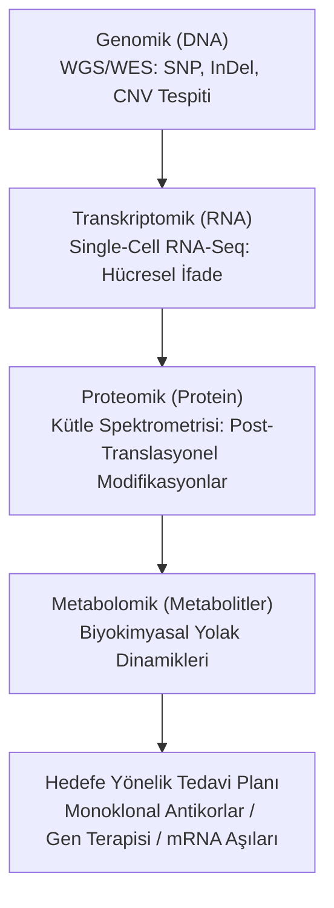
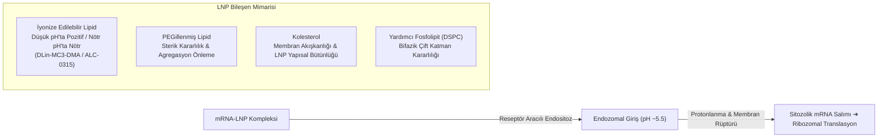

# 🧬 Hassas Tıp (Precision Medicine), CRISPR-Cas9 Gen Düzenleme ve mRNA Terapötikleri
### *İleri Klinik Tıp & Moleküler Biyoloji Araştırma Raporu (2026+)*

> *“Tıbbın geleceği, semptomları ortalama istatistiklerle bastıran 'tek beden herkese uyar' yaklaşımından; bireyin özgün genomik, transkriptomik ve proteomik haritasına göre tasarlanan moleküler hassas müdahalelere evrilmektedir.”*

---

## 📌 1. Giriş ve Hassas Tıbbın Çoklu-Omik (Multi-Omics) Mimarisi

Geleneksel tıp fenotipik tezahürleri tedavi ederken, **Hassas Tıp (Precision Medicine)** hastalıkları moleküler kökeninde sınıflandırır:



---

## ✂️ 2. CRISPR-Cas9 ve İleri Genom Mühendisliği Paradizmaları

### 2.1. Standart CRISPR-Cas9 Mekanizması
*Streptococcus pyogenes* kaynaklı SpCas9 endonükleazı, tek kılavuz RNA (sgRNA) ve 5'-NGG-3' PAM (Protospacer Adjacent Motif) dizisini tanıyarak hedef DNA çift zincirinde kırılma (DSB - Double Strand Break) oluşturur:

$$\text{sgRNA} + \text{Target DNA} \xrightarrow{\text{Cas9 (PAM: NGG)}} \text{DSB} \implies \begin{cases} \text{NHEJ (Non-Homologous End Joining): InDel / Gen Nakavtı (Knockout)} \\ \text{HDR (Homology-Directed Repair): Hassas Gen Ekleme / Onarım} \end{cases}$$

### 2.2. Baz Düzenleme (Base Editing) ve Primer Düzenleme (Prime Editing)
Çift zincir kırıklarının oluşturduğu genomik kararsızlığı önlemek için üçüncü nesil CRISPR teknolojileri geliştirilmiştir:
- **Sitozin / Adenin Baz Düzenleyiciler (CBE/ABE):** Katalitik olarak inaktif dCas9 veya nCas9 nükleazına sitidin ya da adenozin deaminaz bağlanarak $C \rightarrow T$ veya $A \rightarrow G$ transisyonel dönüşümü sağlanır.
- **Prime Editing (PE2, PE3):** Ters transkriptaz (RT) enzimiyle kaynaştırılmış nCas9 ve pegRNA (prime editing guide RNA) kullanılarak DNA'da çift zincir kırığı veya verici DNA şablonu olmaksızın tüm 12 baz değişimi ve hedeflenen insersiyon/delesyonlar gerçekleştirilir.

---

## 💉 3. mRNA Terapötikleri ve Lipid Nanopartikül (LNP) Dağıtım Fiziği

Hücre zarındaki negatif yüklü fosfolipit çift katmanını aşmak ve mRNA'nın endonükleazlar tarafından hızla parçalanmasını önlemek için **İyonize Edilebilir Lipid Nanopartiküller (LNP)** kullanılır:



### 3.1. Psödouridin ($\Psi$) Kimyasal Modifikasyonu
Karikó ve Weissman'ın nobel ödüllü keşfine göre; mRNA dizisindeki uridin bazlarının $N^1$-metilpsödouridin ($m^1\Psi$) ile ikame edilmesi, TLR3, TLR7 ve TLR8 gibi immün kalıp tanıma reseptörlerinin istenmeyen aşırı sitokin fırtınasını engeller ve protein ekspresyon verimini katlar.

---

## 💻 4. Algoritmik Uygulama: sgRNA Hedef-Dışı (Off-Target) Skorlama Fonksiyonu

```python
"""
CRISPR sgRNA İçin Hedef Dışı Eşleşme (Mismatch) Cezalandırma ve CFD Skoru
"""
import numpy as np

CFD_WEIGHTS = {
    # Pozisyona göre baz uyumsuzluk ceza matrisi (Örnek basitleştirilmiş kesit)
    1: 0.95, 2: 0.90, 3: 0.85, 4: 0.80, 5: 0.75,
    15: 0.30, 16: 0.25, 17: 0.15, 18: 0.10, 19: 0.05, 20: 0.02 # PAM yakınındaki tohum bölgesi (Seed Region)
}

def calculate_off_target_score(guide_seq: str, target_seq: str) -> float:
    """sgRNA ile hedef dışı bölge arasındaki bağlanma afinitesini hesaplar."""
    if len(guide_seq) != len(target_seq):
        raise ValueError("Sekans uzunlukları eşit olmalıdır (20 nt).")
        
    score = 1.0
    for pos, (g_base, t_base) in enumerate(zip(guide_seq, target_seq), start=1):
        if g_base != t_base:
            weight = CFD_WEIGHTS.get(pos, 0.5)
            score *= weight
            
    return score
```

---

## 📚 5. Kanonik Kaynakça

1. **Doudna, J. A., & Charpentier, E. (2014):** *“The new frontier of genome engineering with CRISPR-Cas9”*, Science, 346(6213).
2. **Anzalone, A. V. et al. (2019):** *“Search-and-replace genome editing without double-strand breaks or donor DNA”*, Nature, 576, 149-157.
3. **Karikó, K. et al. (2005):** *“Suppression of RNA recognition by Toll-like receptors”*, Immunity, 23(2), 165-175.
4. **Collins, F. S., & Varmus, H. (2015):** *“A new initiative on precision medicine”*, New England Journal of Medicine, 372(9), 793-795.
5. **Cullis, P. R., & Hope, M. J. (2017):** *“Lipid Nanoparticle Systems for Enabling Gene Therapies”*, Molecular Therapy, 25(7), 1467-1475.
