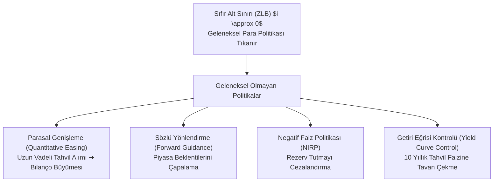
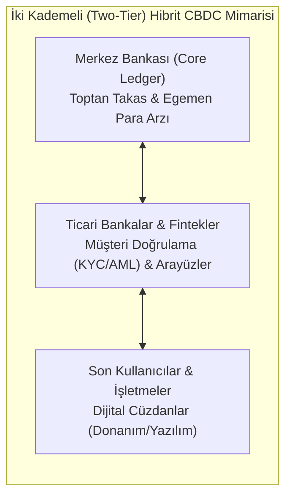

# 📊 Makroekonomik Kaldıraç, Likidite Tuzakları ve Dijital Merkez Bankası Paraları (CBDC)
### *İleri İktisat Bilimi & Parasal İktisat Araştırma Raporu (2026+)*

> *“Para bir meta değil, bir toplumsal muhasebe sistemi ve egemenlik imtiyazıdır. Sıfır alt sınırına (ZLB) çarpan faiz oranları ve küresel borç süper döngüsü, merkez bankacılığını tarihin en radikal bilanço deneyine zorlamaktadır.”*

---

## 📌 1. Giriş ve Borç Deflasyonu Dinamikleri

İrving Fisher'ın öncülüğünü yaptığı ve Hyman Minsky'nin "Finansal Kararsızlık Hipotezi" ile derinleştirdiği makroekonomik borç döngüleri, ekonomik genişleme dönemlerinde risk algısının erozyona uğramasıyla başlar:

$$\text{Finansman Evreleri:} \quad \text{Hedge Finansmanı} \xrightarrow{\text{Öfori}} \text{Spekülatif Finansman} \xrightarrow{\text{Aşırı Kaldıraç}} \text{Ponzi Finansmanı}$$

Minsky Anı (Minsky Moment) tetiklendiğinde; borçlular faiz ve anapara yükümlülüklerini karşılayabilmek için varlıklarını yangın satışı (fire sale) fiyatlarıyla elden çıkarmaya başlar. Bu durum Fisher Borç Deflasyonu sarmalına yol açar:

$$\text{Varlık Satışları} \implies \text{Fiyatlar Düşer} \implies \text{Reel Borç Yükü Artar} \implies \text{İflaslar & Kredi Daralması}$$

---

## 📉 2. Sıfır Alt Sınırı (Zero Lower Bound - ZLB) ve Likidite Tuzağı

John Maynard Keynes'in formüle ettiği likidite tuzağında, nominal politika faiz oranı sıfıra yaklaştığında ($i \rightarrow 0$), para talebinin faiz esnekliği sonsuza yaklaşır:

$$\lim_{i \to 0} \frac{\partial (M/P)^d}{\partial i} = -\infty$$

Bu durumda para arzının ($M$) artırılması faiz oranlarını daha fazla düşüremez; hanehalkı ve kurumlar parayı yatırıma veya tüketime dönüştürmek yerine tamamen nakitte tutmayı tercih eder (IS-LM modelinde yatay LM eğrisi).

---

## 🏦 3. Merkez Bankası Bilanço Mekaniği ve Taylor Kuralı

Klasik dönemde para politikası John Taylor'ın kuralıyla yönlendirilir:

$$i_t = r^* + \pi_t + 0.5(\pi_t - \pi^*) + 0.5(y_t - \bar{y})$$

Burada $r^*$ nötr reel faiz, $\pi_t$ cari enflasyon, $\pi^*$ hedef enflasyon, $(y_t - \bar{y})$ ise çıktı açığıdır (output gap).

ZLB durumunda ise merkez bankaları doğrudan bilanço büyüklüklerini kaldıraç olarak kullanır:

$$\Delta B_{\text{CB}} = \int_0^T (\text{Varlık Alımları}) \, dt \implies \text{Rezerv Artışı} \ (\Delta R)$$

---

## 🪙 4. Dijital Merkez Bankası Paraları (CBDC) ve İki Kademeli Mimari

Geleneksel fiziki nakit ve ticari banka mevduatlarına kıyasla programlanabilir egemen para birimleri:

| Parametre | Fiziki Nakit | Ticari Banka Mevduatı | Bireysel CBDC (Retail CBDC) |
| :--- | :--- | :--- | :--- |
| **Yükümlülük Sahibi** | Merkez Bankası | Ticari Banka | **Merkez Bankası** |
| **Kredi Riski** | Sıfır | Mevduat Sigortası Limitli | **Sıfır** |
| **Programlanabilirlik** | Yok | Kısıtlı API | **Akıllı Sözleşmeler (Smart Contracts)** |
| **İlave Faiz Taşıma** | Hayır (Sıfır Nominal) | Evet | **Mümkün (Doğrudan Negatif Faiz Uygulanabilir)** |

---

## 📚 5. Kanonik Kaynakça

1. **Fisher, I. (1933):** *“The Debt-Deflation Theory of Great Depressions”*, Econometrica, 1(4), 337-357.
2. **Minsky, H. P. (1986):** *“Stabilizing an Unstable Economy”*, Yale University Press.
3. **Bernanke, B. S., & Reinhart, V. R. (2004):** *“Conducting Monetary Policy at Very Low Short-Term Interest Rates”*, American Economic Review.
4. **Taylor, J. B. (1993):** *“Discretion versus policy rules in practice”*, Carnegie-Rochester Conference Series on Public Policy.
5. **BIS (Bank for International Settlements) (2021):** *“Central bank digital currencies: user needs and adoption”*, BIS Papers.
