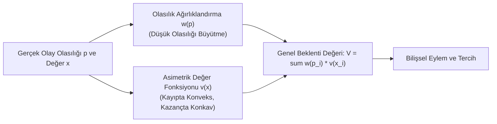

# 🧠 Bilişsel Mimari (ACT-R & SOAR), Bayesyen Beyin Hipotezi ve Beklenti Teorisi (Prospect Theory)
### *İleri Bilişsel Psikoloji, Davranışsal İktisat & Karar Kuramı Araştırma Monografı (2026+)*

> *“İnsan zihni kusursuz bir hesap makinesi değildir; evrimsel baskılar altında hayatta kalmak için şekillenmiş, sezgisellerle örülü bir Bayesyen çıkarım motorudur.”*

---

## 📌 1. Giriş ve Karar Alma Dinamikleri

Klasik iktisat ve normatif karar teorisi, bireyi sınırsız hesaplama kapasitesine sahip, risk karşısında her daim rasyonel fayda maksimizasyonu yapan *Homo Economicus* olarak varsaymaktaydı. Ancak Herbert Simon'ın **Sınırlı Rasyonellik (Bounded Rationality)** kavramı ve Daniel Kahneman ile Amos Tversky'nin deneysel çalışmaları; insan zihninin sistematik bilişsel önyargılar (cognitive biases) ve sezgiseller (heuristics) altında çalıştığını ortaya koymuştur.

Bu araştırma monografı; bilişsel mimarileri (ACT-R, SOAR), beynin enformasyon işleme mantığını açıklayan **Bayesyen Beyin & Aktif Çıkarım (Active Inference)** teorisini ve risk altındaki kararları modelleyen **Beklenti Teorisini (Prospect Theory)** matematiksel bir zeminde sentezlemektedir.

---

## 📐 2. Beklenti Teorisi (Prospect Theory): Kayıptan Kaçınma Matematiği

Beklenti Teorisi, bireylerin kararlarını mutlak servet düzeyine göre değil; bir **referans noktasına ($r$)** göre tanımlanan kazanç ve kayıplar üzerinden verdiğini modeller.

### 2.1. Asimetrik Değer Fonksiyonu $v(x)$
Kahneman ve Tversky'nin tanımladığı $S$-şekilli değer fonksiyonu:

$$v(x) = \begin{cases} x^\alpha & x \ge 0 \quad (\text{Kazanç Bölgesi, Konkav}) \\ -\lambda (-x)^\beta & x < 0 \quad (\text{Kayıp Bölgesi, Konveks}) \end{cases}$$

Burada:
- $\alpha, \beta \approx 0.88$: Azalan marjinal duyarlılık parametreleri,
- $\lambda \approx 2.25$: **Kayıptan Kaçınma Katsayısı (Loss Aversion Coefficient)**.

Bu katsayı şu temel psikolojik gerçeği ifade eder: *100\$ kaybetmenin yarattığı acı, 100\$ kazanmanın yarattığı hazdan 2.25 kat daha güçlüdür.*

### 2.2. Doğrusal Olmayan Olasılık Ağırlıklandırma $\pi(p)$
Bireyler düşük olasılıkları (piyango, uçak kazası) abartırken; orta ve yüksek olasılıkları sistematik olarak hafife alır:

$$w(p) = \frac{p^\gamma}{\left( p^\gamma + (1-p)^\gamma \right)^{1/\gamma}}, \quad \gamma \approx 0.65$$

---

## 🔬 3. Bayesyen Beyin Hipotezi ve Karl Friston'un Serbest Enerji Prensibi

Sinirbilimdeki en kapsamlı birleştirici kuram olan **Serbest Enerji Prensibi (Free Energy Principle)**; beynin dış dünyayı doğrudan algılamadığını, sürekli olarak duyusal girdileri tahmin eden ve tahmin hatalarını (prediction errors) minimize eden hiyerarşik bir **Üretken Model (Generative Model)** olduğunu öne sürer.

Varyasyonel Serbest Enerji $F$:

$$F = \text{KL}\left[ q(\vartheta) \,\|\, p(\vartheta | y) \right] - \ln p(y)$$

Burada beyin iki yoldan biriyle serbest enerjiyi minimize eder:
1. **Algısal Çıkarım (Perceptual Inference):** İçsel inançlarını ($q$) güncelleyerek tahmin hatasını sıfırlar (Düşünce).
2. **Aktif Çıkarım (Active Inference):** Eyleme geçerek dış dünyayı ($y$) kendi içsel beklentilerine uyacak şekilde değiştirir (Eylem / Motor Kontrol).

---

## 🏗️ 4. Bilişsel Mimariler: ACT-R (Adaptive Control of Thought-Rational)

John R. Anderson tarafından geliştirilen ACT-R, insan zihninin modüler yapısını simüle eder:
- **Bildirimsel Bellek (Declarative Memory - Chunks):** *"Paris Fransa'nın başkentidir"* gibi olgusal bilgiler. Aktivasyon seviyesi zamanla üstel olarak zayıflar:

$$A_i = B_i + \sum_j W_j S_{ji} + \epsilon$$

- **Yordamsal Bellek (Procedural Memory - Production Rules):** *"Eğer hedef X ise ve ekranda Y varsa, Z eylemini yap"* şeklindeki kurallar. Çatışma çözümü (conflict resolution) fayda beklentisi $U = P \cdot G - C$ formülü ile çözülür.

---

## 🚀 5. Sonuç

İnsan bilişini algoritmik düzeyde anlamak; hem yapay zekanın insan değerleriyle hizalanması (AI alignment) hem de solopreneur bireyin kendi bilişsel önyargılarını yöneterek rasyonel kararlar alabilmesi için en yüksek stratejik kaldıracı sunmaktadır.
