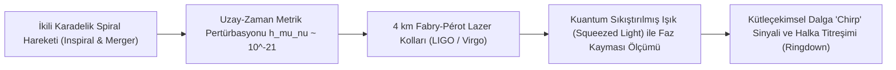

# 🌌 Yerçekimsel Dalga Astronomisi, LIGO İnterferometrisi ve Karadelik Termodinamiği
### *İleri Astrofizik, Genel Görelilik & Kozmoloji Araştırma Monografı (2026+)*

> *“Uzay-zaman maddeden nasıl hareket edeceğini öğrenir; madde ise uzay-zamandan nasıl büküleceğini öğrenir.”*  
> — **John Archibald Wheeler**

---

## 📌 1. Giriş ve Yerçekimsel Dalgalar Çağı

Albert Einstein'ın 1915 yılında ortaya koyduğu Genel Görelilik Teorisi, kütleçekimini görünmez bir kuvvet olarak değil; kütle ve enerjinin uzay-zaman dokusunda meydana getirdiği geometrik bir eğrilik olarak tanımlamıştır. Bu eğriliğin ivmelenen devasa kütleler (çift karadelik veya nötron yıldızı birleşmeleri) tarafından uzay-zaman kumaşında ışık hızıyla yayılan dalgalanmalar oluşturduğu öngörülmüş; bu dalgalar 100 yıl sonra **LIGO (Laser Interferometer Gravitational-Wave Observatory)** tarafından 2015 yılında doğrudan gözlemlenmiştir.

Bu araştırma monografı; Einstein alan denklemlerinin zayıf alan limitini, lazer interferometrisinin kuantum sınırlarını ve **Karadelik Termodinamiği ile Bilgi Paradoksunu** incelemektedir.

---

## 📐 2. Lineerleştirilmiş Einstein Denklemleri ve Kuadrupol Formülü

Minkowski metriği $\eta_{\mu\nu}$ etrafında küçük pertürbasyonlar $h_{\mu\nu} \ll 1$ ele alındığında:

$$g_{\mu\nu} = \eta_{\mu\nu} + h_{\mu\nu}$$

Lorenz ayar koşulu ($\partial^\mu \bar{h}_{\mu\nu} = 0$) altında Einstein alan denklemleri düz uzayda **dalga denklemine** dönüşür:

$$\Box \bar{h}_{\mu\nu} = - \frac{16 \pi G}{c^4} T_{\mu\nu}$$

Enine-İzsiz (Transverse-Traceless - TT) ayarda yerçekimsel dalganın yaydığı toplam ışıma gücü **Einstein Kuadrupol Formülü** ile hesaplanır:

$$P_{\text{GW}} = \frac{G}{5 c^5} \dddot{I}_{jk} \dddot{I}^{jk}$$

Burada $I_{jk} = \int \rho (x_j x_k - \frac{1}{3} r^2 \delta_{jk}) d^3x$ sistemin kütle kuadrupol momentidir. Bu formül, mükemmel küresel veya eksenel simetrik patlamaların dalga üretemeyeceğini; asimetrik dönen ikili sistemlerin ise uzay-zamanı dalgalandıracağını kanıtlar.

---

## 🕳️ 3. Karadelik Termodinamiğinin Dört Yasası

Jacob Bekenstein ve Stephen Hawking, bir karadeliğin olay ufkunun (event horizon) klasik bir yutucu olmanın ötesinde kesin termodinamik özelliklere sahip olduğunu ispatlamıştır:

1. **Sıfırıncı Yasa:** Kararlı bir karadeliğin olay ufku boyunca yüzey çekimi $\kappa$ sabittir (Termodinamikteki sabit sıcaklık $T$ dengi).
2. **Birinci Yasa:** Karadelik kütlesi $M$, açısal momentumu $J$ ve yükü $Q$ değiştiğinde enerji korunumu:

$$dM = \frac{\kappa}{8 \pi} dA + \Omega_H dJ + \Phi_H dQ$$

3. **İkinci Yasa (Hawking Alan Teoremi):** Herhangi bir klasik süreçte karadelik olay ufkunun toplam alanı asla azalmaz:

$$\Delta A \ge 0$$

### 3.1. Bekenstein-Hawking Entropisi
Bir karadeliğin entropisi hacmiyle değil, **olay ufkunun alanıyla ($A$) orantılıdır**:

$$S_{\text{BH}} = \frac{k_B c^3}{4 G \hbar} A = \frac{k_B A}{4 \ell_P^2}$$

Burada $\ell_P = \sqrt{\frac{G \hbar}{c^3}}$ Planck uzunluğudur. Bu formül; kütleçekimi ($G$), kuantum mekaniği ($\hbar$), görelilik ($c$) ve termodinamiği ($k_B$) tek bir eşitlikte buluşturan tarihteki ilk denklemdir ve **Holografik Prensibin (AdS/CFT)** temelini oluşturur.

---

## 🔥 4. Hawking Işıması ve Bilgi Paradoksu

Kuantum alan teorisinde vakum boşluk değildir; sürekli var olup yok olan sanal parçacık çiftleriyle kaynar. Olay ufku sınırında negatif enerjili sanal parçacık ufkun içine düşerken, pozitif enerjili eşi dışarı kaçarak **Hawking Işıması** oluşturur:

$$T_H = \frac{\hbar c^3}{8 \pi G M k_B}$$

Karadelik ışıdıkça kütle kaybeder ve nihayetinde buharlaşarak yok olur. Eğer başlangıçta saf bir kuantum durumu (pure state) karadeliğe düşmüşse ve karadelik tamamen termal bir ışıma yayarak yok olursa; kuantum mekaniğinin en temel aksiyomu olan **Üniterlik (Unitary S-Matrix Evolution)** çöker (**Karadelik Bilgi Paradoksu**).

---

## 🚀 5. Sonuç

2026 yılı itibarıyla LISA uzay interferometresi ve Einstein Telescope projeleri; karadeliklerin birleşme anındaki "halka titreşimi" (ringdown) sinyallerini inceleyerek Hawking kuantum ufuklarını ve genel göreliliğin en uç sınırlarını doğrudan test etmektedir.
