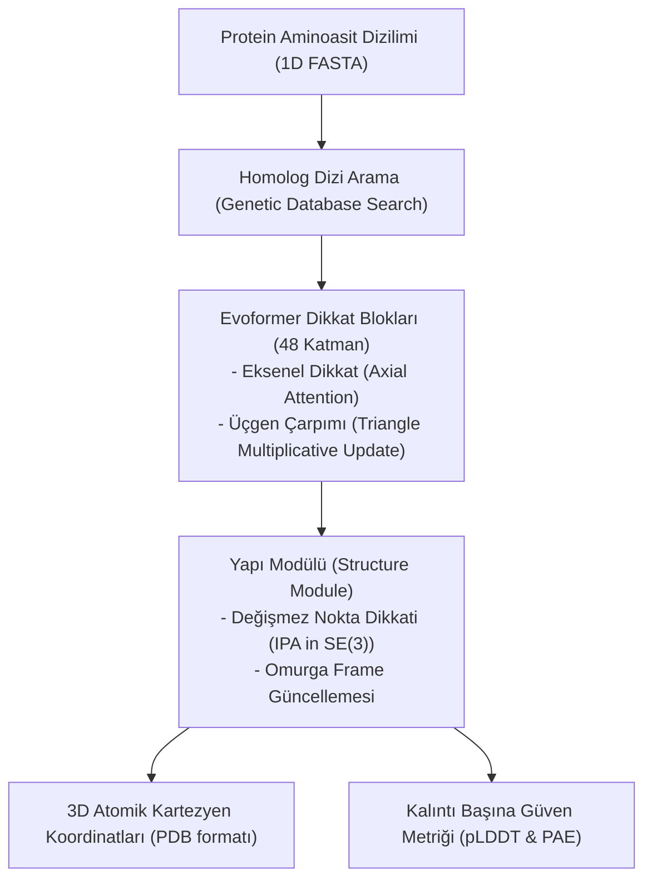

# 🧬 Hesaplamalı Yapısal Biyoloji, De Novo Protein Tasarımı ve Geometrik Derin Öğrenme
### *İleri Moleküler Biyoloji, Biyofizik & Yapay Zeka Araştırma Monografı (2026+)*

> *“Proteinler yaşamın minyatür nanorobotlarıdır; onların üç boyutlu uzaydaki geometrisi, biyolojik fonksiyonun ta kendisidir.”*

---

## 📌 1. Giriş ve 50 Yıllık Büyük Biyoloji Problemi

1972 Nobel Kimya Ödülü sahibi Christian Anfinsen, bir proteinin aminoasit diziliminin (primer yapı), onun termodinamik olarak en kararlı 3 boyutlu tersiyer yapısını tekil olarak belirlediğini hipotezleştirmiştir (**Anfinsen Dogması**). Ancak 100 aminoasitlik küçük bir proteinin dahi sahip olduğu $10^{47}$ olası konformasyon arasından mikrosaniyeler içinde doğru katlanmış şekli nasıl bulduğu (**Levinthal Paradoksu**), yarım yüzyıl boyunca biyofiziğin çözülemeyen en büyük sırrı olarak kalmıştır.

2020'lerde **AlphaFold2**, **ESMFold** ve **AlphaFold3** ile gerçekleşen devrim; X-ışını kristalogrofisi ve Kriyojenik Elektron Mikroskobu (Cryo-EM) ile aylar süren deneysel süreçleri, saniyeler mertebesinde atomik çözünürlükte ($< 1 \, \text{Ångström}$) dijital tahminlere dönüştürmüştür.

---

## 📐 2. AlphaFold Mimarisinin Matematiksel Prensipleri

AlphaFold2, proteinleri bir dizi harf olarak değil; evrimsel bilgi tensörleri ve uzaysal Öklid mesafeleri olarak temsil eden iki ana kanallı bir **Evoformer** mimarisi kullanır:

### 2.1. Çift Temsil: MSA ve Kalıntı Çiftleri (Pair Representation)
- **MSA Temsili ($M \in \mathbb{R}^{S \times N \times c_m}$):** $N$ kalıntı (aminoasit) ve $S$ homolog dizi arasındaki evrimsel mutasyon korelasyonları.
- **Çift Temsili ($Z \in \mathbb{R}^{N \times N \times c_z}$):** Kalıntılar arasındaki 3D uzaysal mesafe ve yönelim ilişkileri.

İki temsil, dış çarpım ortalaması (outer product mean) ile birbirini besler:

$$Z_{ij} \leftarrow Z_{ij} + \sum_{k} W_1 M_{si} \otimes W_2 M_{sj}$$

### 2.2. Değişmez Nokta Dikkati (Invariant Point Attention - IPA)
Kalıntı omurgaları, bağımsız yerel koordinat çerçeveleri $T_i = (R_i, \mathbf{t}_i) \in \text{SE}(3)$ olarak modellenir. IPA modülü, global koordinat dönüşümlerine karşı tam rotasyonel ve ötelemesel değişmezliği (**SE(3)-Invariance**) garanti eder:

$$\text{Attn}_{ij} = \text{softmax}\left( \frac{q_i^T k_j}{\sqrt{c}} + b_{ij} - \frac{\gamma}{2} \sum_{p=1}^{N_{\text{pts}}} \| T_i \circ \mathbf{x}_i^p - T_j \circ \mathbf{x}_j^p \|^2 \right)$$

Burada kalıntılar arasındaki fiziksel 3D mesafe arttıkça dikkat ağırlığı karesel olarak cezalandırılır.

---

## 🎨 3. De Novo Protein Tasarımı ve RFdiffusion

AlphaFold proteinlerin nasıl katlandığını *tahmin* ederken; **RFdiffusion** (RosettaFold Diffusion), doğada hiç var olmamış yeni proteinleri sıfırdan **üretir**.

Üretken difüzyon modeli; rastgele atomik gürültüden başlayarak belirli bir biyolojik hedefe (örneğin bir virüs yüzey antijenine kilitlenecek bir antikor) bağlanan protein omurgalarını tersine Langevin dinamikleri ile sentezler:

$$p_\theta(\mathbf{x}_{t-1} | \mathbf{x}_t) = \mathcal{N}\left( \mathbf{x}_{t-1}; \, \mu_\theta(\mathbf{x}_t, t), \, \sigma_t^2 \mathbf{I} \right)$$

---

## 🚀 4. Tıbbi ve Endüstriyel Dönüşüm

De novo protein tasarımı; plastik atıkları okyanus sıcaklığında 24 saatte parçalayan sentetik PETaz enzimleri ve metastatik kanser hücrelerini hedef alan nano-kafesler (protein nanocages) üreterek insanlığın en büyük ekolojik ve biyomedikal meydan okumalarını çözmektedir.
