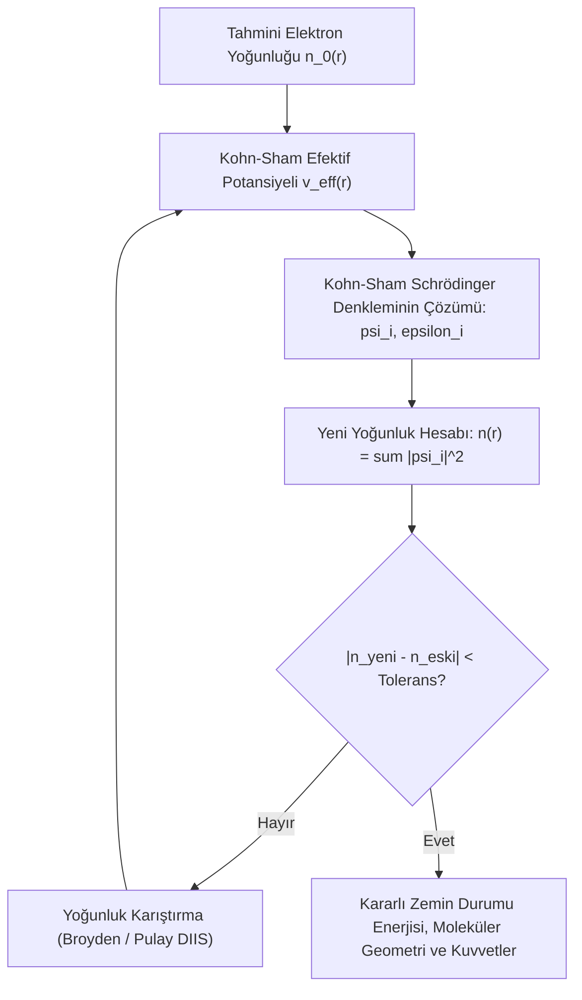

# 🧪 Kuantum Kimyası, Yoğunluk Fonksiyoneli Teorisi (DFT) ve Ab Initio Moleküler Dinamik
### *İleri Teorik Kimya & Hesaplamalı Malzeme Bilimi Araştırma Monografı (2026+)*

> *“Fiziğin ve kimyanın tüm temel yasaları artık tam olarak bilinmektedir; zorluk yalnızca bu denklemlerin çözülemeyecek kadar karmaşık olmasındadır.”*  
> — **Paul Dirac (1929)**

---

## 📌 1. Giriş ve Hesaplamalı Kimya Ufku

Geleneksel kimya, laboratuvar ortamında deneme-yanılma sentezlerine dayanırken; modern kuantum kimyası, atom altı parçacıkların davranışını birinci ilkelerden (*ab initio*) simüle ederek yeni katalizörler, yarı iletkenler ve batarya malzemeleri tasarlamaktadır.

Çok elektronlu bir molekülün dalga fonksiyonu $\Psi(\mathbf{r}_1, \dots, \mathbf{r}_N)$ uzaysal $3N$ serbestlik derecesine sahiptir. Bu üstel karmaşıklık ($100$ elektron için $300$ boyutlu diferansiyel denklem), klasik dalga mekaniği çözümlerini imkansız kılmaktadır. **Yoğunluk Fonksiyoneli Teorisi (Density Functional Theory - DFT)**, 1998 Nobel Kimya Ödülü'ne layık görülen olağanüstü bir indirgeme ile bu $3N$ boyutlu dalga fonksiyonunu yalnızca **3 boyutlu elektron yoğunluğuna $n(\mathbf{r})$** dönüştürür.

---

## 📐 2. Hohenberg-Kohn Teoremleri ve Kohn-Sham Denklemleri

### 2.1. Hohenberg-Kohn Teoremleri (1964)
1. **Teorem 1:** Elektron yoğunluğu $n(\mathbf{r})$, dış potansiyeli $v_{\text{ext}}(\mathbf{r})$ sabit bir terim hariç tekil olarak belirler. Dolayısıyla sistemin tüm temel durum (ground state) özellikleri elektron yoğunluğunun bir fonksiyonelidir.
2. **Teorem 2:** Sistemin toplam enerjisi $E[n]$, gerçek temel durum yoğunluğunda $n_0(\mathbf{r})$ global minimumuna ulaşır:

$$E_0 = \min_{n} E[n] \quad \text{Kısıt:} \quad \int n(\mathbf{r}) d^3r = N$$

### 2.2. Kohn-Sham Öz-Uyumlu Alan (Self-Consistent Field - SCF) Denklemleri
Kohn ve Sham, etkileşen gerçek elektron sistemini, aynı yoğunluğa sahip kurgusal **etkileşmeyen elektronlar sistemi** ile eşleştirmiştir:

$$\left[ - \frac{\hbar^2}{2m} \nabla^2 + v_{\text{eff}}(\mathbf{r}) \right] \psi_i(\mathbf{r}) = \epsilon_i \psi_i(\mathbf{r})$$

Efektif potansiyel üç bileşenden oluşur:

$$v_{\text{eff}}(\mathbf{r}) = v_{\text{ext}}(\mathbf{r}) + e^2 \int \frac{n(\mathbf{r}')}{|\mathbf{r} - \mathbf{r}'|} d^3r' + v_{xc}[n](\mathbf{r})$$

Burada $v_{xc}(\mathbf{r}) = \frac{\delta E_{xc}[n]}{\delta n(\mathbf{r})}$, tüm kuantum mekaniksel değiş-tokuş (exchange) ve korelasyon etkilerini barındıran **Değiş-Tokuş Korelasyon Fonksiyoneli**dir.

---

## 🧪 3. Ab Initio Moleküler Dinamik (AIMD): Car-Parrinello Yöntemi

Klasik moleküler dinamikte atomlar ampirik yay ve elektrostatik kuvvet alanlarıyla (force fields) hareket ettirilirken; **AIMD** yönteminde her zaman adımında ($dt \sim 0.5 \, \text{femtosecond}$) atom çekirdeklerine etkiyen Hellmann-Feynman kuvvetleri doğrudan kuantum elektron yoğunluğundan hesaplanır:

$$\mathbf{F}_I = - \nabla_I \langle \Psi | \hat{H} | \Psi \rangle = - \nabla_I E[n]$$

Car-Parrinello yönteminde elektronik dalga fonksiyonu parametreleri, klasik çekirdek hareketlerine kurgusal bir kütle $\mu$ ile dinamik olarak bağlanarak her adımda pahalı tam diyagonalleştirme zorunluluğu ortadan kaldırılır.

---

## ⚡ 4. Yapay Zeka Hızlandırmalı DFT (Machine Learning Potentials)

Son yıllarda Graph Neural Networks (SchNet, Allegro, NequIP), DFT hesaplamalarıyla eğitilerek kuantum doğruluğunda ancak DFT'den **$100.000$ kat daha hızlı** moleküler kuvvet alanları üretmektedir. Bu füzyon; katı hal lityum pillerinde dendrit oluşumunun ve karbon yakalama metal-organik kafeslerinin (MOF) atomik düzeyde simüle edilmesini sağlamaktadır.
