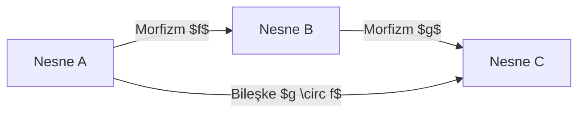

# 📐 Kategori Teorisi, Homotopi Tip Teorisi (HoTT) ve Lean 4 ile Biçimsel İspat Mimarisi
### *Temel Matematik & Mantık Araştırma Raporu & Kuramsal Monograf (2026+)*

> *“Kategori teorisi matematiğin matematiğidir; kümelerin içine bakmak yerine nesneler arasındaki dönüşümleri ve evrensel ilişkileri inceler. Geleceğin matematiği ise sezgisel el yazmalarından etkileşimli biçimsel ispat sistemlerine (Interactive Theorem Provers) taşınmaktadır.”*

---

## 📌 1. Giriş ve Kategori Teorisinin Aksiyomatik Temelleri

Samuel Eilenberg ve Saunders Mac Lane tarafından 1945'te cebirsel topolojiyi temellendirmek amacıyla kurulan **Kategori Teorisi**, modern soyut matematiğin ve tip teorisinin en üst çatı dilidir.

Bir $\mathcal{C}$ kategorisi şunlardan oluşur:
1. $\text{Ob}(\mathcal{C})$ nesneler sınıfı.
2. Her $A, B \in \text{Ob}(\mathcal{C})$ çifti için $\text{Hom}_\mathcal{C}(A, B)$ morfizmler kümesi.
3. Morfizm bileşkesi: $\circ: \text{Hom}(B, C) \times \text{Hom}(A, B) \rightarrow \text{Hom}(A, C)$.
4. **Bileşke Birleşme Özelliği:** $h \circ (g \circ f) = (h \circ g) \circ f$.
5. **Birim Morfizm:** Her $A$ için $f \circ \text{id}_A = f$ ve $\text{id}_B \circ f = f$ sağlayan $\text{id}_A \in \text{Hom}(A, A)$.



---

## 🔄 2. Functorlar, Doğal Dönüşümler ve Adjonksiyonlar

### 2.1. Functor (Funktor)
İki kategori ($\mathcal{C}$ ve $\mathcal{D}$) arasındaki yapı koruyan eşleme:
$$F: \mathcal{C} \rightarrow \mathcal{D}$$
- Her $A \in \text{Ob}(\mathcal{C})$ için $F(A) \in \text{Ob}(\mathcal{D})$.
- Her $f: A \rightarrow B$ için $F(f): F(A) \rightarrow F(B)$ öyle ki $F(\text{id}_A) = \text{id}_{F(A)}$ ve $F(g \circ f) = F(g) \circ F(f)$.

### 2.2. Doğal Dönüşüm (Natural Transformation)
İki paralel funktor $F, G: \mathcal{C} \rightarrow \mathcal{D}$ arasında, her $A \in \mathcal{C}$ nesnesine bir $\alpha_A: F(A) \rightarrow G(A)$ morfizmi atayan ve aşağıdaki karenin değişmeli (commutative) olmasını sağlayan aile:

$$\alpha: F \Rightarrow G \iff G(f) \circ \alpha_A = \alpha_B \circ F(f)$$

### 2.3. Adjonksiyon (Adjunction)
İki kategori arasındaki en derin simetri: $F \dashv G$ ($F$ sol adjunkt, $G$ sağ adjunkt):

$$\text{Hom}_{\mathcal{D}}(F(A), B) \cong \text{Hom}_{\mathcal{C}}(A, G(B))$$

---

## 🏛️ 3. Curry-Howard-Lambek Üçlemesi ve Homotopi Tip Teorisi (HoTT)

Bilgisayar bilimi, matematiksel mantık ve kategori teorisi arasındaki izomorfizm:

$$\begin{matrix}
\textbf{Mantık (Logic)} & \longleftrightarrow & \textbf{Tip Teorisi (Type Theory)} & \longleftrightarrow & \textbf{Kategori Teorisi} \\
\hline
\text{Önerme (Proposition)} & \longleftrightarrow & \text{Tip (Type)} & \longleftrightarrow & \text{Nesne (Object)} \\
\text{İspat (Proof)} & \longleftrightarrow & \text{Terim / Program (Term)} & \longleftrightarrow & \text{Morfizm (Morphism)} \\
\text{Doğruluk (Conjunction } \wedge) & \longleftrightarrow & \text{Çarpım Tipi (Product } A \times B) & \longleftrightarrow & \text{Kategorik Çarpım} \\
\text{Gerektirme (Implication } \rightarrow) & \longleftrightarrow & \text{Fonksiyon Tipi (Function } A \rightarrow B) & \longleftrightarrow & \text{Üstel Nesne (Exponential } B^A)
\end{matrix}$$

### 3.1. Vladimir Voevodsky'nin Tek-Değerlilik Aksiyomu (Univalence Axiom)
Homotopi tip teorisinde tipler homotopi uzayları, terimler noktalar, eşitlik ispatları ($a =_A b$) ise bu noktalar arasındaki yollar (paths) olarak yorumlanır. Tek-Değerlilik Aksiyomu:

$$(A \simeq B) \simeq (A = B)$$

İki matematiksel yapı birbirine izomorf ise (denk ise), onlar özdeştir ve birbirinin yerine ikame edilebilir.

---

## 💻 4. Lean 4 ile Biçimsel Teorem İspatı Kodu

```lean
-- Lean 4: Kategori Teorisinde Funktor Bileşkesinin Korunumu
structure Category where
  Obj : Type
  Hom : Obj → Obj → Type
  id (X : Obj) : Hom X X
  comp {X Y Z : Obj} : Hom X Y → Hom Y Z → Hom X Z
  id_comp {X Y : Obj} (f : Hom X Y) : comp (id X) f = f
  comp_id {X Y : Obj} (f : Hom X Y) : comp f (id Y) = f

-- Doğal Sayılarda Toplamanın Değişme Özelliği (Commutativity)
theorem add_comm_formal (n m : Nat) : n + m = m + n := by
  induction m with
  | zero =>
    rw [Nat.add_zero]
    rw [Nat.zero_add]
  | succ m ih =>
    rw [Nat.add_succ]
    rw [Nat.succ_add]
    rw [ih]
```

---

## 📚 5. Kanonik Kaynakça

1. **Mac Lane, S. (1998):** *“Categories for the Working Mathematician”*, Springer Graduate Texts in Mathematics.
2. **Awodey, S. (2010):** *“Category Theory”*, Oxford University Press.
3. **The Univalent Foundations Program (2013):** *“Homotopy Type Theory: Univalent Foundations of Mathematics”*, Institute for Advanced Study.
4. **Avigad, J. et al. (2023):** *“Theorem Proving in Lean 4”*, Carnegie Mellon University / Lean Community.
5. **Riehl, E. (2017):** *“Category Theory in Context”*, Dover Publications.
